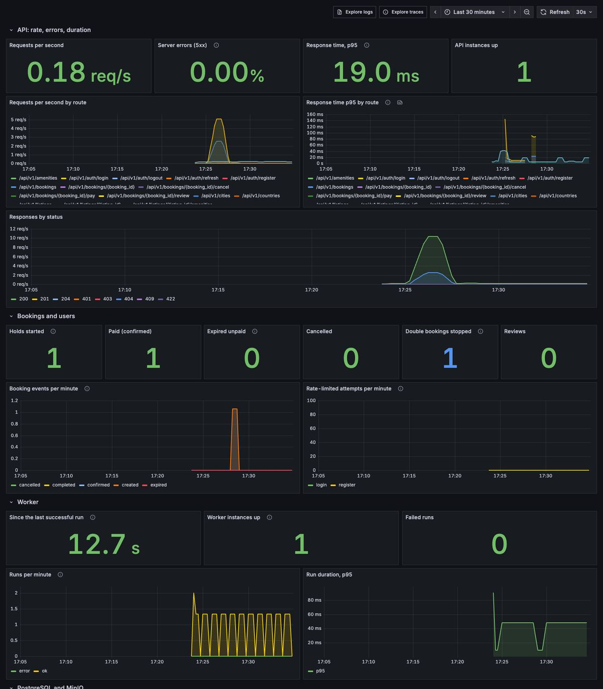

<p align="center">
  
</p>

<p align="center">
  <a href="https://github.com/zianazari/Caravansara/actions/workflows/ci.yml"></a>
  
  
</p>

A *caravansara* (کاروانسرا) was a roadside inn on the Silk Road: travellers arrived at dusk, took a room for the night and moved on at dawn. **Caravansara** is the same idea for today: an Airbnb-like site where guests find a place, hold it, pay and leave a review, and hosts list their homes.

This repository holds the **backend and the database design**. There is no frontend yet; everything below is reachable through the API and tried out in **Swagger UI**.

## Technology

<p align="left">
  
  
  
  
  
  
  
  
  
  
  
  
  
  
</p>

| Layer | Tools |
| --- | --- |
| API | Python 3.13, FastAPI, Pydantic v2, Swagger UI and ReDoc |
| Data | PostgreSQL 16 with PostGIS, SQLAlchemy 2 (async) with asyncpg, Alembic |
| Security | argon2 password hashing, JWT access tokens with rotating refresh tokens |
| Files | S3 API with presigned uploads; MinIO in development and tests |
| Quality | pytest with testcontainers, Playwright API tests, Ruff, mypy (strict), import-linter |
| Monitoring | Prometheus with alert rules, Grafana, Loki for logs, Tempo for traces, OpenTelemetry, Grafana Alloy as the collector |
| Delivery | uv, Docker and Docker Compose, GitHub Actions |

## What it does

| | |
| --- | --- |
| 🧭 **Search** | By city, or by centre and radius (1–100 km) on a map. Filters for dates, adults, children, infants, pets and amenities (all must match). |
| ⏳ **Reserve** | A 15-minute hold on the dates, then a simulated payment. Retrying with the same `Idempotency-Key` never books twice. |
| 🛡️ **No double booking** | Two guests can never hold the same night. PostgreSQL enforces it with an `EXCLUDE` constraint, so no race in app code can break it. |
| 📍 **Privacy** | Search and the map use a pin moved 100–500 m from the real address. The exact address appears only after payment. |
| 🏠 **Hosts** | Create and edit listings, upload photos straight to object storage, pick amenities, see bookings. |
| ⭐ **Reviews** | One per completed stay, within 14 days, never edited. The listing's rating updates itself. |
| 🕰️ **City time** | "Today", cancellation and the end of a stay follow the listing's time zone, not the server's. |

<p align="center">
  
</p>

## Architecture

Caravansara is a **modular monolith**: one FastAPI codebase and one PostgreSQL database, split into modules with strict borders. It runs as two processes, and photos never pass through the API.

<p align="center">
  
</p>

### Runtime

| Process / service | Role | Why it's separate |
| --- | --- | --- |
| **API** (FastAPI, uvicorn) | All endpoints under `/api/v1`, Swagger at `/docs` | Stateless, so any number of copies can run behind a load balancer |
| **Worker** (`caravansara worker`) | Every minute: expire unpaid holds, complete finished stays | Scheduled jobs would run once per API copy if they lived in the API |
| **PostgreSQL 16 + PostGIS** | The single source of truth; enforces the critical rules | The only place every API copy shares, so the only safe place for race-proof rules |
| **MinIO / S3** | Photo files | Browsers upload directly with presigned URLs, so large files don't load the API |
| **Monitoring** (optional profile) | Alloy, Loki, Tempo, Prometheus, Grafana | Watches all of the above; off by default so daily development stays light |

### Modules

| Module | Owns | Uses |
| --- | --- | --- |
| `core` | settings, DB sessions, error shape, JWT, storage client | nothing; the base layer |
| `identity` | `users`, `refresh_tokens`, `auth_attempts` | `core` |
| `catalog` | `countries`, `cities`, `amenities` (read-only) | `core` |
| `listings` | `listings`, photos, amenities per listing, fuzzed pin | `catalog`, `identity` |
| `bookings` | `bookings`: hold, pay, cancel, worker queries | `listings` |
| `reviews` | `reviews`, rating cache | `bookings`, `listings`, `identity` |
| `search` | read-only search queries | `listings` (types only) |
| `jobs` | the worker loop | `bookings` |

Every module has the same layers:

```
router.py      HTTP: paths, status codes, Swagger docs
   ↓
service.py     business rules; the only file other modules may import
   ↓
repository.py  SQL queries
   ↓
models.py      tables          schemas.py  request and response shapes
```

**The border rule:** a module may call another module only through its `service`. For example, `bookings` asks `listings.service` for capacity and price, and never queries the listings table itself. [import-linter](https://import-linter.readthedocs.io/) checks this in CI, so the borders can't quietly erode. It's also what makes a later split into services possible.

### Where each rule lives

| Rule | Enforced in | Why there |
| --- | --- | --- |
| No overlapping bookings | PostgreSQL `EXCLUDE` constraint | App-level "check, then insert" races between API copies |
| A retried reservation books once | `UNIQUE (idempotency_key)` | Holds even when two retries arrive at the same moment |
| Reviews only for completed stays; rating cache | Triggers | Stays correct whatever code writes the rows |
| Capacity, dates in city time, own listing, state transitions | `service` layer | Need logic and context the database doesn't have |
| Payment vs. expiry race | Conditional `UPDATE … WHERE status = 'pending' AND hold_expires_at > now()` | Exactly one of the two wins |
| An overdue unpaid hold doesn't block search | Search query: a `pending` hold counts only until `hold_expires_at` | A free place isn't shown as taken while the worker catches up |

### A reservation, step by step

1. `POST /bookings` arrives with a JWT and an `Idempotency-Key`.
2. **router** validates the body and the token.
3. **bookings.service** returns the earlier booking if this key was already used; otherwise it asks `listings.service` for the listing and checks capacity, dates (city time) and that the guest isn't the host.
4. In **one transaction**, it expires stale holds on that listing and inserts a `pending` row with a 15-minute `hold_expires_at`.
5. **PostgreSQL** saves it (201) or rejects an overlap with error `23P01` (409 `dates_unavailable`).

#### A booking's life

<p align="center">
  
</p>

`expired` and `cancelled` free the dates; `pending`, `confirmed` and `completed` hold them.

#### Two guests, one night

<p align="center">
  
</p>

A test fires 20 such requests at once and checks that exactly one wins.

### Key decisions

| Decision | Reason |
| --- | --- |
| Monolith, not microservices | Booking and review share one transaction and one deploy; module borders keep a later split open |
| Async SQLAlchemy + asyncpg | The API mostly waits on the database, and FastAPI is async |
| No Redis | PostgreSQL already covers locks, holds, idempotency, the job queue and rate limiting |
| Fuzzed public pin stored once | Search and the map never touch the real address; a fresh offset per request could be averaged away |
| Tests on real PostgreSQL and MinIO | `EXCLUDE`, triggers and PostGIS can't be mocked or run on SQLite |

### Data model

<p align="center">
  
</p>

12 tables; `auth_attempts`, the rate-limit log, is left out of the diagram because nothing references it. The full schema with every rule is in [`db/schema.sql`](db/schema.sql); the design and its reasons are in [`docs/backend-design.md`](docs/backend-design.md) (Persian).

## Try it

Needs Docker.

```bash
docker compose up --build                               # db, MinIO, migrations, API, worker
docker compose run --rm migrate caravansara seed-demo   # optional: 200 real listings in 4 cities
```

Open **http://localhost:8000/docs**, log in with `POST /auth/login` as `guest@example.com` / `caravansara-demo`, press **Authorize**, paste the `access_token`, and every endpoint is ready to try.

The demo data comes from [Inside Airbnb](https://insideairbnb.com/) (CC BY 4.0): real titles, prices, amenities and review text from Amsterdam, Lisbon, Copenhagen and Stockholm; people, addresses and bookings are synthetic. See [`db/demo/README.md`](db/demo/README.md).

## Monitoring

<p align="center">
  
</p>

```bash
docker compose --profile observability up -d --build   # Grafana http://localhost:3000 (admin / caravansara)
```

Each kind of data answers a different question, so all three are collected and connected:

| | Answers | How |
| --- | --- | --- |
| 📈 **Metrics** | How many, how fast, how often it fails | `/metrics` on the API and the worker, per route *template* (`/listings/{listing_id}`), so the number of series stays fixed. Business events too: holds, payments, expiries, **double bookings stopped** by the database, rate limits, reviews |
| 📜 **Logs** | What exactly happened | One JSON line per request with `request_id`, `trace_id`, route, status and time. Emails, tokens and secret fields are masked before they are written |
| 🧵 **Traces** | Where the time went | OpenTelemetry spans for the request, every SQL statement and every S3 call. A log line opens its trace, and a span opens its logs |

Seven alert rules watch what users would feel first: the API or the **worker** gone (unpaid holds would stay locked, with no error in the API), the worker failing, 5xx above 5%, slow search, and the database down or out of connections. The rules have their own unit tests, and a pytest check fails if the dashboard or an alert uses a metric the code doesn't export. Details in [`observability/README.md`](observability/README.md).

## Tests

<p align="left">
  
  
</p>

Two layers, because each one catches what the other can't:

| | pytest (`backend/tests`) | Playwright (`e2e/`) |
| --- | --- | --- |
| **Runs against** | PostgreSQL + PostGIS and MinIO that testcontainers starts for each run | The real `docker compose` stack, from outside, over HTTP |
| **Proves** | Every rule in each module, exact race moments, DST, migrations, the API contract | The built image, real settings and wiring: all 30 endpoints, photo upload to MinIO, the whole host and guest story |
| **Size** | 161 tests, 98.3% coverage | 48 tests, a few seconds |

The Playwright tests use its `request` fixture, so they need no browser yet; browser tests for the UI will join the same project. Some highlights:

- 🏁 **Booking race:** six guests reserve the same nights at the same moment, and exactly one wins (the others get `409 dates_unavailable`).
- 🔁 **Idempotency:** a retried reservation with the same `Idempotency-Key` returns the same booking.
- 🔐 **Privacy:** the real address appears only after payment; a reused refresh token revokes every session of that user.
- 📸 **Photos:** a real presigned upload to MinIO, then reorder, cover and delete.
- ⭐ **Reviews:** accepted on day 14 after check-out, refused on day 15.

Each test creates its own users and listings, so the tests run in parallel and never depend on each other. The data is kept, so it can be inspected in the database afterwards.

```bash
docker compose -f docker-compose.yml -f e2e/compose.e2e.yml up -d --build   # higher per-IP limits for the run
cd e2e && npm ci && npx playwright test
npx playwright show-report                                                   # HTML report, traces of failures
```

More in [`e2e/README.md`](e2e/README.md). To try the API by hand instead, import [`postman/Caravansara.postman_collection.json`](postman/Caravansara.postman_collection.json) into Postman.

## API at a glance

All paths start with `/api/v1`. Every error has the same shape, with a stable code a client can translate:

```json
{"error": {"code": "dates_unavailable", "message": "These dates were just booked."}}
```

| Area | Method | Endpoint | Access |
| --- | --- | --- | --- |
| **Auth** | `POST`<br>`POST`<br>`POST`<br>`POST`<br>`GET`<br>`PATCH` | `/auth/register`<br>`/auth/login`<br>`/auth/refresh`<br>`/auth/logout`<br>`/me`<br>`/me` | Public<br>Public<br>Refresh token<br>Refresh token<br>User<br>User |
| **Catalog** | `GET`<br>`GET`<br>`GET` | `/countries`<br>`/cities?q=`<br>`/amenities` | Public<br>Public<br>Public |
| **Search** | `GET`<br>`GET` | `/search/listings`<br>`/search/filters` | Public<br>Public |
| **Listings** | `POST`<br>`GET`<br>`GET`<br>`PATCH`<br>`PUT`<br>`GET` | `/listings`<br>`/me/listings`<br>`/listings/{id}`<br>`/listings/{id}`<br>`/listings/{id}/amenities`<br>`/listings/{id}/bookings` | User<br>User<br>Public<br>Host<br>Host<br>Host |
| **Photos** | `POST`<br>`POST`<br>`PATCH`<br>`DELETE`<br>`PUT` | `/listings/{id}/photos/upload-url`<br>`/listings/{id}/photos`<br>`/listings/{id}/photos/{photo_id}`<br>`/listings/{id}/photos/{photo_id}`<br>`/listings/{id}/photos/order` | Host<br>Host<br>Host<br>Host<br>Host |
| **Bookings** | `POST`<br>`GET`<br>`GET`<br>`POST`<br>`POST` | `/bookings`<br>`/me/bookings`<br>`/bookings/{id}`<br>`/bookings/{id}/pay`<br>`/bookings/{id}/cancel` | User<br>User<br>Guest or host<br>Guest<br>Guest or host |
| **Reviews** | `POST`<br>`GET` | `/bookings/{id}/review`<br>`/listings/{id}/reviews` | Guest<br>Public |

Every endpoint, with its parameters, examples and errors, is described and can be tried in Swagger UI at `/docs`.

The same description is committed as [`backend/openapi.json`](backend/openapi.json), the contract a frontend builds its client from. A test fails when the code and this file disagree, so the API never changes by accident; an intended change shows up as a diff in the pull request.

## Repository

```
backend/     FastAPI app, Alembic migrations, tests  → backend/README.md
e2e/         Playwright API tests against the running stack (48 tests)  → e2e/README.md
postman/     Postman collection of all endpoints, with saved ids and tokens
observability/  Alloy, Loki, Tempo, Prometheus (alerts + rule tests), Grafana dashboard  → observability/README.md
db/          schema, search query, seeds, ERD, demo-data builder
docs/        backend design (fa), database overview, ERD demo deck, future work
             README graphics: docs/images/readme (diagram sources in diagrams/*.mmd, rebuilt by build_diagrams.py)
.github/     CI: ruff, mypy --strict, import-linter, tests, Docker build, monitoring config
```

Tests run against real PostgreSQL + PostGIS and MinIO in containers, because the most important rules live in the database and can't be mocked. Details in [`backend/README.md`](backend/README.md) and [Tests](#tests).

## What's next

Spec-driven development (SDD) for the rest of the work, more and bulkier test data, an index review on real load (with the numbers from monitoring), Redis caching for hot reads once the numbers show where it helps, a web UI with right-to-left Persian, browser tests with Playwright, and splitting out services only if the numbers ask for it. The plan and its order are in [`docs/future-work.md`](docs/future-work.md).
