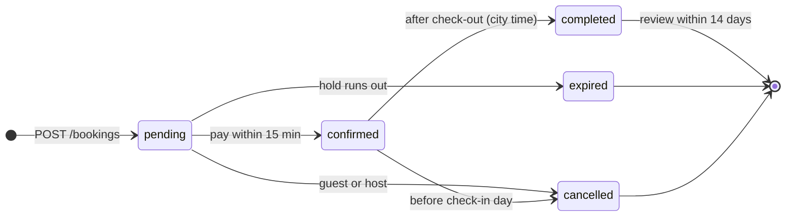
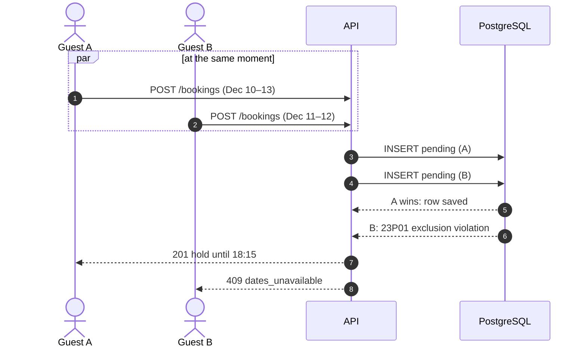
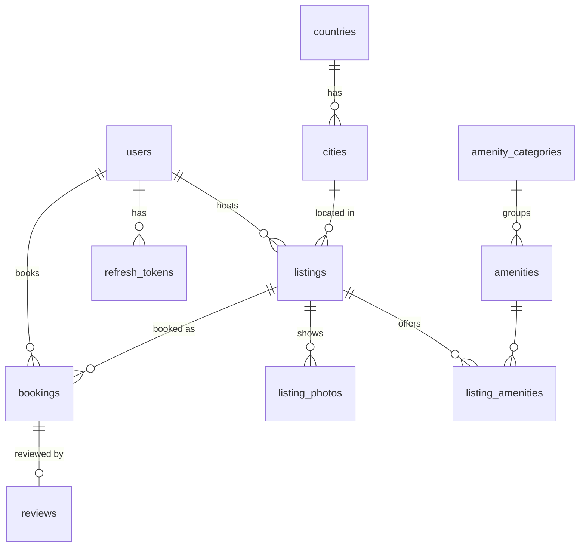

<p align="center">
  
</p>

<p align="center">
  <a href="https://github.com/zianazari/Caravansara/actions/workflows/ci.yml"></a>
  
  
  
  
</p>

A *caravansara* (کاروانسرا) was a roadside inn on the Silk Road: travellers arrived at dusk, took a room for the night and moved on at dawn. **Caravansara** is the same idea for today: an Airbnb-like site where guests find a place, hold it, pay and leave a review, and hosts list their homes.

This repository holds the **backend and the database design**. There is no frontend yet; everything below is reachable through the API and tried out in **Swagger UI**.

## What it does

| | |
| --- | --- |
| 🧭 **Search** | By city, or by centre and radius (1–100 km) on a map. Filters for dates, adults, children, infants, pets and amenities (all must match). |
| ⏳ **Reserve** | A 15-minute hold on the dates, then a simulated payment. Retrying with the same `Idempotency-Key` never books twice. |
| 🛡️ **No double booking** | Two guests can never hold the same night. PostgreSQL enforces it with an `EXCLUDE` constraint, so no race in app code can break it. |
| 📍 **Privacy** | Search and the map use a pin moved 100–500 m from the real address. The exact address appears only after payment. |
| 🏠 **Hosts** | Create and edit listings, upload photos straight to object storage, pick amenities, see bookings. |
| ⭐ **Reviews** | One per completed stay, within 14 days, never edited. The listing's rating updates itself. |
| 🕰️ **City time** | "Today", cancellation and the end of a stay follow the listing's time zone, not the server's. |

<p align="center">
  
</p>

## How it fits together

One codebase and one database, split into modules with clear borders. The API and the worker run as two processes; photos go from the browser straight to storage.

```mermaid
flowchart LR
    client(["Client<br/>web, mobile, Swagger"])
    browser(["Browser upload"])

    subgraph api["API process · FastAPI"]
        direction TB
        identity["identity<br/>accounts, JWT, rate limit"]
        catalog["catalog<br/>countries, cities, amenities"]
        search["search<br/>city or radius"]
        listings["listings<br/>listings, photos, pin"]
        bookings["bookings<br/>hold, pay, cancel"]
        reviews["reviews"]
    end

    worker["worker process<br/>every minute: expire holds,<br/>complete finished stays"]
    db[("PostgreSQL 16 + PostGIS<br/>EXCLUDE, triggers, GiST")]
    s3[("MinIO / S3<br/>photos")]

    client -- "HTTPS /api/v1" --> api
    api --> db
    worker --> db
    browser -- "presigned POST" --> s3
    listings -- "signs the upload,<br/>checks the file" --> s3
```



Modules talk to each other only through their `service`; [import-linter](https://import-linter.readthedocs.io/) breaks the build if one reaches into another's tables or repository.

### A booking's life



`expired` and `cancelled` free the dates; `pending`, `confirmed` and `completed` hold them.

### Two guests, one night



A test fires 20 such requests at once and checks that exactly one wins.

### Data model



12 tables. The full schema with every rule is in [`db/schema.sql`](db/schema.sql); the design and its reasons are in [`docs/backend-design.md`](docs/backend-design.md) (Persian).

## Try it

Needs Docker.

```bash
docker compose up --build                               # db, MinIO, migrations, API, worker
docker compose run --rm migrate caravansara seed-demo   # optional: 200 real listings in 4 cities
```

Open **http://localhost:8000/docs**, log in with `POST /auth/login` as `guest@example.com` / `caravansara-demo`, press **Authorize**, paste the `access_token`, and every endpoint is ready to try.

The demo data comes from [Inside Airbnb](https://insideairbnb.com/) (CC BY 4.0): real titles, prices, amenities and review text from Amsterdam, Lisbon, Copenhagen and Stockholm; people, addresses and bookings are synthetic. See [`db/demo/README.md`](db/demo/README.md).

## API at a glance

All paths start with `/api/v1`. Every error has the same shape, with a stable code a client can translate:

```json
{"error": {"code": "dates_unavailable", "message": "These dates were just booked."}}
```

| Area | Endpoints |
| --- | --- |
| Auth | `POST /auth/register` · `/auth/login` · `/auth/refresh` · `/auth/logout` · `GET/PATCH /me` |
| Catalog | `GET /countries` · `/cities?q=` · `/amenities` |
| Search | `GET /search/listings` · `/search/filters` |
| Listings | `POST /listings` · `GET/PATCH /listings/{id}` · `GET /me/listings` · `PUT /listings/{id}/amenities` |
| Photos | `POST /listings/{id}/photos/upload-url` · `POST /listings/{id}/photos` · `PATCH/DELETE …/photos/{photo_id}` · `PUT …/photos/order` |
| Bookings | `POST /bookings` · `GET /me/bookings` · `GET /bookings/{id}` · `POST /bookings/{id}/pay` · `/cancel` · `GET /listings/{id}/bookings` |
| Reviews | `POST /bookings/{id}/review` · `GET /listings/{id}/reviews` |

## Repository

```
backend/     FastAPI app, Alembic migrations, tests  → backend/README.md
db/          schema, search query, seeds, ERD, demo-data builder
docs/        backend design (fa), database overview, ERD demo deck, future work
.github/     CI: ruff, mypy --strict, import-linter, tests, Docker build
```

Tests run against real PostgreSQL + PostGIS and MinIO in containers, because the most important rules live in the database and can't be mocked. Details in [`backend/README.md`](backend/README.md).

## What's next

More and bulkier test data, monitoring (logs, metrics, traces with Prometheus and Grafana), an index review on real load, a web UI with right-to-left Persian, browser tests with Playwright, and splitting out services only if the numbers ask for it. The plan and its order are in [`docs/future-work.md`](docs/future-work.md).
