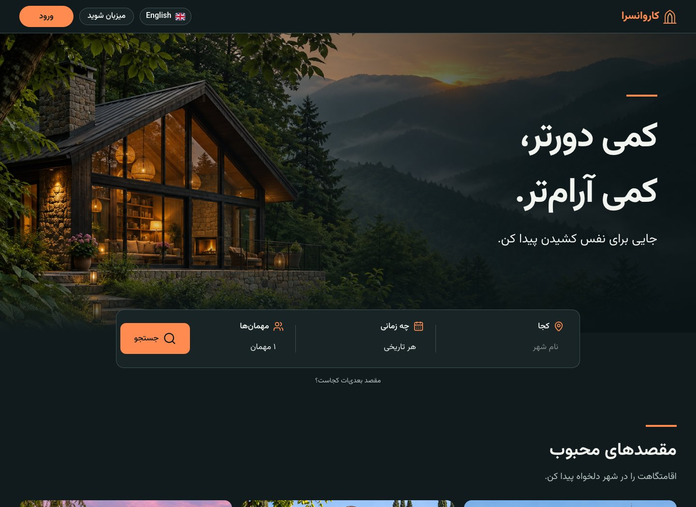
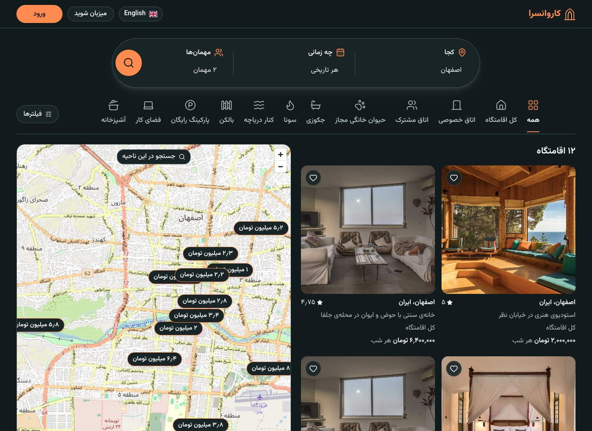
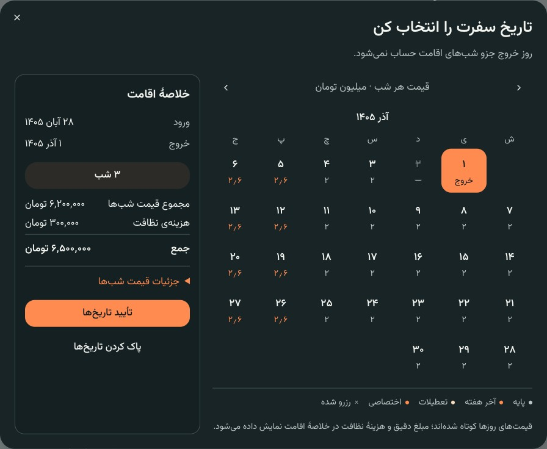
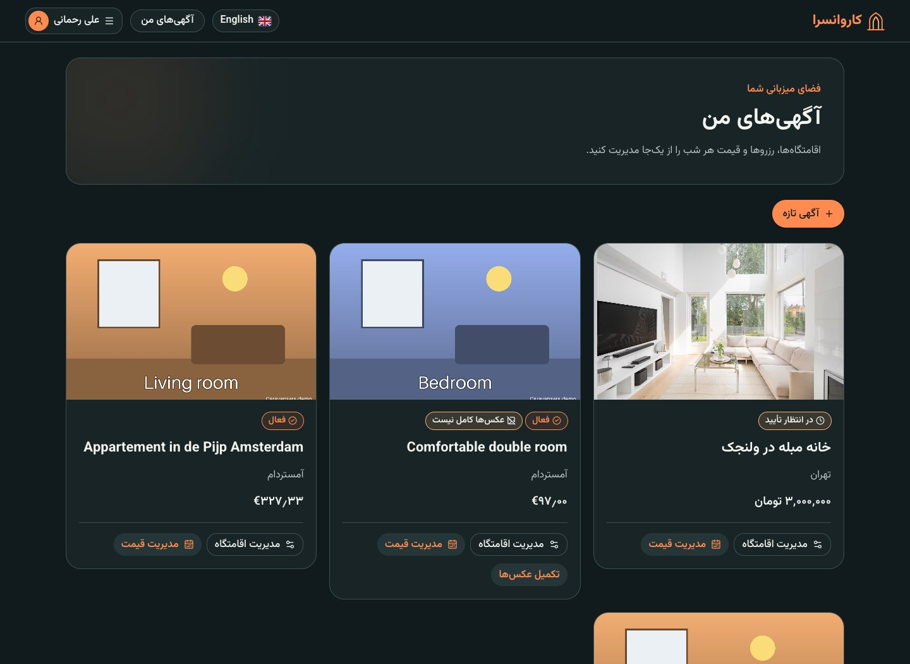
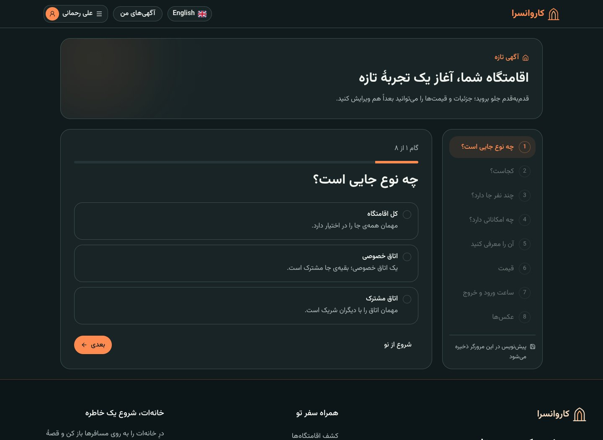
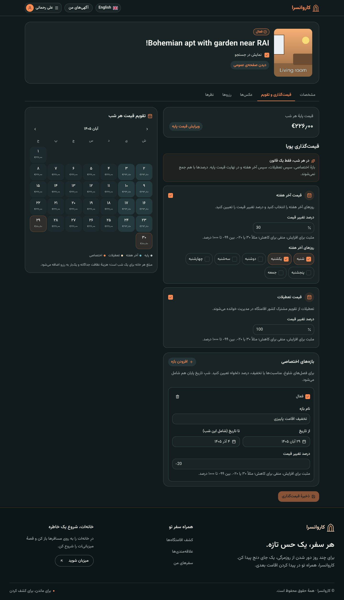
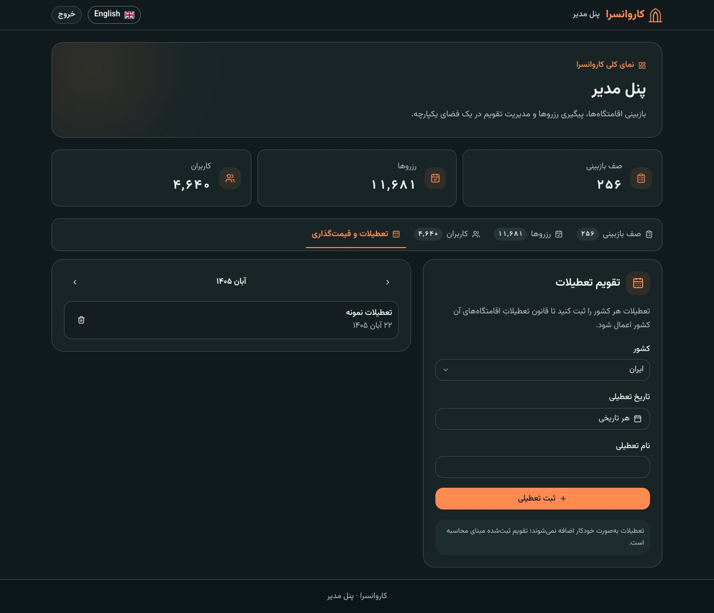
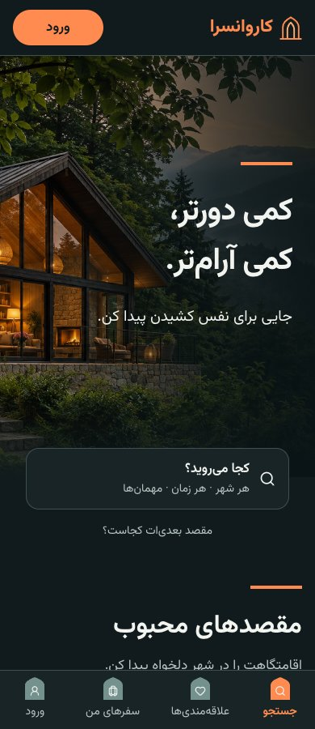

# Caravansara · کاروانسرا

A Persian/English accommodation booking platform for guests, hosts and administrators. Guests discover
places and book stays; hosts publish listings and manage nightly prices; admins review properties and
maintain a shared holiday calendar.

Named after the roadside inns of the Silk Road, Caravansara combines a warm visual identity with Persian
RTL layouts, Jalali dates and English support.

<p align="center">
  <a href="https://github.com/zianazari/Caravansara/actions/workflows/ci.yml"></a>
  
  
  
</p>

[Features](#features) · [Screenshots](#screenshots) · [Run locally](#run-locally) ·
[Architecture](#architecture) · [Testing](#testing) · [Documentation](#documentation) · [Roadmap](#roadmap)

## Features

### For guests

- Search by city or map area, with dates, guest counts, property types, amenities, reviews and photo-count filters.
- Explore photo galleries, approximate map locations, ratings and saved favourites.
- Keep search available in a compact form while scrolling, with full-area clickable search segments.
- Hold dates for 15 minutes, complete the simulated payment flow, and manage trips, cancellations and receipts.
- See a per-night price breakdown and leave one review after a completed stay, within 14 days.
- Compare prices under each day in the booking calendar, then confirm dates with an exact stay summary.
- Use Persian RTL with Vazirmatn, Jalali dates and toman amounts, or English with Gregorian dates and localized currencies.

### For hosts

- Create a listing in eight steps, with desktop step navigation, mobile layouts and at least five photos.
- Manage property details, photos, publication status and bookings from a dedicated workspace.
- Open each property's pricing manager directly from its listing card.
- Choose weekend days and their price adjustment, set a separate holiday adjustment, and add named date ranges with increases or discounts.
- Preview saved nightly prices in a Jalali/Gregorian monthly calendar.

For example, a host can set weekends to **+30%**, shared holidays to **+100%**, and a selected date range to
**−20%**. One rule applies to each night: **custom range → holiday → weekend → base price**. Percentages
never stack. Booking and receipt amounts retain the saved nightly breakdown after later price changes.
See the [dynamic pricing guide](docs/dynamic-pricing.md).

### For administrators

- Review new and edited listings, approve them or return them with a rejection reason.
- Sort the review queue by submission time, title, city or host; newest submissions appear first by default.
- Sort every user and booking table column in ascending or descending order across all matching records before pagination.
- Maintain shared holidays by country and date; hosts choose the adjustment for their own properties.
- Work in a dark/orange panel on a separate admin host, with overview counts and recorded exact-address views.

Both public designs share these features: the default **boutique** palette uses ivory/olive; the
**cinematic** preview uses dark surfaces and orange accents. Account menus show full names and user-icon
avatars, Persian notifications use Vazirmatn, and map price markers keep their position on hover.

## Screenshots

All application screenshots were captured on **13 November 2026**, at **1440 px desktop** and **390 px
mobile** widths. Host/admin screens use development demo accounts;
the pricing rules and sample holiday are demonstration settings. Home covers are generated decorative
illustrations. [Demo data and image provenance](db/demo/README.md); map data ©
[OpenStreetMap contributors](https://www.openstreetmap.org/copyright).

### Cinematic home

<p align="center">
  
</p>

<details>
<summary>Guest search and map</summary>

City search, filters, accommodation cards and approximate price pins in Isfahan.

<p align="center">
  
</p>

</details>

<details>
<summary>Guest calendar with nightly prices and a stay summary</summary>

Daily prices reflect the property's saved rules. Booked nights are marked, checkout is excluded from the
nightly charge, and the selected dates are applied only after confirmation.

<p align="center">
  
</p>

</details>

<details>
<summary>Host dashboard, listing wizard and dynamic pricing</summary>

Listing cards link directly to management tools. The wizard guides registration in eight steps, and the
pricing editor combines recurring rules, custom date ranges and a nightly price calendar.

<p align="center">
  
  
  
</p>

</details>

<details>
<summary>Admin workspace and shared holiday calendar</summary>

Overview counts and country/month controls for the shared calendar.

<p align="center">
  
</p>

</details>

<details>
<summary>Mobile boutique and cinematic homes</summary>

Compact search and bottom navigation in both designs.

<p align="center">
  
  
</p>

</details>

## Run locally

### Start the default site

Requires Docker with Docker Compose. Run from the repository root:

```bash
docker compose up -d --build --wait
```

Compose starts PostgreSQL/PostGIS, MinIO, migrations, the API, worker, Mailpit and Next.js.

- **Site:** [localhost:3001/fa](http://localhost:3001/fa) or [localhost:3001/en](http://localhost:3001/en)
- **Admin:** [admin.localhost:3001/fa/admin](http://admin.localhost:3001/fa/admin)
- **API explorer:** [localhost:8000/docs](http://localhost:8000/docs)
- **Development email:** [localhost:8025](http://localhost:8025)
- **MinIO console:** [localhost:9001](http://localhost:9001)

### Optional demo data

On an empty development database, load 800 listings in nine cities, photos and example booking states:

```bash
docker compose run --rm migrate caravansara seed-demo
```

| Account | Email               | Password           |
| ------- | ------------------- | ------------------ |
| Guest   | `guest@example.com` | `caravansara-demo` |
| Host    | `host@example.com`  | `caravansara-demo` |
| Admin   | `admin@example.com` | `caravansara-demo` |

These are development accounts. Admins sign in through the admin host. To create a separate admin:

```bash
docker compose exec -e CARAVANSARA_ADMIN_PASSWORD='your-local-password' api \
  caravansara create-admin --email you@example.com --name "Your name"
```

Demo data combines [Inside Airbnb](https://insideairbnb.com/) snapshots under CC BY 4.0 with 50
hand-written Persian listings. People, addresses, bookings and demo photos are synthetic. Details and
edge cases are documented in [db/demo/README.md](db/demo/README.md).

### Add the cinematic preview

With the default stack running:

```bash
docker compose -f docker-compose.yml -f docker-compose.cinematic.yml \
  up -d --build --no-deps --wait web-cinematic
```

Open [localhost:3011/fa](http://localhost:3011/fa) or [localhost:3011/en](http://localhost:3011/en).
Its admin panel is at [admin.localhost:3011/fa/admin](http://admin.localhost:3011/fa/admin).
Both frontends share the same API, database, accounts, media and bookings. See the
[frontend setup guide](frontend/README.md#separate-cinematic-preview-on-port-3011).

### Enable monitoring

```bash
docker compose --profile observability up -d --build --wait
```

[Grafana](http://localhost:3000) uses `admin` / `caravansara` locally.
Prometheus metrics, Loki logs and Tempo traces are connected through Grafana Alloy, with alerts for API,
worker and database health. See [observability/README.md](observability/README.md).

## Architecture

Caravansara is a **modular monolith**: one FastAPI codebase and one PostgreSQL database with enforced
module boundaries. Next.js serves the web UI; the API handles requests; a separate worker expires holds,
completes stays and delivers emails from a transactional outbox.

| Layer          | Technology                                                                                 |
| -------------- | ------------------------------------------------------------------------------------------ |
| Web            | Next.js 16, React 19, TypeScript, Tailwind CSS, Radix, next-intl, TanStack Query, MapLibre |
| API            | Python 3.13, FastAPI, Pydantic v2, SQLAlchemy 2, asyncpg                                   |
| Data           | PostgreSQL 16, PostGIS, Alembic; 17 application tables through migration `0012`            |
| Media          | S3-compatible storage; MinIO locally                                                       |
| Authentication | Argon2 passwords, JWT access tokens and rotating refresh tokens                            |
| Monitoring     | Prometheus, Grafana, Loki, Tempo, OpenTelemetry, Grafana Alloy                             |
| Delivery       | uv, Docker Compose, GitHub Actions                                                         |

The database enforces overlapping-booking prevention, idempotency and review constraints. Conditional
updates resolve payment/expiry races. Public maps use a stored location offset 100–500 m from the real
address; exact-address access is restricted. City time zones govern booking dates and stay completion.
Listing photos upload directly to S3; profile pictures pass through API validation.

Modules call each other through service boundaries checked by import-linter. The committed
[OpenAPI contract](backend/openapi.json) generates the frontend API types; contract drift fails CI.
Explore the [architecture diagram](docs/images/readme/architecture.svg), [database diagram](db/erd.png)
and [design decisions](docs/backend-design.md).

## Testing

- **Backend:** 415 pytest tests against real PostgreSQL/PostGIS and MinIO using testcontainers.
- **Frontend:** 478 Vitest tests covering rules, components, Persian/English layouts and axe accessibility.
- **End to end:** 139 collected Playwright tests for API behavior and browser journeys on the running stack.

Coverage includes booking races, idempotency, privacy, photo uploads, listing review, guest/host flows,
daily pricing, shared holidays, receipts and responsive accessibility. CI also checks formatting, lint,
types, module boundaries, builds and API-client synchronization.

Run the browser/API suite with both frontend variants:

```bash
docker compose -f docker-compose.yml -f docker-compose.cinematic.yml \
  -f e2e/compose.e2e.yml up -d --build --wait
cd e2e
npm ci
npx playwright install chromium
npx playwright test
npx playwright show-report
```

Backend and frontend test commands are in their [backend](backend/README.md) and
[frontend](frontend/README.md) guides; stack setup and reports are in [e2e/README.md](e2e/README.md).

## Documentation

| Guide                                                             | Contents                                                                    |
| ----------------------------------------------------------------- | --------------------------------------------------------------------------- |
| [Frontend](frontend/README.md)                                    | UI development, localization, sessions, design variants and component tests |
| [Backend](backend/README.md)                                      | API development, configuration, migrations and quality checks               |
| [Dynamic pricing](docs/dynamic-pricing.md)                        | Rule priority, calendar controls, quotes and saved booking prices           |
| [End-to-end tests](e2e/README.md)                                 | Compose setup, fixtures, browser journeys and reports                       |
| [Database](db/README.md)                                          | Schema, constraints, indexes and diagrams                                   |
| [Demo data](db/demo/README.md)                                    | Accounts, sources, photos and edge cases                                    |
| [Bulk measurements](db/bulk/README.md)                            | Separate performance database and query benchmarks                          |
| [Monitoring](observability/README.md)                             | Metrics, logs, traces, dashboards and alert rules                           |
| [Design document — فارسی](docs/backend-design.md)                 | Architecture, behavior and implementation decisions                         |
| [Postman collection](postman/Caravansara.postman_collection.json) | Saved API requests and examples                                             |

Source code lives in `frontend/` and `backend/`; browser/API tests in `e2e/`; database assets in `db/`;
project documentation and current README screenshots in `docs/`. Historical specifications are in
`specs/`. The [project constitution](.specify/memory/constitution.md) records development principles.

## Roadmap

- Email verification, password recovery and server-side listing drafts.
- Host-blocked dates, automatic holiday imports and a real payment gateway.
- Remaining browser race/error scenarios and first-time-user usability checks.
- Caching or service separation when measured performance justifies it.

See [docs/future-work.md](docs/future-work.md) for the remaining work and dependencies.
