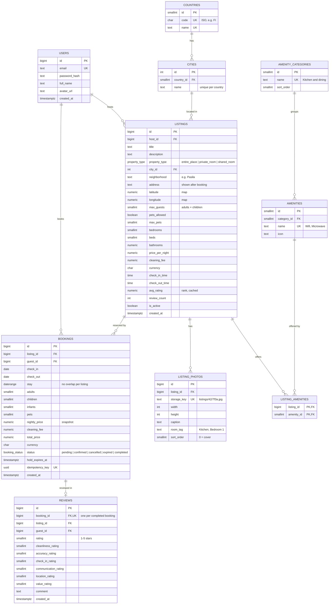

# Place Reservation Site: ERD

Decisions (Oct 30, 2026): **rank** = star rating · **comments** = review text only · **scope** = simple (no payments, wishlists, messages).


## Files

| File | What it is |
| --- | --- |
| `schema.sql` | PostgreSQL 13+ schema: 10 tables, the no-double-booking constraint, review triggers |
| `seed_amenities.sql` | 12 amenity categories and 31 amenities (Wifi, Kitchen, Microwave …) |
| `search_query.sql` | Where + When + Who search with map bounds and multi-amenity filter (must have ALL), plus filter-panel counts |
| `schema.dbml` | Paste into [dbdiagram.io](https://dbdiagram.io) |
| `erd.mmd` | Mermaid source (also below; GitHub and VS Code render it) |

## Rules the database enforces (all tested on PostgreSQL 16)

| Rule | How |
| --- | --- |
| Two guests can't book the same nights | `EXCLUDE USING gist (listing_id WITH =, stay WITH &&)` on active bookings; 20 simultaneous requests → exactly 1 booking |
| Same-day turnover is allowed | `stay` is half-open `[check_in, check_out)` |
| Cancelled bookings free the dates | constraint only covers `pending`, `confirmed`, `completed` |
| A retried "Reserve" click can't double-book | `UNIQUE (idempotency_key)` |
| Only a completed stay can be reviewed, once | trigger + `UNIQUE (booking_id)` |
| A review's listing and guest match its booking | composite FK `(booking_id, listing_id, guest_id)` |
| No pets on a no-pets listing | `CHECK (pets_allowed OR max_pets = 0)` |
| Rank stays current | trigger refreshes `listings.avg_rating` and `review_count` |

Left to the app: guest count ≤ `max_guests`, expiring unpaid `pending` holds (a job sets them to `expired`), fuzzing the map pin.

## Photos

Image files live in object storage (S3, R2 or GCS) and are served through a CDN. `listing_photos` stores only the `storage_key` (e.g. `listings/42/7f3a.jpg`) plus `width` and `height`. The app builds the URL, e.g. `https://cdn.example.com/listings/42/7f3a.jpg?w=720`, so a CDN or domain change needs no database update. Uploads go browser → presigned URL → storage, then the API inserts the row.

## Run it

```bash
createdb airbnb
psql -d airbnb -f schema.sql -f seed_amenities.sql
psql -d airbnb -f search_query.sql
```

## Mermaid source


