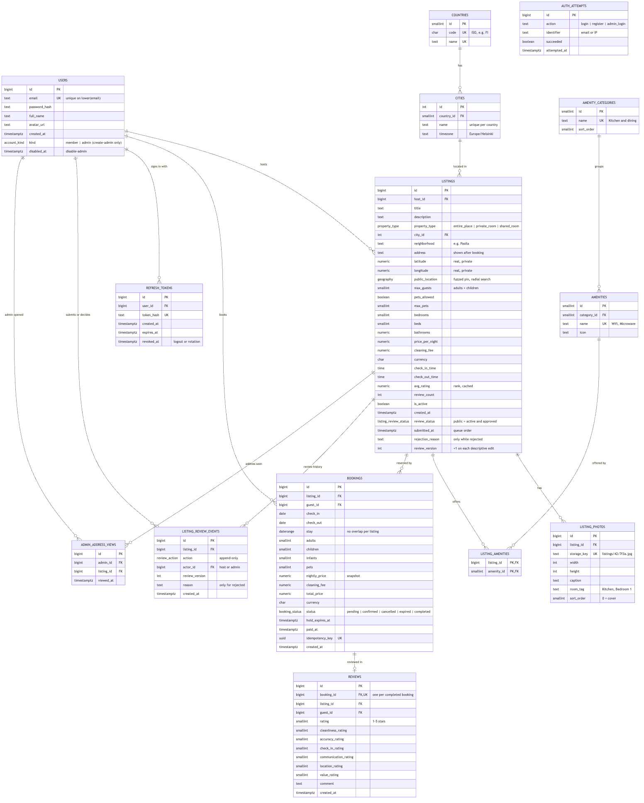
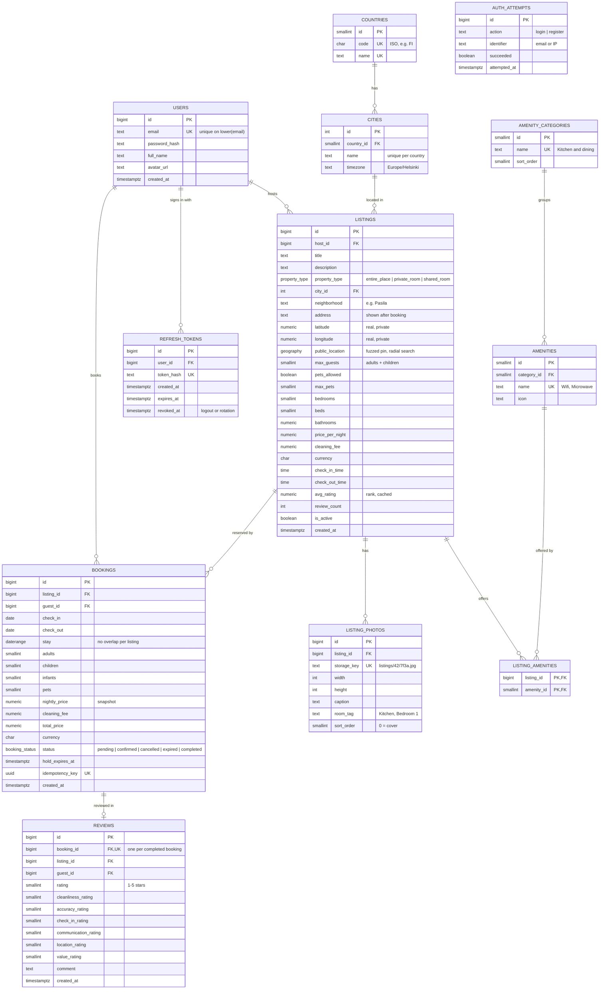

# Caravansara: ERD

Decisions: **rank** = star rating · **comments** = review text only · **scope** = simple (no payments, wishlists, messages).
Updated 2026-11-02 to match `Caravansara/docs/backend-design.md` (the backend design is the source of truth; once the
backend exists, Alembic migrations are, and these files follow them).



## Files

| File | What it is |
| --- | --- |
| `schema.sql` | PostgreSQL 16 + PostGIS schema: 12 tables, the no-double-booking constraint, review triggers |
| `seed_amenities.sql` | 12 amenity categories and 31 amenities (Wifi, Kitchen, Microwave …) |
| `search_query.sql` | City **or** radial (centre + 1–100 km) search + When + Who + multi-amenity filter (must have ALL), sort by rating or distance; plus filter-panel counts |
| `schema.dbml` | Paste into [dbdiagram.io](https://dbdiagram.io) |
| `erd.mmd` | Mermaid source (also below; GitHub and VS Code render it) |

## Changes on 2026-11-02

| Change | Why |
| --- | --- |
| New `refresh_tokens` (hash, expiry, revoked) | JWT with refresh-token rotation: real logout and revocation |
| New `auth_attempts` (one row per attempt) | Rate limit for login and registration |
| Unique index on `lower(email)` | `A@x.com` and `a@x.com` can't become two accounts |
| `(listing_id, sort_order)` unique is `DEFERRABLE INITIALLY DEFERRED` | Reordering photos or swapping the cover in one transaction doesn't fail |
| `cities.timezone` (IANA) | "Today" and the end of a stay are computed in the city's local time |
| Partial index on `bookings.hold_expires_at` `WHERE status = 'pending'` | The worker expires overdue holds without scanning all bookings |
| `listings.public_location geography(Point, 4326)` + GiST index | Radial search with PostGIS; real `latitude`/`longitude` stay private |

## Rules the database enforces (all tested on PostgreSQL 16 + PostGIS 3.4)

| Rule | How |
| --- | --- |
| Two guests can't book the same nights | `EXCLUDE USING gist (listing_id WITH =, stay WITH &&)` on active bookings; 20 simultaneous requests → exactly 1 booking |
| Same-day turnover is allowed | `stay` is half-open `[check_in, check_out)` |
| Cancelled or expired bookings free the dates | constraint only covers `pending`, `confirmed`, `completed` |
| A retried "Reserve" click can't double-book | `UNIQUE (idempotency_key)` |
| Only a completed stay can be reviewed, once | trigger + `UNIQUE (booking_id)` |
| A review's listing and guest match its booking | composite FK `(booking_id, listing_id, guest_id)` |
| No pets on a no-pets listing | `CHECK (pets_allowed OR max_pets = 0)` |
| Rank stays current | trigger refreshes `listings.avg_rating` and `review_count` |
| One account per email, any letter case | unique index on `lower(email)` |
| Every listing has a public point, every city a time zone | `NOT NULL` |

Rules in the service layer (see `backend-design.md`): guest count ≤ `max_guests`, host can't book own listing,
radius 1–100 km, review within 14 days, hold expiry and payment as conditional `UPDATE`s, booking state machine.

## Map and privacy

The real point (`latitude`, `longitude`) is shown only to the host and to guests with a confirmed or completed booking.
When a listing is created, the app moves the point ~100–500 m at random and stores it once in `public_location`
(recomputed only if the real point changes). Search (`ST_DWithin`), `distance_km` and the map pin use only that,
so shrinking the radius or averaging many requests can't reveal the address. `ST_MakePoint` takes **longitude first**.
Search near the 180° meridian works (tested).

## Photos

Image files live in object storage (MinIO in dev/test, S3 or R2 in production) and are served through a CDN.
`listing_photos` stores only the `storage_key` (e.g. `listings/42/7f3a.jpg`) plus `width` and `height`. The app builds
the URL, e.g. `https://cdn.example.com/listings/42/7f3a.jpg?w=720`, so a CDN or domain change needs no database update.
Uploads go browser → presigned URL → storage, then the API checks the file exists and inserts the row.

## Run it

Needs PostgreSQL 16 with the PostGIS extension available (e.g. the `postgis/postgis:16-3.4` Docker image).

```bash
createdb airbnb
psql -d airbnb -f schema.sql -f seed_amenities.sql
psql -d airbnb -f search_query.sql
```

## Mermaid source


