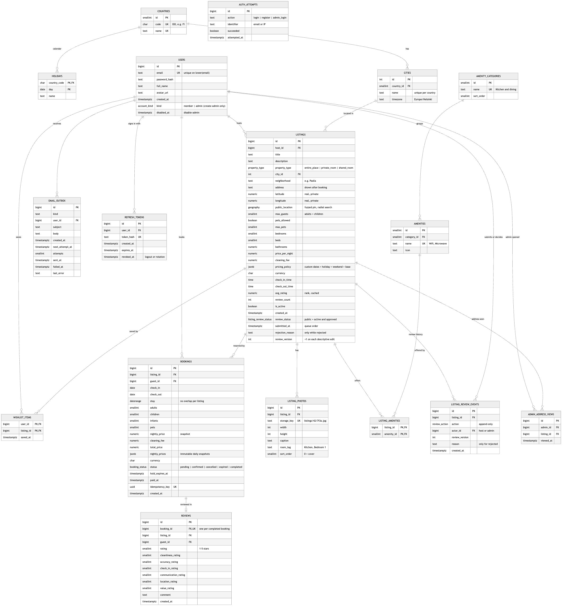

# Caravansara Database: Design Overview

Updated November 13, 2026 · Zia

Current schema: **17 application tables** on PostgreSQL 16 with PostGIS, through Alembic migration `0012`.
The authoritative history is `backend/migrations/`; `db/schema.sql`, `db/schema.dbml` and the ERD are reference
snapshots. [Backend design](backend-design.md) and [dynamic pricing](dynamic-pricing.md) document API/service rules.
The older online overview and Persian slide deck are historical artifacts, not the current schema.

## Domain map

| Domain | Tables | Role |
| --- | --- | --- |
| Identity | `users`, `refresh_tokens`, `auth_attempts` | Members/admins, sessions and rate limits |
| Catalog | `countries`, `cities`, `amenity_categories`, `amenities`, `holidays` | Destinations, amenities and country holiday dates |
| Listings | `listings`, `listing_photos`, `listing_amenities` | Properties, host pricing policy, photos and features |
| Bookings & reviews | `bookings`, `reviews` | No-overlap guarantee, saved nightly prices and ratings |
| Moderation | `listing_review_events`, `admin_address_views` | Append-only decisions and recorded exact-address access |
| Saved places & email | `wishlist_items`, `email_outbox` | Member favourites and transactional delivery |

## Daily prices and saved reservations

`listings.pricing_policy` stores host-controlled weekend days/percentages, holiday percentages and named custom
ranges. Only one rule applies per night: custom range, then shared holiday, then weekend, then base price.
Custom range ends include that night; checkout dates do not. Active custom ranges cannot overlap. Disabled
rules remain stored. The host's monthly price preview uses the same server calculation as search and checkout.

`holidays` has compound key `(country_code, day)` and a non-empty name. Active admins manage it through the web
panel. Country/amenity catalogs still use seeding; holidays are maintained manually rather than auto-imported.

`bookings.nightly_prices` saves each date, price, source, percentage and label. Base price, cleaning fee, currency,
total and payment time are also booking snapshots. Existing reservations retain their original amounts.
Creation locks the listing against concurrent edits and rejects a supplied quote amount/currency mismatch with
`409 price_changed`. Decimal half-up rounding happens per night before summing, with cleaning charged once.

## From the screenshots to the schema

### Search: Where / When / Who

- **Where** is either a city (`countries` → `cities`, for autocomplete) or a centre point plus a radius of 1–100 km.
- **When** is a check-in/check-out pair. The "±1/2/3/7/14 days" flexible option only widens the query, so it needs no table. "Today" is computed in the city's own time zone (`cities.timezone`).
- **Who** has four counters: adults, children, infants, pets. The booking stores all four.
  - Adults + children must fit within `max_guests`; infants don't count.
  - Pets need `pets_allowed` and must stay within `max_pets`.

### Map and privacy

Each listing keeps two points:

- the real `latitude` / `longitude`, shown only to the host and to guests with a confirmed or completed booking;
- `public_location`, a PostGIS `geography(Point, 4326)` moved about 100–500 m at random when the listing is created and stored once.

Search (`ST_DWithin` with a GiST index), `distance_km` and the map pin use only the public point, so shrinking the radius or averaging many requests can't reveal the address. Airbnb does the same: it shows an approximate area until a booking is confirmed.

### Listing

- Type: entire place, private room, or shared room.
- Size: bedrooms, beds, baths; check-in and check-out times; price per night and cleaning fee.
- A listing is never deleted, only deactivated with `is_active`, so past bookings stay intact.

### Photos

The files live in object storage (MinIO in development, S3 or R2 in production) behind a CDN. `listing_photos` keeps only the `storage_key`, `width`, `height`, an optional `room_tag` and `sort_order` (0 = cover). Reordering or swapping the cover works in one transaction, because the order constraint is checked at commit.

### Amenities

A catalog instead of yes/no columns: 12 categories and 31 amenities, linked to listings through `listing_amenities`. Adding "microwave" is a new row, not a migration. `amenities.icon` holds a key like `wifi` that the frontend maps to an icon. Pets are a listing column, not an amenity.

## No double booking

The database itself is the guarantee, because two requests can pass a "still free" check at the same moment and application code on several servers can't see each other.

- **`EXCLUDE USING gist (listing_id WITH =, stay WITH &&)`** on bookings that are `pending`, `confirmed` or `completed`. Two overlapping active rows cannot exist; the second insert fails with `23P01`, which the API returns as 409 `dates_unavailable`.
- **Half-open ranges** `[check_in, check_out)`: a guest can arrive the day the previous one leaves. `cancelled` and `expired` bookings free the dates.
- **15-minute hold:** a booking starts as `pending` with `hold_expires_at`. Simulated payment confirms it with a conditional `UPDATE`, so a payment and an expiry arriving together can't both win. A worker expires overdue holds every minute (using a partial index on pending holds), and the booking transaction also expires stale holds on the same listing.
- **Idempotency:** each booking request carries an `Idempotency-Key`, stored as a UNIQUE `idempotency_key`. A retried request returns the same booking instead of creating a second one.

A real example: Airbnb's engineering team wrote in 2019 about building an idempotency library called *Orpheus* after network retries caused double payments.

Tested on PostgreSQL 16: 20 simultaneous requests for the same nights produced exactly one booking.

## Reviews and rank

- "Rank" is the star rating: an overall 1–5 score plus six sub-ratings (cleanliness, accuracy, check-in, communication, location, value).
- A review needs a **completed** booking (trigger), and each booking gets at most one review (`UNIQUE (booking_id)`).
- A composite foreign key makes the review's listing and guest match its booking, which blocks most fake reviews.
- Only the guest reviews the place; there are no host replies and no host-reviews-guest.
- A review must be written within 14 days of check-out and can't be edited or deleted (service rules).
- `avg_rating` and `review_count` are cached on the listing (the "4.76 (279)" on the card) and kept current by a trigger.

## Decisions

| Topic | Decision |
| --- | --- |
| Rank | Star rating 1–5 plus six sub-ratings, cached on the listing |
| Comments | Review text only; no host replies, no guest–host messaging |
| Scope | Simple: no wishlists, messages, host date blocking or per-night prices; payment is simulated |
| Database | PostgreSQL 16 with PostGIS |
| Table name | `listings` (the offer, Airbnb's own term), not `places` |
| Map | Radial search on a fuzzed `public_location`; real coordinates stay private |
| Photos | Object storage behind a CDN; the row keeps `storage_key`, `width`, `height` |
| Amenity icons | A key in `amenities.icon` mapped by the frontend; left nullable by choice |
| Pets | `pets_allowed` / `max_pets` on the listing, not an amenity |
| Sign-in | JWT with refresh-token rotation (`refresh_tokens`); login and registration rate-limited (`auth_attempts`) |
| Email | Unique regardless of letter case |
| Time | `cities.timezone` decides "today" and when a stay ends |
| Double booking | `EXCLUDE` on active bookings, a 15-minute hold, and an idempotency key |

## ERD

Twelve tables. `listings` is the hub with five relationships; `bookings` carries the no-overlap constraint and `reviews` hangs off a completed booking.

The full column list is in `db/erd.mmd`, `db/schema.sql` and `db/schema.dbml` in `Caravansara`.

## What the database guarantees

All tested on PostgreSQL 16 with PostGIS 3.4.

| Rule | How |
| --- | --- |
| Two guests can't book the same nights | `EXCLUDE USING gist (listing_id WITH =, stay WITH &&)`; 20 simultaneous requests gave exactly 1 booking |
| Same-day turnover allowed | `stay` is half-open `[check_in, check_out)` |
| Cancelled or expired bookings free the dates | Constraint only covers pending, confirmed, completed |
| Retried "Reserve" can't double-book | `UNIQUE (idempotency_key)` |
| Only a completed stay is reviewed, once | Trigger + `UNIQUE (booking_id)` |
| Review matches its booking's guest and listing | Composite FK `(booking_id, listing_id, guest_id)` |
| Rank stays current | Trigger refreshes `avg_rating` and `review_count` |
| One account per email, any letter case | Unique index on `lower(email)` |
| Photo order can be rearranged safely | `(listing_id, sort_order)` unique, checked at commit |
| Radial search is fast and works across the 180° meridian | GiST index on `public_location`, `ST_DWithin` |

**Left to the service layer:** guest count and pets within capacity, a host can't book their own listing, radius 1–100 km, the booking state machine, payment and expiry as conditional updates, cancellation only before the check-in day, the 14-day review window, and showing the exact address only after a confirmed booking.

## Out of scope

- Real payments and refunds (payment is simulated)
- Guest–host messages and host replies to reviews (wishlists were added later: `wishlist_items`, migration 0007, `docs/backend-design.md`)
- Host date blocking (per-night dynamic pricing is implemented)
- Changing booking dates (cancel and rebook instead), currency conversion, and general destination/amenity editing in the admin panel (holidays are already admin-managed)

## Files

- `Caravansara/db/`: `schema.sql`, `seed_amenities.sql`, `search_query.sql`, `schema.dbml` (for dbdiagram.io), `erd.mmd` and `erd.png`, and a README
- `Caravansara/docs/backend-design.md`: backend requirements, API and service rules (source of truth)
- `Caravansara/docs/future-work.md`: remaining work: listing drafts, additional browser edge cases, account emails, measured caching and any justified service split
- `Caravansara/frontend/`: the guest/host web site and admin workspace, Persian RTL and English, default and cinematic variants
