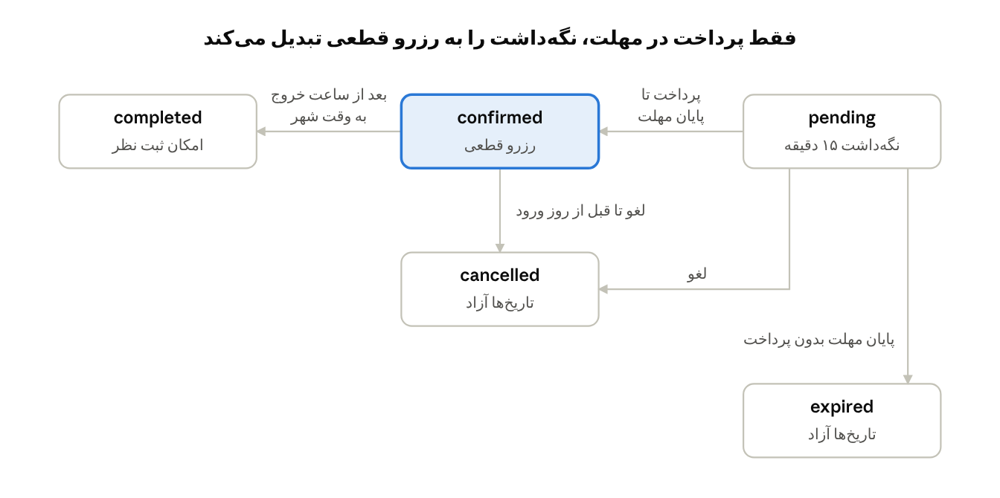
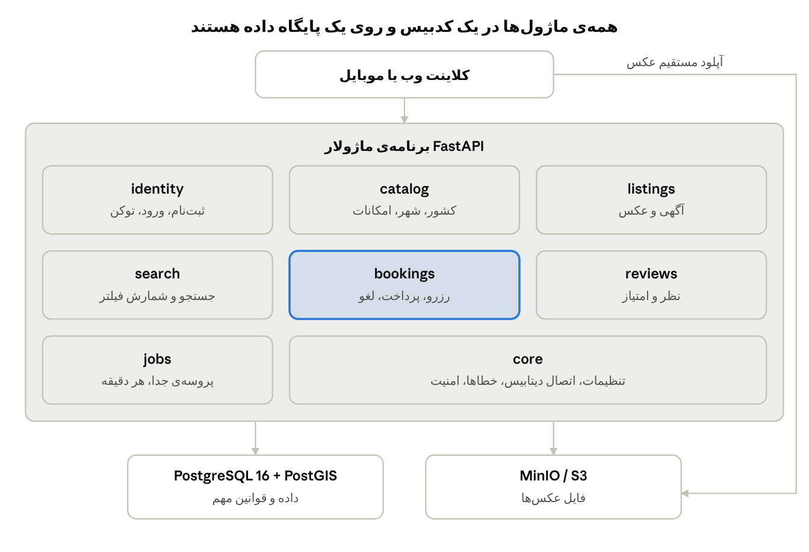

# سند جامع بکند کاروانسرا (Caravansara)

Nov 1, 2026 · @zia

## خلاصه

این سند بکند کاروانسرا (Caravansara)، یک سایت رزرو اقامتگاه شبیه Airbnb، را تعریف می‌کند: مهمان جستجو و رزرو می‌کند، میزبان آگهی می‌گذارد، و دو نفر هرگز نمی‌توانند یک اقامتگاه را برای شب‌های مشترک بگیرند.

بکند با Python و FastAPI، به‌صورت یک برنامه‌ی ماژولار (نه میکروسرویس) روی PostgreSQL ساخته شده است. کد در پوشه‌ی `backend/` است و نحوه‌ی اجرای آن در `backend/README.md` آمده است.

- **مخاطب:** توسعه‌دهندگان و هر کسی که دامنه‌ی نسخه‌ی اول را تأیید می‌کند.
- **دامنه:** بکند و API، و از کار ۰۰۵ بخش مهمانِ سایت وب (`frontend/`، بخش «فرانت‌اند وب»). صفحه‌های میزبان و پنل مدیر هنوز ساخته نشده‌اند.
- **منابع:** `CONTEXT.md`، `schema.sql`، `search_query.sql`، دموی ERD و تصمیم‌های گرفته‌شده در بررسی مشترک. نسخه‌ی قدیمی Design Overview مبنا نیست، چون هنوز پرداخت، پیام و پاسخ میزبان را شرح می‌دهد.

## تصمیم‌های کلیدی و دلیل آن‌ها

مهم‌ترین تصمیم این است که قوانین حیاتی در خود دیتابیس باشند، چون چند نمونه‌ی API یا کد اشتباه نمی‌توانند آن‌ها را دور بزنند. ستون «منشأ» نشان می‌دهد هر تصمیم از کجا آمده است.

| تصمیم | دلیل | منشأ |
| --- | --- | --- |
| معماری ماژولار، نه میکروسرویس | رزرو و نظر در یک تراکنش می‌مانند و استقرار ساده است؛ مرز ماژول‌ها با import-linter حفظ می‌شود | درخواست مالک پروژه |
| جلوگیری از رزرو تکراری با `EXCLUDE` | بررسی و ثبت در برنامه دو قدم جداست و مسابقه می‌سازد؛ دیتابیس تنها نقطه‌ی مشترک همه‌ی سرورهاست | طراحی قبلی |
| جستجوی شعاعی با PostGIS | فاصله روی کره محاسبه دقیق می‌خواهد؛ `ST_DWithin` با ایندکس GiST این را آماده می‌دهد و مشکل خط ۱۸۰ درجه را هم ندارد. این تصمیم جای «بدون PostGIS» قبلی را می‌گیرد | درخواست مالک پروژه، انتخاب ابزار از Claude |
| ذخیره‌ی نقطه‌ی عمومی جدا از مختصات واقعی | اگر فیلتر روی مختصات واقعی باشد، با کوچک کردن شعاع مکان دقیق پیدا می‌شود و جابه‌جایی پین بی‌اثر است | پیشنهاد Claude |
| سقف ۱ تا ۱۰۰ کیلومتر برای شعاع | شعاع خیلی بزرگ کوئری را کند می‌کند و شعاع خیلی کوچک فقط درخواست‌های بی‌فایده می‌سازد | پیشنهاد Claude |
| پرداخت شبیه‌سازی‌شده | چرخه‌ی نگه‌داشت و انقضا کامل تست می‌شود و بعداً فقط درگاه واقعی جایگزین می‌شود | مالک پروژه، به پیشنهاد Claude |
| JWT با refresh token | برای وب و موبایل مناسب است و برخلاف JWT تنها، خروج واقعی و ابطال دارد | مالک پروژه، به پیشنهاد Claude |
| MinIO با S3 API | همان کد در توسعه، تست و تولید اجرا می‌شود و تست آپلود واقعی است | مالک پروژه، به پیشنهاد Claude |
| چهار اصلاح اسکیما | هر کدام مشکل مشخصی را حل می‌کند که در بخش پایگاه داده آمده است | مالک پروژه، به پیشنهاد Claude |
| انقضای نگه‌داشت در همان تراکنش رزرو | اگر فقط worker این کار را بکند، تا دقیقه‌ی بعد تاریخ بی‌دلیل بسته می‌ماند | پیشنهاد Claude |
| پرداخت با `UPDATE` شرطی | اگر پرداخت و انقضا هم‌زمان برسند، فقط یکی برنده می‌شود | پیشنهاد Claude |
| تکرار رزرو همان رزرو را برمی‌گرداند | کاربر با قطع شبکه باید نتیجه‌ی موفق را ببیند، نه خطا | پیشنهاد Claude |
| ماشین حالت صریح در service | دیتابیس گذار وضعیت را کنترل نمی‌کند، پس `completed` به `pending` جلوی دیتابیس آزاد است | پیشنهاد Claude |
| worker جدا از API | نمونه‌های API بدون حالت می‌مانند و زمان‌بندی با تعداد آن‌ها چند برابر نمی‌شود | پیشنهاد Claude |
| بدون Redis | کاری نداریم که آن را بهتر از PostgreSQL انجام دهد؛ جزئیات در بخش معماری آمده است | پیشنهاد Claude |
| Rate limit برای ورود و ثبت‌نام | بدون آن حدس زدن رمز عبور محدودیتی ندارد | پیشنهاد Claude |
| SQLAlchemy async | کار این API بیشتر انتظار برای دیتابیس است و FastAPI با async هم‌خوان است | پیشنهاد Claude |
| تست روی PostgreSQL واقعی | `EXCLUDE`، تریگرها و PostGIS با mock یا SQLite قابل تست نیستند | پیشنهاد Claude |
| میزبان آگهی خودش را رزرو نمی‌کند | جلوی ساخت امتیاز جعلی برای خود را می‌گیرد | مالک پروژه |
| نظر غیرقابل ویرایش و مهلت ۱۴ روزه | اعتبار امتیازها حفظ می‌شود و نظرها به اقامت نزدیک می‌مانند | مالک پروژه |
| لغو بدون جریمه تا قبل از روز ورود | پرداخت واقعی نداریم، پس جریمه و بازپرداخت معنی ندارد | مالک پروژه |
| کاتالوگ فقط با seed | فهرست کنترل‌شده باید کنترل‌شده بماند؛ نقش مدیر سیستم فقط برای تأیید آگهی می‌آید، نه برای کاتالوگ | مالک پروژه |
| آگهی تازه پس از تأیید مدیر سیستم عمومی می‌شود | کیفیت و درستی آگهی‌ها پیش از دیده شدن کنترل می‌شود، تا آگهی جعلی یا ناقص به مهمان نرسد | مالک پروژه (2026-11-06)؛ پیاده‌شده در [specs/backend (004)](../specs/backend/)، بخش «تأیید آگهی» |

## قابلیت‌های سایت

نسخه‌ی اول چرخه‌ی کامل مهمان و میزبان را پوشش می‌دهد: از ثبت‌نام تا جستجو، رزرو، اقامت و نظر. مانده‌ی کار در بخش «خارج از دامنه» آمده است.

### حساب کاربری

| قابلیت | توضیح |
| --- | --- |
| ثبت‌نام و ورود | با ایمیل و رمز عبور؛ ایمیل بدون حساسیت به حروف یکتاست |
| نشست امن | JWT کوتاه‌عمر و refresh token قابل ابطال؛ خروج واقعی از حساب |
| پروفایل | نام و تصویر؛ هر کاربر هم مهمان است و هم می‌تواند میزبان باشد. بی‌عکس، آواتار پیش‌فرض (حرف اول نام روی رنگ ثابت) دارد؛ عکس خودش PNG یا JPEG تا ۵ مگابایت است (بخش «آپلود عکس») |
| محدودیت تلاش | rate limit برای ورود و ثبت‌نام |

### مهمان

| قابلیت | توضیح |
| --- | --- |
| جستجوی «کجا» | انتخاب کشور و شهر با پیشنهاد خودکار، یا جستجوی شعاعی با مرکز و شعاع |
| جستجوی «کی» | تاریخ ورود و خروج؛ فقط اقامتگاه‌های آزاد نمایش داده می‌شوند |
| جستجوی «چند نفر» | بزرگسال، کودک، نوزاد و حیوان خانگی؛ نوزاد در ظرفیت حساب نمی‌شود |
| فیلتر امکانات | آگهی باید همه‌ی امکانات انتخاب‌شده را داشته باشد، با شمارش برای پنل فیلتر |
| نتایج و نقشه | کارت با عکس کاور، امتیاز، قیمت کل و پین تقریبی روی نقشه |
| صفحه‌ی آگهی | عکس‌ها، توضیحات، امکانات دسته‌بندی‌شده، ظرفیت، قیمت و نظرها |
| رزرو | نگه‌داشت ۱۵ دقیقه‌ای تاریخ‌ها و سپس پرداخت شبیه‌سازی‌شده |
| مدیریت سفرها | فهرست رزروها، جزئیات و آدرس دقیق پس از تأیید، و لغو تا قبل از روز ورود |
| ثبت نظر | امتیاز ۱ تا ۵، شش امتیاز جزئی و متن، تا ۱۴ روز بعد از خروج |

### میزبان

| قابلیت | توضیح |
| --- | --- |
| مدیریت آگهی | ساخت، ویرایش، فعال و غیرفعال کردن آگهی |
| مدیریت عکس‌ها | آپلود مستقیم با presigned URL، تعیین کاور، تغییر ترتیب، عنوان و برچسب اتاق |
| انتخاب امکانات | از کاتالوگ ۱۲ دسته و ۳۱ امکان |
| مشاهده‌ی رزروها | فهرست رزروهای هر آگهی |
| لغو رزرو | تا قبل از روز ورود |
| وضعیت بازبینی | هر آگهی در «آگهی‌های من» وضعیت `pending`، `approved` یا `rejected` را دارد، و آگهی ردشده دلیل مدیر را |
| ارسال دوباره | آگهی ردشده پس از اصلاح با `POST /listings/{id}/resubmit` به انتهای صف برمی‌گردد |

### مدیر سیستم (admin)

| قابلیت | توضیح |
| --- | --- |
| ساختن و از کار انداختن حساب | فقط با `caravansara create-admin` و `disable-admin` روی سرور؛ هیچ مسیر API حساب admin نمی‌سازد |
| ورود جدا | `POST /admin/auth/login`، توکن ۱۵ دقیقه‌ای؛ این توکن روی هیچ endpoint عضو کار نمی‌کند. از کار ۰۱۱ با refresh token چرخشی، و نشستی که ۸ ساعت پس از ورود تمام می‌شود |
| صف بازبینی | آگهی‌های در انتظار، از قدیمی‌ترین |
| جزئیات برای بازبینی | هر آگهی در هر وضعیت، با آدرس دقیق؛ هر بار دیدن ثبت می‌شود |
| تأیید و رد | رد با دلیل نوشته‌شده (۱ تا ۱۰۰۰ نویسه)؛ تصمیم فقط برای نسخه‌ای که admin دیده است |

### سیستم

| قابلیت | توضیح |
| --- | --- |
| جلوگیری از رزرو هم‌زمان | محدودیت `EXCLUDE` در PostgreSQL |
| ایمنی در تکرار رزرو | کلاینت در هدر `Idempotency-Key` می‌فرستد؛ تکرار درخواست رزرو دوم نمی‌سازد |
| انقضای نگه‌داشت | نگه‌داشت پرداخت‌نشده `expired` می‌شود و تاریخ‌ها آزاد می‌شوند |
| پایان اقامت | رزرو بعد از ساعت خروج به وقت شهر `completed` می‌شود |
| به‌روز ماندن امتیاز | تریگر `avg_rating` و `review_count` را همگام می‌کند |
| صف بازبینی در داشبورد | worker هر دقیقه تعداد آگهی‌های در انتظار و قدیمی‌ترین انتظار را برای Grafana می‌نویسد |
| داده‌ی اولیه | فرمان seed برای کشور، شهر و امکانات (فقط ردیف‌های تازه)، فرمان جدا برای داده‌ی دمو با عکس، و `seed-bulk` برای داده‌ی حجیم در دیتابیس جدا |

## قواعد کسب‌وکار

هر قانون هر جا که ممکن باشد در دیتابیس اعمال می‌شود و بقیه در لایه‌ی service. ستون آخر محل اجرای هر قانون را نشان می‌دهد.

| حوزه | قانون | محل اجرا |
| --- | --- | --- |
| رزرو | دو رزرو فعال یک آگهی هم‌پوشانی ندارند | دیتابیس (`EXCLUDE`) |
| رزرو | ورود همان روز خروج قبلی مجاز است | دیتابیس (بازه‌ی نیمه‌باز) |
| رزرو | میزبان نمی‌تواند آگهی خودش را رزرو کند | service |
| رزرو | بزرگسال و کودک حداکثر `max_guests`؛ نوزاد حساب نمی‌شود | service |
| رزرو | حیوان خانگی فقط با `pets_allowed` و تا `max_pets` | service |
| رزرو | ورود از امروز به وقت شهر به بعد | service |
| رزرو | اقامت حداکثر ۳۶۵ شب و حداکثر ۱ سال جلوتر؛ هر دو قابل تنظیم | service |
| قیمت | جمع = شب‌ها × `price_per_night` + `cleaning_fee`؛ در لحظه‌ی رزرو روی رزرو کپی می‌شود. قیمت شب و هزینه‌ی نظافت در هر ارزی حداکثر ۱٬۰۰۰٬۰۰۰٬۰۰۰ است. جمعی که در ستون جا نشود ۴۲۲ `amount_too_large` می‌گیرد | service |
| پرداخت | فقط مهمان همان رزرو و فقط تا پایان مهلت نگه‌داشت | service (`UPDATE` شرطی) |
| لغو | مهمان و میزبان تا قبل از روز `check_in`؛ بدون جریمه و بازپرداخت | service |
| لغو | رزرو لغوشده تاریخ‌ها را آزاد می‌کند | دیتابیس |
| نظر | فقط برای رزرو `completed` و حداکثر یک نظر برای هر رزرو | دیتابیس (تریگر و `UNIQUE`) |
| نظر | فقط مهمان همان رزرو درباره‌ی همان آگهی | دیتابیس (کلید خارجی ترکیبی) |
| نظر | حداکثر ۱۴ روز بعد از `check_out` | service |
| نظر | بعد از ثبت ویرایش یا حذف نمی‌شود | نبود endpoint |
| آگهی | حذف نمی‌شود و فقط با `is_active` غیرفعال می‌شود؛ رزروهای قبلی برقرار می‌مانند | service |
| آگهی | آگهی تازه، و آگهی تأییدشده پس از ویرایش توصیفش (عنوان، توضیح، مکان، عکس تازه، امکانات، نوع؛ قیمت، فعال بودن، ترتیب عکس‌ها، ساعت ورود و خروج، ظرفیت و حیوان خانگی تأیید نمی‌خواهند)، تا تأیید مدیر سیستم در جستجو، صفحه‌ی عمومی آگهی و رزرو دیده نمی‌شود؛ رزروهای موجود برقرار می‌مانند. میزبان آن را با وضعیت «در انتظار تأیید» می‌بیند. رد با دلیل نوشته‌شده است، و میزبان آگهی ردشده را اصلاح می‌کند و دوباره می‌فرستد. آگهی فقط وقتی عمومی است که هم تأییدشده و هم فعال باشد. مدیر سیستم فقط با فرمان CLI ساخته می‌شود | دیتابیس (پیش‌فرض `pending`، CHECKها، trigger سابقه)، service (`UPDATE` شرطی تصمیم، شرط عمومی در جستجو، صفحه، نظرها و رزرو) و CLI؛ بخش «تأیید آگهی» |
| حریم خصوصی | آدرس دقیق فقط برای میزبان و مهمان رزرو `confirmed` یا `completed` | service |
| حریم خصوصی | مدیر سیستم برای بازبینی آدرس دقیق را می‌بیند، و هر بار دیدن (کدام admin، کدام آگهی، کی) در همان تراکنش ثبت می‌شود | service و دیتابیس (`admin_address_views`) |
| حریم خصوصی | جستجو، فاصله و پین فقط از نقطه‌ی عمومی جابه‌جاشده استفاده می‌کنند تا مکان واقعی با میانگین‌گیری یا کوچک کردن شعاع لو نرود | service |
| جستجو | شهر یا مرکز و شعاع الزامی است؛ شعاع بین ۱ تا ۱۰۰ کیلومتر و قابل تنظیم است؛ تاریخ ورود و خروج با هم می‌آیند | service |
| جستجو | مرتب‌سازی پیش‌فرض با امتیاز و سپس تعداد نظر، و در جستجوی شعاعی با فاصله هم ممکن است؛ صفحه‌بندی با limit/offset | service |
| جستجو | نگه‌داشت `pending` فقط تا `hold_expires_at` تاریخ‌ها را می‌بندد، حتی پیش از اجرای worker؛ وگرنه اقامتگاه آزاد تا یک دقیقه گرفته نشان داده می‌شد | service (کوئری جستجو) |

## تأیید آگهی

این بخش نتیجه‌ی کار چهارم با Spec Kit است ([specs/backend (004)](../specs/backend/)). آگهی تازه، و آگهی تأییدشده پس از ویرایش توصیفش، تا تأیید مدیر سیستم (admin) در جستجو، صفحه‌ی عمومی و رزرو تازه دیده نمی‌شود. آگهی فقط وقتی **عمومی** است که هم فعال باشد (تصمیم میزبان) و هم تأییدشده (تصمیم admin). رزروهای موجود هر آگهی پنهان برقرار می‌مانند: پرداخت، لغو، پایان اقامت و نظر مثل قبل کار می‌کنند، و مهمانِ دارای رزرو زنده صفحه‌ی آگهی را می‌بیند.

**کدام ویرایش بازبینی می‌خواهد (تصمیم مالک پروژه، 2026-11-06):** بازبینی برای درستی توصیف اقامتگاه است. تنظیم‌های عملیاتی بدون تأیید عوض می‌شوند، چون هر تأیید دوباره آگهی را پنهان می‌کند. فقط تغییر واقعی حساب است: فرستادن همان عنوان، همان مختصات تا ۶ رقم اعشار، یا همان مجموعه‌ی امکانات، آگهی را تأییدشده نگه می‌دارد.

| بدون تأیید | با تأیید (آگهی تا تأیید پنهان می‌شود) |
| --- | --- |
| قیمت هر شب، هزینه‌ی نظافت و ارز | عنوان و توضیح |
| فعال و غیرفعال کردن | شهر، محله، نشانی و مکان روی نقشه |
| ترتیب عکس‌ها، انتخاب کاور و حذف عکس | عکس تازه، و عنوان یا برچسب اتاقِ عکس |
| ساعت ورود و خروج | امکانات |
| ظرفیت (مهمان، اتاق خواب، تخت، حمام) و حیوان خانگی | نوع اقامتگاه |

**ماژول `moderation`:** endpointهای admin در ماژول تازه‌ی `moderation` هستند و جدول `admin_address_views` را دارند. وضعیت بازبینی خود آگهی در `listings` می‌ماند، چون جستجو، صفحه و رزرو همه از آن می‌خوانند. `moderation` مثل بقیه فقط از راه service ماژول‌های دیگر کار می‌کند (قرارداد import-linter).

**ساختارهای تازه، دلیل وجود و اثرشان.** هر چیز تازه‌ای که این کار اضافه کرد، با دلیلش این‌جا ثبت می‌شود، تا بعدها معلوم باشد چرا هست و حذفش چه چیزی را می‌شکند. کنار تعریف هر کدام در کد هم توضیح کوتاهی آمده است.

| ساختار | چرا وجود دارد | اثرش |
| --- | --- | --- |
| وضعیت بازبینی (`listings.review_status`: `pending`، `approved`، `rejected`) | قاعده‌ی مالک پروژه: آگهی پیش از دیده شدن بازبینی می‌شود. «عمومی» ستون ذخیره‌شده نیست، بلکه `is_active AND review_status = 'approved'` است، تا دو تصمیم میزبان و admin از هم جدا بمانند | جستجو (`search/repository.py::_where`)، صفحه‌ی آگهی و نظرهایش (`listings.service._visible_to`) و رزرو تازه (`bookings.service.create_booking`، با `ListingInfo.is_public`) فقط آگهی عمومی را می‌بینند |
| پیش‌فرض دو مرحله‌ای: `approved` هنگام افزودن ستون، بعد `pending` | آگهی‌های موجود باید بدون UPDATE روی ۱۰۰ هزار ردیف تأییدشده شوند؛ چنان UPDATE‌ای جدول را بازنویسی و bloat می‌کرد. آگهی تازه باید حتی اگر کدی وضعیت را فراموش کند، در انتظار ساخته شود | migration روی bulk در کمتر از یک ثانیه، بدون بازنویسی (همان filenode). داده‌ی دمو و حجیم باید `approved` را صریح بنویسند |
| زمان ورود به صف (`listings.submitted_at`) | صف از قدیمی‌ترین است؛ CHECK می‌گوید آگهی در انتظار بدون آن نیست | ارسال دوباره، و ویرایش توصیفی آگهی تأییدشده، آگهی را به انتهای صف می‌برند. ویرایش آگهی در انتظار جایش را عوض نمی‌کند |
| دلیل رد (`listings.rejection_reason`) | میزبان باید بداند چه چیزی را اصلاح کند. CHECK: فقط برای آگهی ردشده، ۱ تا ۱۰۰۰ نویسه، نه فقط فاصله | در «آگهی‌های من» دیده می‌شود، و با ارسال دوباره پاک می‌شود. سابقه‌ی همه‌ی دلیل‌ها در `listing_review_events` می‌ماند |
| شماره‌ی نسخه‌ی بازبینی (`listings.review_version`) | admin آگهی را می‌بیند و چند دقیقه بعد تصمیم می‌گیرد. در این فاصله میزبان ممکن است عنوان یا عکس را عوض کند. بدون شماره‌ی نسخه، تأیید admin نسخه‌ای را عمومی می‌کرد که هرگز ندیده است. قفل ردیف کافی نیست، چون admin بین دیدن و تصمیم قفلی نگه نمی‌دارد | هر ویرایش توصیفی شماره را یکی بالا می‌برد، در هر وضعیتی. جزئیات و صف admin شماره را نشان می‌دهند، و تأیید یا رد همان را می‌فرستد. اگر عوض شده باشد، `409 listing_changed`. ویرایش‌های بدون تأیید شماره را عوض نمی‌کنند، تا تأییدی را بی‌دلیل رد نکنند |
| تصمیم با `UPDATE` شرطی (`WHERE review_status = 'pending' AND review_version = :v`) | constitution اصل I: تغییر وضعیتی که دو درخواست هم‌زمان می‌توانند انجامش دهند، فقط با UPDATE شرطی تصمیم گرفته می‌شود | از دو admin هم‌زمان دقیقاً یکی برنده می‌شود، و دومی `409 listing_not_pending` می‌گیرد. اگر هیچ ردیفی عوض نشود، وضعیت دوباره خوانده می‌شود تا علت (`listing_not_pending` یا `listing_changed`) گفته شود |
| ایندکس صف (`listings_review_queue_idx (submitted_at, id) WHERE review_status = 'pending'`) | صفحه‌ی صف، شمارش آن و قدیمی‌ترین انتظار | فقط آگهی‌های در انتظار را دارد، پس کوچک است. هر سه کوئری زیر ۰٫۰۱ ms |
| نوع حساب (`users.kind`: `member` یا `admin`)، نه جدول جدا | پایگاه داده با همان ایندکس یکتای `lower(email)` جلوی یک ایمیل برای دو حساب را می‌گیرد، حتی وقتی ثبت‌نام و `create-admin` هم‌زمان اجرا شوند. با دو جدول این تضمین فقط در کد می‌ماند | ورود عادی حساب admin را نمی‌پذیرد، و admin از ورود جدای خودش توکنی با `type: admin` می‌گیرد. `CurrentUserId` فقط `type: access` را می‌پذیرد، پس admin اصلاً نمی‌تواند آگهی ثبت کند، رزرو کند یا پروفایل عضو را ببیند. هیچ schema ورودی فیلد `kind` ندارد |
| `users.disabled_at` و بررسی حساب در هر درخواست admin (`identity.service.require_active_admin`) | از کار انداختن admin باید بی‌درنگ اثر کند | admin از کار افتاده از درخواست بعدی `401` می‌گیرد، حتی با توکن نگذشته، و سابقه‌ی تصمیم‌هایش می‌ماند |
| توکن admin کوتاه و بدون refresh (`admin_token_minutes = 15`) | توکن گم‌شده پس از ۱۵ دقیقه بی‌فایده است، و هر درخواست حساب را هم در دیتابیس می‌سنجد | admin پس از ۱۵ دقیقه دوباره وارد می‌شود |
| طرح امنیتی جدای `AdminBearer` در OpenAPI | Swagger باید توکن عضو و توکن admin را جدا نگه دارد، تا روی هر endpoint توکن درست فرستاده شود | در Swagger دو کلید Authorize هست. رفتار سرور عوض نمی‌شود: هر دو `Authorization: Bearer` هستند و نوع توکن تصمیم می‌گیرد |
| `auth_attempts.action` به‌علاوه‌ی `admin_login` | همان سقف ورود عادی، اما جدا شمرده. CHECK جدول فقط `login` و `register` را می‌پذیرفت، و migration آن را گسترش داد (در plan دیده نشده بود؛ تست ورود admin آن را پیدا کرد) | تلاش‌های ناموفق ورود عضو سقف admin را پر نمی‌کنند و برعکس. شمارنده‌ی `caravansara_rate_limited_total{action="admin_login"}` |
| سابقه‌ی بازبینی (`listing_review_events`)، فقط افزودنی | باید معلوم باشد چه کسی کدام آگهی را کی فرستاد، تأیید یا رد کرد، کدام نسخه و با چه دلیلی (FR-015). `action` پنج مقدار دارد: `submitted` (آگهی تازه)، `edited` (ویرایشی که آگهی تأییدشده را به صف برگرداند)، `resubmitted`، `approved` و `rejected` | trigger هر UPDATE و DELETE را رد می‌کند. کلید خارجی‌اش هم یعنی آگهی دارای سابقه حذف‌شدنی نیست (آگهی هرگز حذف نمی‌شود). تست‌هایی که آگهی پاک می‌کردند حالا `TRUNCATE` می‌کنند |
| ثبت دیدن نشانی دقیق (`admin_address_views`) | constitution 1.3.0 اصل V: admin نشانی دقیق را می‌بیند، پس هر دیدن ثبت می‌شود تا این دسترسی پاسخ‌گو بماند | هر `GET /admin/listings/{id}` یک ردیف می‌نویسد، در همان تراکنش پاسخ، پس پاسخی بدون ثبت وجود ندارد. در log نیست، چون نشانی در log ممنوع است. هنوز هیچ رابطی آن را نمی‌خواند |
| ترتیب بررسی در endpointهای admin: Host، توکن، حساب، بعد آگهی | بدون ورود admin هیچ چیزی درباره‌ی هیچ آگهی‌ای، حتی وجودش، نباید برگردد (FR-020) | آگهی ناموجود هم برای غیر admin `401` می‌گیرد، نه `404` |
| تنظیم `CARAVANSARA_ADMIN_HOST` | constitution 1.3.0: ابزار admin فقط روی زیردامنه‌ی خودش از اینترنت در دسترس است | وقتی پر است، endpointهای admin روی Host دیگر وجود ندارند (`404`). در development خالی است. محافظت اصلی همچنان ورود admin است |
| فرمان‌های `create-admin` و `disable-admin` | حساب admin فقط با فرمان روی سرور ساخته می‌شود (FR-012). رمز از `CARAVANSARA_ADMIN_PASSWORD` یا دو بار پرسش می‌آید، نه آرگومان، چون تاریخچه‌ی shell و فهرست پردازه‌ها آرگومان را نگه می‌دارند | `create-admin` حساب موجود را هرگز ارتقا نمی‌دهد. ایمیل در خروجی فرمان نیست |
| بیننده‌ی اختیاری در `GET /listings/{id}/reviews` | آگهی پنهان برای دیگران باید مثل آگهی ناموجود باشد (FR-002). پیش از این کار، صفحه‌ی آگهی غیرفعال پیدا نمی‌شد اما نظرهایش دیده می‌شدند | فهرست نظرها همان قاعده‌ی صفحه‌ی آگهی را دارد. این رفتار آگهی غیرفعال را هم عوض کرد |
| دیدن آگهی پنهان توسط مهمانِ دارای رزرو زنده (`listings.repository.has_live_booking`) | مهمانی که پرداخت کرده باید جای اقامتش را پیدا کند (FR-019). SQL ساده روی `bookings` است، نه `bookings.service`، چون `bookings` خودش `listings.service` را import می‌کند | `confirmed`، `completed` و نگه‌داشتِ نگذشته صفحه را نشان می‌دهند؛ `cancelled`، `expired` و نگه‌داشتِ گذشته نه. نشانی دقیق مثل قبل فقط در صفحه‌ی رزرو است |
| عدد صف از worker، نه از API | هر نسخه‌ی API عدد خودش را به Prometheus می‌داد، و عددها تکراری یا کهنه می‌شدند | Grafana تعداد آگهی‌های در انتظار و قدیمی‌ترین انتظار را با حداکثر یک دقیقه تأخیر نشان می‌دهد |
| `ANALYZE listings` در پایان migration `0006` | `ADD COLUMN` برای ستون تازه آمار نمی‌سازد و autoanalyze هم شروع نمی‌شود؛ planner بدون آمار جستجوی شهری با تاریخ را ۳۶ ← ۱۷۰ ms کند کرد | ۰٫۴ ثانیه روی ۱۰۰ هزار آگهی؛ نقشه‌ها همان نقشه‌های پیش از migration‌اند. تست migration بودن آمار را می‌سنجد |
| `seed-demo` در production اجرا نمی‌شود | داده‌ی دمو یک حساب admin با رمز شناخته‌شده دارد، تا صف بازبینی در دمو دیده شود | این داده فقط در development و دمو بارگذاری می‌شود |
| بازگرداندن migration: آگهی‌های تأییدنشده غیرفعال و حساب‌های admin حذف می‌شوند | با حذف ستون‌ها، آگهی ردشده بی‌درنگ عمومی می‌شد، و حساب admin به کاربر عادی با رمز تبدیل می‌شد که می‌تواند رزرو کند | هیچ آگهی، رزرو یا نظری حذف نمی‌شود. جدول‌های سابقه پیش از حذف admin برداشته می‌شوند، چون به او ارجاع دارند |
| تأیید پیش‌فرض در helperهای تست (`create_listing`، `createListing`، `addPhoto`) | تست‌های پیش از این کار آگهی عمومی را جستجو و رزرو می‌کنند و باید بدون تغییر انتظار پاس شوند (SC-007) | pytest با SQL مستقیم و e2e با یک admin واقعی از `create-admin` تأیید می‌کنند. `approved=False` آگهی را همان‌طور که میزبان ساخت نگه می‌دارد |

## جستجوی شعاعی

کاربر مرکز و شعاع می‌فرستد و آگهی‌های داخل آن دایره برمی‌گردند. این روش جای محدوده‌ی مستطیلی قبلی را می‌گیرد؛ جستجو با شهر هم باقی می‌ماند.

### ذخیره‌سازی

| داده | ستون | چه کسی می‌بیند | دلیل |
| --- | --- | --- | --- |
| مختصات واقعی | `latitude`، `longitude` | میزبان و مهمان رزرو قطعی | از طراحی قبلی می‌ماند و در هیچ فیلتر عمومی استفاده نمی‌شود |
| نقطه‌ی عمومی | `public_location geography(Point, 4326)` | همه | `geography` فاصله را به متر و روی کره حساب می‌کند |

نقطه‌ی عمومی هنگام ساخت آگهی با جابه‌جایی تصادفی حدود ۱۰۰ تا ۵۰۰ متر ساخته و ذخیره می‌شود. فقط وقتی مختصات واقعی تغییر کند دوباره محاسبه می‌شود. دلیل ذخیره‌کردن این است که محاسبه‌ی تازه برای هر درخواست با میانگین‌گیری لو می‌رود و با ایندکس هم قابل جستجو نیست.

### کوئری

```sql
CREATE INDEX listings_public_location_idx
    ON listings USING gist (public_location) WHERE is_active;

SELECT l.id,
       ST_Distance(l.public_location, c.center) / 1000 AS distance_km
FROM   listings l,
       (SELECT ST_MakePoint(:lng, :lat)::geography AS center) c
WHERE  l.is_active
  AND  ST_DWithin(l.public_location, c.center, :radius_km * 1000);
```

بقیه‌ی فیلترها مثل تاریخ، ظرفیت و امکانات طبق `search_query.sql` به این کوئری اضافه می‌شوند. کوئری واقعی جستجو در دو مرحله اجرا می‌شود، و جستجوی شعاعی تا ۷ شب رزروهای مسدودکننده را یک‌جا hash می‌کند. دلیل هر دو با عدد در بخش «ایندکس‌ها و کارایی» آمده است.

### قرارداد API

`GET /search/listings?lat=60.17&lng=24.94&radius_km=5` از این روش استفاده می‌کند.

- **ورودی:** `city_id` یا هر سه مقدار `lat`، `lng` و `radius_km`. از این دو روش باید یکی فرستاده شود.
- **شعاع:** بازه‌ی ۱ تا ۱۰۰ کیلومتر و قابل تنظیم.
- **خروجی:** نقطه‌ی عمومی و `distance_km` گردشده به ۰٫۱ کیلومتر؛ فاصله هم از نقطه‌ی عمومی حساب می‌شود.
- **مرتب‌سازی:** پیش‌فرض امتیاز است و `sort=distance` هم مجاز است.

اثر جانبی این تغییر: `ST_MakePoint` ابتدا طول و بعد عرض می‌گیرد، پس ترتیب پارامترها تست می‌شود و تصویر Docker دیتابیس هم باید PostGIS داشته باشد.

## چرخه‌ی رزرو و جریان‌های اصلی

رزرو با نگه‌داشت ۱۵ دقیقه‌ای شروع می‌شود و فقط با پرداخت در مهلت قطعی می‌شود. گذارهای دیگر رد می‌شوند و خطای `invalid_booking_state` برمی‌گردد.



`expired` و `cancelled` تاریخ‌ها را آزاد می‌کنند، چون محدودیت `EXCLUDE` فقط `pending`، `confirmed` و `completed` را می‌شمارد.

### ساخت رزرو

1. کلاینت `POST /bookings` را با یک `Idempotency-Key` تازه می‌فرستد.
2. اگر همان کلید از همان کاربر با همان محتوا قبلاً ثبت شده، همان رزرو برمی‌گردد.
3. service ظرفیت، تاریخ‌ها، مالکیت آگهی و سقف اقامت را کنترل می‌کند.
4. در همان تراکنش، نگه‌داشت‌های منقضی‌شده‌ی همان آگهی `expired` می‌شوند تا تاریخ بی‌دلیل بسته نماند.
5. قیمت محاسبه و ردیف `pending` با `hold_expires_at` درج می‌شود.
6. برنده‌ی رقابت 201 می‌گیرد و بازنده با خطای `23P01` پاسخ 409 می‌گیرد.

### کارهای زمان‌بندی‌شده

worker هر دقیقه دو کار انجام می‌کند: نگه‌داشت‌های گذشته از مهلت را `expired` می‌کند و رزروهایی را که ساعت خروجشان به وقت شهر گذشته `completed` می‌کند. اجرای هم‌زمان دو نمونه‌ی worker به داده آسیب نمی‌زند، چون هر تغییر یک `UPDATE` شرطی است.

### آپلود عکس (آگهی و آواتار)

عکس آگهی و عکس پروفایل دو راه جدا دارند (constitution 1.4.0، 2026-11-10):

- **عکس آگهی:** هرگز از API نمی‌گذرد.
  1. کاربر از API یک presigned POST می‌گیرد. policy آن نوع فایل را ثابت می‌کند و اندازه را محدود می‌کند، پس خود storage فایل بزرگ‌تر را نگه نمی‌دارد.
  2. مرورگر فایل را مستقیم در storage می‌گذارد.
  3. کلاینت `storage_key` را به API می‌فرستد، و بکند پس از بررسی، آن را ثبت می‌کند.
  4. نشانی عمومی فایل از روی کلید ساخته می‌شود.
- **عکس پروفایل:** از API می‌گذرد (کار ۰۰۶، [specs/006-avatar-upload-via-api](../specs/006-avatar-upload-via-api/)). خود فایل بدنه‌ی `PUT /me/avatar` است، و API اندازه، نوع و محتوای آن را **پیش از** نوشتن در storage می‌سنجد. پس فایلی که قاعده‌ها را ندارد، از هیچ کلاینتی، در storage نوشته نمی‌شود. با presigned POST، storage فقط اندازه و نوع اعلام‌شده را می‌دید: فایل جعلی پیش از هر بررسی ذخیره می‌شد، و اگر کلاینت آن را عکس پروفایل نمی‌کرد، همان‌جا می‌ماند. مالک پروژه خواست چنین فایلی اصلاً به storage نرسد (2026-11-08).

| | عکس آگهی | آواتار |
| --- | --- | --- |
| endpointها | `POST /listings/{id}/photos/upload-url`، سپس `POST /listings/{id}/photos` | `PUT /me/avatar` با خود فایل در بدنه؛ `DELETE /me/avatar`. `POST /me/avatar/upload-url` کار ۰۰۵ برداشته شد |
| نوع‌ها | JPEG، PNG و WebP | فقط PNG و JPEG (`AVATAR_TYPES`) |
| سقف | ۱۰ مگابایت (`CARAVANSARA_MAX_PHOTO_BYTES`) | ۵ مگابایت، ۵٬۲۴۲٬۸۸۰ بایت (`CARAVANSARA_MAX_AVATAR_BYTES`؛ تصمیم مالک پروژه، 2026-11-08) |
| پیشوند کلید | `listings/{listing_id}/` | `avatars/{user_id}/` |
| بررسی سرور | پیشوند کلید، تکراری نبودن، و وجود فایل | پیش از نوشتن: `Content-Length` بیش از سقف (`413 image_too_large`، بی خواندن حتی یک بایت)؛ خواندن تکه‌تکه و رها کردن به محض گذشتن از سقف (`read_limited`، همان 413)؛ نوع اعلام‌شده (`415 unsupported_image_type`)؛ و ۸ بایت اول، امضای PNG یا JPEG (`422 invalid_image`) |
| قالب ذخیره | همان نوع اعلام‌شده | قالب از محتوا: PNG با برچسب JPEG، با پسوند و `ContentType` PNG ذخیره و ارائه می‌شود |
| جایگزینی | هر عکس ردیف خودش را دارد | زیر قفل ردیف کاربر (`get_user_for_update`، `SELECT … FOR UPDATE`): عکس قبلی خوانده و عکس تازه ثبت می‌شود، و فایل قبلی پس از commit پاک می‌شود. پس دو آپلود هم‌زمان پشت هم انجام می‌شوند و فایل بی‌صاحب نمی‌ماند. قفل فقط در همان commit کوتاه است، نه در طول ارسال |
| شکست | — | storage در دسترس نیست: `503 service_unavailable`، و چیزی عوض نمی‌شود. ثبت پس از نوشتن شکست بخورد: فایل تازه پاک می‌شود (FR-007). ارسال در میانه قطع شود: چیزی نوشته نشده است (`400 bad_request`) |
| عمر نشانی آپلود | ۶۰۰ ثانیه (`upload_url_seconds`) | ندارد |

**حافظه:** API برای هر آپلود حداکثر سقف به‌علاوه‌ی یک تکه (۶۴ کیلوبایت در uvicorn) می‌خواند و نگه می‌دارد. فایل ۵۰ مگابایتی بی `Content-Length` با خواندن کمتر از ۶ مگابایت رد می‌شود (تست `test_avatar.py`).

**`PATCH /me` (FR-041، تصمیم مالک پروژه، 2026-11-08):**
- **قاعده:** `avatar_url` در `PATCH /me` فقط نشانی‌ای را زیر `media_base_url/avatars/{user_id}/` می‌پذیرد، که فایلش موجود است و اندازه و ۸ بایت اولش دوباره سنجیده می‌شود. از ۰۰۶ فقط `PUT /me/avatar` آنجا می‌نویسد، پس این سنجش خط دوم دفاع است. خطاهای این مسیر همان 422 کار ۰۰۵ می‌مانند، از جمله `image_too_large`، چون بدنه‌ی این درخواست کوچک است و فایل از پیش ذخیره شده. هر نشانی دیگر `422 invalid_avatar_url` می‌گیرد، و چیزی از آن درخواست ذخیره نمی‌شود.
- **دلیل:** نشانی سرور بیرونی، IP و زمان هر بیننده‌ی نظرها و صفحه‌ی آگهی را به آن سرور می‌داد، و سقف اندازه و نوع را دور می‌زد.
- **داده‌ی موجود:** هنگام این تغییر، فقط ۱۱ ردیف داده‌ی تست e2e نشانی بیرونی داشتند. سایت هم هر نشانی را که از storage سیستم نباشد نادیده می‌گیرد و آواتار پیش‌فرض نشان می‌دهد.

**آواتار پیش‌فرض:** در سایت ساخته می‌شود و ذخیره نمی‌شود: حرف اول نام (`Intl.Segmenter`) روی یکی از ۸ رنگ، که با `user.id` انتخاب می‌شود و کنتراست AA دارد.

## فرانت‌اند وب (مهمان، میزبان و پنل مدیر)

این بخش نتیجه‌ی کار پنجم با Spec Kit است ([specs/005-frontend-guest/](../specs/005-frontend-guest/)). سایت در `frontend/` است. مهمان در آن جستجو می‌کند، آگهی می‌بیند، حساب می‌سازد، رزرو و پرداخت می‌کند، سفرها را می‌بیند و لغو می‌کند، و نظر می‌دهد، به فارسی راست‌به‌چپ (پیش‌فرض، `/fa`) و انگلیسی (`/en`). صفحه‌های میزبان (کار ۰۰۶) و پنل مدیر (کار ۰۰۷) جدا ساخته می‌شوند.

| ساختار | چرا | اثر |
| --- | --- | --- |
| Next.js 16 (App Router)، React 19، TypeScript 5.9 strict، Tailwind 4، کامپوننت‌های به سبک shadcn/ui روی `radix-ui`، next-intl، TanStack Query، و `openapi-fetch` با نوع‌های تولیدشده از `openapi.json` | پشته‌ای که constitution تعیین کرده است. TypeScript 7 نه، چون `typescript-eslint` فقط `<6.1.0` را می‌پذیرد. eslint 9 نه 10، چون پلاگین‌های `eslint-config-next` هنوز 10 را نمی‌پذیرند | هر تغییر قرارداد که سایت را بشکند، در CI دیده می‌شود (همگامی `schema.d.ts`) |
| کوکی `cv_refresh` (`HttpOnly`، `SameSite=Strict`، `Path=/session`، ۳۰ روز، `Secure` در production) و route handlerهای `/session/login`، `register`، `refresh` و `logout` | refresh token جایی باشد که اسکریپت صفحه نخواند، بدون تغییر API | access token فقط در حافظه است. XSS نشست ۳۰روزه را نمی‌دزدد. هر `POST /session/*` از مبدأ دیگر `403 bad_origin` می‌گیرد. `refresh` بی‌کوکی `204` می‌دهد، نه خطا |
| قفل `navigator.locks` (`cv-refresh`) و `BroadcastChannel` (`cv-session`) | بکند استفاده‌ی دوباره از refresh token را دزدی می‌داند و همه‌ی نشست‌ها را باطل می‌کند | در هر مرورگر هرگز دو refresh هم‌زمان نیست. زبانه‌ی دیگر توکن تازه را برمی‌دارد، و خروج در یک زبانه همه را بیرون می‌برد |
| `src/app/api/v1/[...path]/route.ts` (proxy) و بسته بودن `/api/v1/auth/*` در `proxy.ts` | یک مبدأ بدون CORS. نشانی API هنگام اجرا خوانده می‌شود، چون `rewrites` هنگام build ثابت می‌شوند | فقط سرآیندهای `authorization`، `content-type`، `accept`، `accept-language` و `idempotency-key` فرستاده می‌شوند، پس کوکی سایت به API نمی‌رسد. `/metrics` و `/docs` از سایت در دسترس نیستند |
| سقف بدنه‌ی `MAX_FORWARD_BYTES` (۵ مگابایت + ۶۴ کیلوبایت) و stream بدنه در همان proxy (کار ۰۰۶) | proxy پیش‌تر کل بدنه را، بی سقف، در حافظه می‌خواند، و از ۰۰۶ عکس پروفایل هم از آن می‌گذرد | بدنه‌ی بزرگ‌تر با `413 image_too_large` و همان `details` پاسخ API رد می‌شود و به API نمی‌رسد. بدنه‌ی کوچک‌تر بی خواندن کامل به API فرستاده می‌شود (`duplex: "half"`) |
| `X-Forwarded-For` از سایت، و `FORWARDED_ALLOW_IPS` روی `api` | محدودیت تلاش ورود و ثبت‌نام با IP درخواست می‌شمارد، و پشت سایت این IP برای همه یکی بود | هر بازدیدکننده جدا شمرده می‌شود. نشانی جعلی روی پورت ۸۰۰۰ نادیده گرفته می‌شود (`web.spec.ts`) |
| CSP با nonce در `proxy.ts` (نام تازه‌ی `middleware.ts` در Next.js 16) | اسکریپت تزریقی اجرا نشود، و تصویر از سرور بیرونی بار نشود | صفحه‌ها رندر پویا دارند. `'unsafe-eval'` فقط در توسعه است. `img-src` و `connect-src` فقط سایت، storage و کاشی نقشه را مجاز می‌کنند |
| رندر سرور برای جستجو و آگهی، بدون توکن؛ رندر کاربر برای حساب، رزرو، سفرها و نظر | دیده شدن در موتور جستجو و سرعت اولین نمایش، بدون اینکه توکنی به سرور Next.js برسد | هر صفحه‌ی آگهی عنوان و توضیح خودش را دارد. نشانی دقیق در هیچ صفحه‌ی عمومی نیست (تست SC-005) |
| تقویم شمسی در `/fa` و میلادی در `/en` (`jalaali-js` برای تبدیل، `Intl` برای نمایش) | تصمیم مالک پروژه (2026-11-07) | API همیشه تاریخ میلادی می‌گیرد. هر روز ۱۴۰۰ تا ۱۴۱۰ با رفت‌وبرگشت و با `Intl` آزموده شد |
| وقت شهر آگهی (`lib/cityTime.ts`، فقط `Intl`) | API لغو و نظر را با تاریخ شهر آگهی می‌سنجد | دکمه‌ی لغو و نظر فقط وقتی هست که API هم می‌پذیرد. مرز نیمه‌شب و روزهای تغییر ساعت آزموده شدند |
| ریال به تومان (÷ ۱۰) با BigInt روی رشته‌ی decimal | تصمیم مالک پروژه (2026-11-08) | داده و API ریال می‌مانند. هیچ رقمی گم نمی‌شود، حتی در بزرگ‌ترین جمع (۳۶۶ میلیارد) |
| ترجمه‌ی کاتالوگ‌ها: شهرها، ۳۱ امکان، ۱۲ دسته و نوع اقامتگاه در پیام‌ها، کشورها با `Intl.DisplayNames` | API نام‌ها را انگلیسی می‌دهد | شهری که بعداً اضافه شود، تا ترجمه شدن با نام API دیده می‌شود. تست، همه‌ی کدهای خطای بکند را با هر دو فایل ترجمه مقایسه می‌کند |
| پیش‌نویس رزرو در `sessionStorage` با `Idempotency-Key` ثابت | دو بار زدن یا قطع اتصال دو نگه‌داشت نسازد، و انتخاب‌ها پس از ورود بمانند | روی stack، دو درخواست با یک کلید یک نگه‌داشت برگرداندند |
| نقشه‌ی MapLibre با کاشی raster از `NEXT_PUBLIC_MAP_TILE_URL` (پیش‌فرض OpenStreetMap) | OpenStreetMap سبک برداری ندارد، و کاشی raster کلید پولی نمی‌خواهد | فقط پین عمومی و تقریبی نشان داده می‌شود. ذکر منبع به صفحه‌ی copyright پیوند دارد. در production ارائه‌دهنده‌ی جدا لازم است (سیاست کاشی OSM) |

**اندازه‌ها (SC-003، [measurements.md](../specs/005-frontend-guest/measurements.md)):**
- **روش:** Chrome با throttling موبایل Lighthouse (۱۵۰ ms، ۱٫۶ Mbps، CPU چهار برابر کندتر)، روی داده‌ی حجیم.
- **نتیجه:** LCP بین ۰٫۶۰ و ۰٫۶۷ ثانیه، TBT کمتر از ۱۰ ms، و CLS حداکثر ۰٫۰۲۷، برای صفحه‌ی اول، جستجوی لندن (۴۸٬۱۶۸ آگهی) و صفحه‌ی آگهی.
- **مانده:** LCP با عکس واقعی هنوز اندازه گرفته نشده، چون `caravansara_demo` در migration `0001` است.

**دسترس‌پذیری:**
- **در تست‌ها:** هر صفحه در Vitest با axe آزموده می‌شود.
- **در Chrome واقعی:** هر ۷ صفحه، در هر دو زبان، با عرض ۳۶۰ و ۱۲۸۰، بی‌نشست و با نشست، بدون یافته‌ی axe (با کنتراست)، بدون اسکرول افقی و بدون خطای کنسول بودند.
- **آزموده‌نشده:** Safari (26.6.2 روی دستگاه توسعه هست). اجرای خودکار آن (`safaridriver`) خاموش بود، و مالک پروژه آزمودنش را به بعد گذاشت (2026-11-08). مهم‌ترین پرسش این است که Safari کوکی `Secure` را روی `http://localhost` می‌پذیرد یا نه. اگر نپذیرد، کاربر پس از هر بارگذاری صفحه از حساب بیرون می‌افتد.

### تم کاروانسرایی (کار ۰۰۷)

این بخش نتیجه‌ی کار هفتم با Spec Kit است ([specs/007-caravansara-theme/](../specs/007-caravansara-theme/)). مالک پروژه نمونه‌ی `mockup/` را در 2026-11-09 تأیید کرد:

- **رنگ‌ها:** گرم، همان رنگ‌های نمودارهای README.
- **شکل:** طاق جناغی کاروانسرا، به عنوان شکل تکرارشونده.
- **چیدمان:** ساختار آشنای Airbnb.

این کار فقط ظاهر و چیدمان است. API، پایگاه داده و رفتار ۰۰۵ عوض نشدند، و همه‌ی تست‌های ۰۰۵ پاس ماندند.

| ساختار | چرا | اثر |
| --- | --- | --- |
| tokenهای رنگ در `src/app/globals.css`، تنها جای رنگ در سایت: مقدار تازه‌ی tokenهای ۰۰۵، و `--surface`، `--copper`، `--amber`، `--sand-strong`، `--night`، `--gold`، `--on-dark` و `--on-dark-muted` | همه‌ی اجزا از tokenها می‌خوانند، پس کل سایت یک‌جا عوض می‌شود | تست `no-raw-colors` هر رنگ خام بیرون از این فایل را رد می‌کند (جز آواتار ۰۰۵ و favicon). تست `theme` هر جفت متن و زمینه را با فرمول WCAG می‌سنجد |
| دکمه و پیوند با مسی تیره‌ی `#9a5418`، نه مسی نمودارها (`#b5651d`) | متن سفید روی `#b5651d` فقط ۴٫۳۴ است، کمتر از AA | کنتراست ۵٫۷۵. مسی و کهربایی برای شکل‌ها و درخشش می‌مانند |
| `color-scheme: light` | سایت فقط روشن است | حالت تیره‌ی سیستم فیلدها و تقویم را تیره نمی‌کشد |
| کلاس‌های `arch` و `arch-soft`: `mask-image` با یک SVG `data:` | یک شکل طاق در همه جا. `clip-path: url(#id)` یک `<svg><defs>` در هر صفحه می‌خواهد، و Safari گاهی آن را روی عنصر HTML اجرا نمی‌کند | چیزی به DOM اضافه نمی‌شود، و CSP تغییری نخواست (`data:` در `img-src` بود). طاق قرینه است، پس در `/en` همان می‌ماند |
| `ArchFrame`: عکس در طاق کوتاه، یا جایگزین گرم (SVG) | کارت، گالری، سفر و خلاصه‌ی رزرو یک قاب دارند | آگهی بی عکس جای خالی خاکستری ندارد |
| hero صفحه‌ی اول با SVG و CSS، نه عکس | چند کیلوبایت، تیز در هر اندازه، بی درخواست تازه | LCP همان متن عنوان است. متن فقط روی بخش آبی شب hero است، چون axe کنتراست روی شیب را نمی‌سنجد، و تست مرورگر جایش را می‌سنجد |
| نشان کارت: «انتخاب مهمان‌ها» (امتیاز ≥ ۴٫۸ و ≥ ۳ نظر) و «تازه» (بی نظر)، در `lib/badge.ts` | حس Airbnb، از داده‌ی امروز کارت | چیزی ذخیره نمی‌شود |
| یک ردیف برای هر شهر پیشنهادی در صفحه‌ی اول (`CityRow`)، با جستجوی موجود و بار هنگام دیدن (`IntersectionObserver`، ۲۰۰ px) | پاسخ مالک پروژه (Q1): بی endpoint تازه | دو درخواست برای هر ردیف دیده‌شده؛ cache پنج دقیقه. شهر بی آگهی یا با خطا ردیف ندارد |
| دسته‌ها از امکانات و حیوان خانگی (`lib/categories.ts`، `CategoryBar`) | پاسخ Q2: بی تغییر API. جستجو فیلتر نوع اقامتگاه ندارد | در صفحه‌ی اول فقط `?category=` عوض می‌شود و ردیف‌ها فیلتر می‌شوند. در جستجو همان `amenity_ids` یا `pets` تنظیم می‌شود. دسته‌ای که امکانش در فهرست نیست، نمی‌آید |
| نوار پایین گوشی (`BottomNav`): جستجو، سفرها، پروفایل یا ورود | ناوبری آشنای گوشی. علاقه‌مندی‌ها کار جداست (Q3) | صفحه‌ی آگهی و رزرو به‌جایش نوار ثابت رزرو دارند (`MobileBookingBar`)، چون دو نوار ثابت صفحه‌ی کوچک را پر می‌کنند. `body` فاصله‌ی پایین دارد، تا چیزی زیر نوار پنهان نماند |
| قرص جستجو روی دسکتاپ، و یک خط «کجا می‌روید؟» روی گوشی که همان فرم را در dialog باز می‌کند | ساختار آشنای Airbnb | هر دو یک فرم‌اند، پس رفتار و نام فیلدهای ۰۰۵ ماندند |
| `[locale]/[...rest]/page.tsx` | نشانی ناشناخته زیر یک زبان (مثلاً `/fa/no-such-page`) صفحه‌ی ۴۰۴ پیش‌فرض Next.js را، بیرون از layout و بی `lang`، نشان می‌داد | همان صفحه‌ی «یافت نشد» سایت، با زبان و جهت درست |
| پین‌های نقشه فقط دیدنی (`aria-hidden`، بیرون از ترتیب Tab) | هر پین همان پیوند کارت کنار نقشه است. پین‌های نزدیک از ۲۴ پیکسل کوچک‌ترند، که WCAG 2.5.8 با پیوند هم‌ارز جای دیگر می‌پذیرد. MapLibre هم نام «Map marker» به پین می‌داد، که با قیمت نمی‌خواند | صفحه‌خوان و صفحه‌کلید نتیجه‌ها را از فهرست کارت‌ها می‌گیرند |

**تست در مرورگر واقعی (`e2e/tests/theme.spec.ts`):**
- **صفحه‌ها و عرض‌ها:** هر ۱۱ صفحه‌ی مهمان، در عرض‌های ۳۲۰، ۳۶۰، ۳۹۰، ۷۶۸ و ۱۲۸۰ و به هر دو زبان، بی اسکرول افقی و بی یافته‌ی axe (با کنتراست) بودند.
- **حالت‌های دیگر:** «کاهش حرکت»، حالت تیره‌ی سیستم، چاپ، جای متن hero، و کشیدن گالری با لمس هم آزموده می‌شوند.
- **یافته‌هایی که jsdom نمی‌دید:**
  - ردیف‌هایی که افقی اسکرول می‌شوند، grid پدر را پهن می‌کردند. `min-w-0` آن را درست کرد.
  - ایمیل بلند در صفحه‌ی حساب نمی‌شکست.
  - متن hero در ۷۶۸ پیکسل روی درگاه می‌افتاد.
  - پین‌های نقشه و صفحه‌ی ۴۰۴ بیرون از layout مشکل داشتند (جدول بالا).
- **تصویرها:** با `SCREENSHOTS=1`، تصویر همه‌ی صفحه‌ها برای مالک پروژه در `specs/007-caravansara-theme/screens/` ساخته می‌شود.

**اندازه‌ها ([measurements.md](../specs/007-caravansara-theme/measurements.md)):**
- **روش:** همان روش ۰۰۵، کنار نسخه‌ی بی تم (`main`)، روی همان داده.
- **LCP:** ۰٫۷۸ تا ۰٫۷۹ ثانیه، که ۰٫۰۳ تا ۰٫۱۱ ثانیه بیشتر از نسخه‌ی بی تم است.
- **CLS:** حداکثر ۰٫۰۵۱.
- **TBT:** برابر یا کمتر از نسخه‌ی بی تم.
- **یافته از ۰۰۵:** جستجو یک کار طولانی حدود ۳۳۰ میلی‌ثانیه‌ای برای راه‌اندازی MapLibre دارد، که از ۰۰۵ آمده است (`docs/future-work.md`).

### صفحه‌های میزبان (کار ۰۰۸)

این بخش نتیجه‌ی کار هشتم است ([specs/008-host-pages/](../specs/008-host-pages/))، آخرین کاری که با Spec Kit انجام شد. میزبان حالا بی Swagger آگهی می‌سازد، عکس‌ها را مدیریت می‌کند، وضعیت بازبینی را می‌بیند، آگهی را فعال و غیرفعال می‌کند، و رزروها و نظرهای هر آگهی را می‌بیند. API، پایگاه داده و `openapi.json` عوض نشدند.

| ساختار | چرا | اثر |
| --- | --- | --- |
| `/host/new?step=1..8`: ساخت آگهی در ۸ گام (`ListingWizard`، `steps/*`)، گام در نشانی | فرم بلند روی گوشی سخت است؛ ساختار آشنای Airbnb. گام در نشانی است تا دکمه‌ی بازگشت مرورگر و تازه کردن صفحه روی همان گام بمانند | گامی که گام‌های پیشش کامل نیست نشان داده نمی‌شود، و نخستین گام ناقص می‌آید |
| پیش‌نویس در `sessionStorage` (`cv-listing-draft`، `lib/listingDraft.ts`) | پاسخ‌ها با تازه کردن صفحه نباید گم شوند، ولی چیزی رازدار نیست که بیرون از زبانه بماند | با بستن زبانه پاک می‌شود. فایل عکس‌ها در آن نیست. پیش‌نویس فقط پاسخ‌های میزبان را دارد؛ پیش‌فرض‌ها (۲ مهمان، ۱ اتاق، ساعت ۱۵ و ۱۱) در حالت صفحه می‌مانند |
| `lib/listingForm.ts`: قاعده‌ی هر گام، فیلدهای هر گام، و ساخت بدنه‌ی `POST /listings` | یک جدول برای بررسی هر گام، بررسی نهایی و نگاشت خطای API به گام | همان حدهای `ListingCreate`. خطای `validation_error` (چه `details` با `loc`، چه `details.fields`) کنار همان فیلد می‌آید و ساخت به گام آن برمی‌گردد |
| ساخت آگهی فقط در گام آخر، سپس آپلود عکس‌ها دوتا دوتا و `PUT …/photos/order`، با دست‌کم ۳ عکس (پاسخ Q1 مالک پروژه، 2026-11-10) | API آگهی پیش‌نویس ندارد، و آگهی تازه همان دم در صف مدیر است | مدیر تقریباً هرگز آگهی بی عکس نمی‌بیند. اگر عکسی شکست بخورد، آگهی می‌ماند، دکمه‌ی «دوباره» می‌آید، و شناسه‌ی آگهی در پیش‌نویس است، پس ارسال دوباره آگهی دوم نمی‌سازد |
| قاعده‌ی ۳ عکس در سایت (`MIN_PHOTOS`) و، از کار ۰۱۰، در API | سایت پیش از ارسال می‌گوید؛ API تنها جای مطمئن قاعده است | ارسال با کمتر از ۳ عکس غیرفعال است، و حذف تا زیر ۳ عکس هم. آگهی کم‌عکس نشان «عکس‌ها کامل نیست» می‌گیرد. API همین را نگه می‌دارد (بخش «قاعده‌ی ۳ عکس در API (کار ۰۱۰)») |
| آپلود با `XMLHttpRequest` (`lib/photoUpload.ts`) | `fetch` پیشرفت آپلود ندارد | نوار پیشرفت برای هر عکس، بی وابستگی تازه. پهنا و بلندی با `createImageBitmap` |
| `lib/imageCheck.ts`، مشترک با آواتار | یک قاعده‌ی بررسی فایل در یک جا | فایل بد پیش از ارسال رد می‌شود: اندازه، نوع، و امضای JPEG، PNG و WebP (`RIFF…WEBP`) |
| ترتیب با کشیدن (Pointer Events) و دکمه‌های «جلوتر»، «عقب‌تر» و «کاور کن» | کتابخانه‌ی کشیدن وابستگی تازه است؛ دکمه‌ها برای صفحه‌کلید و صفحه‌خوان لازم‌اند | ترتیب بی‌درنگ دیده می‌شود. پس از خواندن دوباره‌ی آگهی، فهرست سرور جای آن را می‌گیرد، تا عکسی که بعد از جابه‌جایی اضافه شده پنهان نماند |
| `lib/reviewFields.ts` (فهرست قاعده‌ی ۰۰۴) و `ReviewWarningDialog` | میزبان باید بداند کدام تغییر آگهی تأییدشده را تا تأیید دوباره پنهان می‌کند | هشدار فقط برای عنوان، توضیح، مکان، نوع، امکانات، عکس تازه و برچسب عکس، و فقط برای آگهی تأییدشده. قیمت، ظرفیت، ساعت، ترتیب، کاور و حذف بی هشدار |
| `LocationPicker`: پین قابل‌کشیدن و کادرهای عرض و طول | API مختصات دقیق می‌خواهد؛ geocoding نشانی میزبان را به سرویس بیرونی می‌فرستد (اصل V) | نقشه روی یک آگهی همان شهر باز می‌شود (`GET /search/listings?city_id&limit=1`)، یا از دور. کادرها راه صفحه‌کلید هستند |
| ورودی قیمت به تومان برای ریال (`MoneyInput`، `priceForApi`) | سایت ریال را همه جا تومان نشان می‌دهد (تصمیم ۰۰۵) | ×۱۰ با BigInt پیش از ارسال؛ رقم فارسی و جداکننده پذیرفته می‌شود؛ سقف API پس از ×۱۰ سنجیده می‌شود. واحد پول از کشور شهر شروع می‌شود (IR→IRR، GB→GBP، SE→SEK، DK→DKK، US→USD، بقیه EUR) |
| `/host`: کارت‌ها با نشان وضعیت (متن و آیکون، نه فقط رنگ) | FR-008 و دسترس‌پذیری | `ListingSummary` شمار عکس ندارد، پس هر کارت آگهی خودش را می‌خواند (`useHostListing`، همان cache صفحه‌ی آگهی). برای میزبان با آگهی‌های زیاد، فیلد شمار عکس در API بهتر است (`future-work.md`) |
| `/host/listings/[id]?tab=`: مشخصات (همان گام‌ها)، عکس‌ها، رزروها، نظرها | یک صفحه برای همه‌ی کارهای یک آگهی | پس از هر ذخیره آگهی دوباره خوانده می‌شود، تا تصمیم هم‌زمان مدیر دیده شود. آگهی کس دیگر «یافت نشد» است؛ امنیت خود در API است (اصل V) |
| پیوند «میزبان شوید» یا «آگهی‌های من» در سرصفحه (`useHostLink`) | هر کاربر می‌تواند میزبان باشد | یک درخواست `GET /me/listings?limit=1` برای کاربر واردشده، با cache پنج دقیقه. روی گوشی در منوی حساب است. نوار پایین در `/host/new` نیست، چون دکمه‌های گام آنجا هستند |
| `CityCombobox` با برچسب دلخواه و کد کشور | همان جزء جستجو در فرم میزبان | پیش‌فرض واحد پول از کشور شهر انتخاب‌شده |

**تست‌ها:**
- **Vitest:** ۳۶۵ تست، از جمله قاعده‌های فرم، پیش‌نویس، هر گام، ارسال به ترتیب R3، شکست یک عکس، خطای فیلد API، هشدار بازبینی، کارت‌ها، رزروها و نظرها.
- **Playwright (`e2e/tests/host.spec.ts`):** مسیر کامل در Chrome روی stack: ساخت در ۸ گام با کلیک روی نقشه، قیمت تومان و سه عکس؛ قیمت ×۱۰ در API؛ آگهی در صف مدیر و بیرون از جستجو؛ قیمت بی هشدار و عنوان با هشدار؛ کاور تازه؛ حذف غیرفعال با ۳ عکس؛ غیرفعال و فعال با رزرو باقی‌مانده؛ رد و ارسال دوباره؛ آگهی کس دیگر. سه صفحه‌ی میزبان به `theme.spec.ts` افزوده شدند (پنج عرض، دو زبان، axe). کل e2e: ۹۷ تست.
- **SC-005:** یک عکس ۵ مگابایتی از انتخاب تا دیده شدن در آگهی، روی stack محلی، ۰٫۵ ثانیه.
- **یافته‌های مرورگر واقعی که تست واحد ندید:** پیش‌نویس ذخیره‌شده پیش‌فرض‌های ظرفیت را پس از نخستین تغییر پاک می‌کرد؛ ترتیب محلی عکس پس از کاور کردن، عکس تازه را پنهان می‌کرد. هر دو درست شدند، با تست واحد. دکمه‌های کاشی عکس درون فرم ساخت، فرم را ارسال می‌کردند؛ همه `type="button"` شدند.

### پنل مدیر (کار ۰۰۹)

مدیر سیستم حالا آگهی‌ها را از سایت بازبینی می‌کند، نه از Swagger. این نخستین کار بی Spec Kit است (constitution 2.0.0). API، پایگاه داده و `openapi.json` عوض نشدند.

| ساختار | چرا | اثر |
| --- | --- | --- |
| همان برنامه‌ی Next.js، که پنل را فقط روی میزبان `ADMIN_HOST` نشان می‌دهد (`lib/adminHost.ts`، `proxy.ts`) (تصمیم مالک پروژه، 2026-11-10، به‌جای برنامه‌ی جدا) | تم، اجزا، ترجمه‌ها و پراکسی API دوباره به کار می‌روند؛ برنامه‌ی جدا سرویس، CI و کپی اجزا می‌خواست | روی میزبان عمومی `/{locale}/admin…` و `/admin-api/…` وجود ندارند (404)، حتی برای prefetch. روی میزبان مدیر فقط همین‌ها هستند و `/` به صف می‌رود. بی `ADMIN_HOST` پنل هیچ‌جا نیست. سایت عمومی هیچ پیوندی به آن ندارد (اصل V) |
| `ADMIN_HOST` در compose: `admin.localhost:3001` (با `CARAVANSARA_ADMIN_HOST` عوض می‌شود) | مرورگرها `*.localhost` را به همین ماشین می‌فرستند؛ DNS لازم نیست | در production زیردامنه‌ی مدیر. reverse proxy باید `X-Forwarded-Host` را خودش بگذارد، چون میزبان از آن خوانده می‌شود |
| توکن مدیر در کوکی `cv_admin` (HttpOnly، SameSite=Strict، Path=/admin-api) با `/admin-api/login` | اسکریپت صفحه نباید توکن را ببیند | با تازه کردن صفحه نشست می‌ماند. از کار ۰۱۱ با refresh تا ۸ ساعت (بخش «نشست مدیر با refresh») |
| `/admin-api/api/v1/admin/*`: پراکسی فقط مسیرهای مدیر، با توکن کوکی (`forwardTo`، مشترک با `/api/v1`) | یک راه برای رسیدن به API مدیر، بی توکن در مرورگر | `auth/*` از این راه نمی‌رود (404)؛ هر POST باید از خود پنل باشد (Origin)، روی کوکی SameSite=Strict. بی کوکی 401 |
| صف بازبینی، و صفحه‌ی هر آگهی با عکس‌ها، همه‌ی مشخصات، نشانی دقیق و نقشه با پین واقعی (`AdminQueue`، `AdminReview`، `ExactMap`) | مدیر برای سنجیدن واقعی بودن آگهی نشانی را لازم دارد (اصل V) | API هر بار دیدن را در `admin_address_views` ثبت می‌کند، و صفحه این را می‌گوید. نقشه فقط دیدنی است و نشانی متنی هم هست |
| تصمیم با همان `review_version` دیده‌شده | تغییر میزبان در میانه نباید ندیده تأیید شود | پاسخ `409 listing_changed` پیام می‌دهد و نسخه‌ی تازه را نشان می‌دهد؛ تأیید بعدی با نسخه‌ی تازه است |
| دلیل رد: ۱ تا ۱۰۰۰ نویسه، همان‌طور که نوشته شده به میزبان می‌رسد | قاعده‌ی `RejectIn` | بی دلیل، دکمه پیام می‌دهد و چیزی نمی‌فرستد |
| فارسی و انگلیسی (تصمیم مالک پروژه، 2026-11-10) | مثل بقیه‌ی سایت | متن‌ها در `admin.*` از `messages_source.py` |

**تست‌ها:** Vitest: مسیریابی دو میزبان، کوکی و پراکسی مدیر، کلاینت، صف، بررسی، رد بی دلیل، ۴۰۹ و ورود (۳۸۱ تست در کل). Playwright (`e2e/tests/admin.spec.ts`): نبود پنل روی میزبان عمومی و نبود سایت روی میزبان مدیر، کوکی HttpOnly که `document.cookie` نمی‌بیند، ثبت دیدن نشانی، تأیید، رد با دلیل، تغییر هم‌زمان میزبان، خروج، و ورود و صف و بررسی در دو زبان و سه عرض با axe (۱۰۳ تست e2e در کل).

### قاعده‌ی ۳ عکس در API (کار ۰۱۰)

قاعده‌ای که از کار ۰۰۸ فقط در سایت بود، حالا در API هم هست. دلیل: هر کسی با API کار کند، از جمله ابزار دیگر یا Swagger، باید همان قاعده را ببیند. سایت فقط پیش از ارسال آن را می‌گوید. پایگاه داده عوض نشد.

| ساختار | چرا | اثر |
| --- | --- | --- |
| `listings.service.MIN_PHOTOS = 3` | یک جا برای عدد قاعده (پاسخ Q1 مالک پروژه، 2026-11-10) | سایت همان عدد را در `lib/listingStatus.ts` دارد |
| تأیید با کمتر از ۳ عکس: `409 too_few_photos` | مهمان از روی عکس‌ها تصمیم می‌گیرد؛ آگهی با یک عکس چیز زیادی از جا نمی‌گوید | رد آگهی کم‌عکس با دلیل همچنان شدنی است. پنل مدیر دکمه‌ی تأیید را برای آن غیرفعال می‌کند و دلیلش را می‌گوید |
| حذف یکی از ۳ عکس آخر: `409 too_few_photos` | آگهی تأییدشده نباید پس از تأیید کم‌عکس شود | حذف ردیف آگهی را قفل می‌کند (`SELECT … FOR UPDATE` در `_get_owned`)، پس از دو حذف هم‌زمان روی ۴ عکس، یکی رد می‌شود؛ تست هم‌زمانی همین را می‌سنجد. چون حذف زیر ۳ ممکن نیست، شمارش هنگام تأیید هم در همان لحظه درست می‌ماند |
| قاعده فقط برای کارهای تازه | آگهی‌هایی که پیش از این کار با کمتر از ۳ عکس تأیید شده‌اند (داده‌ی دمو و تست) دست نمی‌خورند | migration لازم نیست؛ اگر چنین آگهی‌ای دوباره به بازبینی برود، پیش از تأیید باید عکس بگیرد |

**تست‌ها:** pytest: تأیید با ۲ عکس (409، و رد همچنان ممکن)، حذف یکی از ۳ عکس آخر، و دو حذف هم‌زمان روی ۴ عکس. سازنده‌ی تست (`Factory.listing`) به آگهی در انتظار ۳ ردیف عکس می‌دهد. e2e: تأیید بی عکس 409، و حذف یکی از ۳ عکس آخر 409؛ کمک‌کننده‌ی `createListing` پیش از تأیید ۳ عکس واقعی آپلود می‌کند. ۳۶۵ تست بکند، ۳۸۲ تست Vitest، ۱۰۳ تست e2e.

### نشست مدیر با refresh (کار ۰۱۱)

تا کار ۰۱۰، مدیر فقط توکن ۱۵ دقیقه‌ای داشت و هر ۱۵ دقیقه دوباره وارد می‌شد. حالا یک refresh token چرخشی هم می‌گیرد. migration لازم نبود: همان جدول `refresh_tokens` کاربران به کار می‌رود، چون مدیر هم یک ردیف `users` است (`kind = admin`).

| ساختار | چرا | اثر |
| --- | --- | --- |
| `POST /admin/auth/login` حالا `refresh_token` و `session_expires_in` هم می‌دهد | مدیر نباید هر ۱۵ دقیقه رمز بزند؛ توکن کوتاه همچنان حفاظت اصلی در برابر توکن گم‌شده است | پاسخ دو فیلد تازه دارد (افزودنی، چیزی حذف نشد) |
| سقف ثابت نشست: `admin_session_hours = 8` از لحظه‌ی ورود | پنل فراموش‌شده نباید هفته‌ها وارد بماند؛ یک روز کاری بس است | refresh تازه همان `expires_at` ردیف قبلی را می‌گیرد، پس refresh کردن نشست را دراز نمی‌کند. پس از ۸ ساعت ورود دوباره |
| `POST /admin/auth/refresh`: چرخش، و لغو همه‌ی نشست‌ها با توکن تکراری | همان قاعده‌ی کاربران: توکن تکراری یعنی دزدیده یا تکرارشده | refresh فقط برای حساب مدیر فعال است؛ `disable-admin` همه‌ی refresh tokenهای آن را هم لغو می‌کند |
| `POST /auth/refresh` (کاربران) توکن مدیر را رد می‌کند، و برعکس | refresh token مدیر نباید توکن کاربر عادی بدهد | ۴۰۱ `invalid_token`؛ رد شدن توکن را مصرف نمی‌کند، پس همچنان روی endpoint خودش کار می‌کند |
| `POST /admin/auth/logout` | خروج باید نشست را در API هم تمام کند | refresh token از کار می‌افتد؛ توکن کوتاه حداکثر ۱۵ دقیقه می‌ماند |
| پنل: کوکی دوم `cv_admin_refresh` (HttpOnly، SameSite=Strict، Path=/admin-api، عمر `session_expires_in`)، و `cv_admin` که ۳۰ ثانیه پیش از توکن تمام می‌شود | توکن‌ها هرگز به اسکریپت صفحه نمی‌رسند؛ توکن منقضی هرگز فرستاده نمی‌شود | وقتی `cv_admin` نیست، پراکسی پنل پیش از فرستادن درخواست هر دو توکن را تازه می‌کند. اگر نشست تمام شده باشد، هر دو کوکی پاک می‌شوند و پنل به ورود می‌رود |
| یک تازه‌سازی برای درخواست‌های هم‌زمان (`renewAdminTokens`، در حافظه‌ی همان پروسه) | API با refresh token تکراری همه‌ی نشست‌ها را لغو می‌کند؛ دو درخواست هم‌زمان پنل نباید یک توکن را دو بار بفرستند | در یک نمونه‌ی سایت درست است. چند نمونه پشت load balancer برای میزبان مدیر sticky session می‌خواهند (`future-work.md`) |

**تست‌ها:** pytest: چرخش با حفظ پایان نشست، توکن تکراری، نشست تمام‌شده، جدا ماندن توکن مدیر و کاربر، `disable-admin`، و خروج (۳۷۱ تست). Vitest: کوکی‌ها، تازه‌سازی یک‌باره برای دو درخواست هم‌زمان، پایان نشست و خروج (۳۸۴ تست). e2e: پس از پاک شدن کوکی کوتاه، پنل بی ورود دوباره کار می‌کند و refresh token چرخیده است (۱۰۴ تست).

### علاقه‌مندی‌ها (کار ۰۱۲)

کاربر روی قلب هر آگهی می‌زند تا آن را برای بعد نگه دارد. این همان کار پیشنهادی Q3 کار ۰۰۷ است: ذخیره برای حساب کاربر، روی همه‌ی دستگاه‌ها.

| ساختار | چرا | اثر |
| --- | --- | --- |
| جدول `wishlist_items` (migration 0007): کلید اصلی `(user_id, listing_id)`، `saved_at`، و FK با `ON DELETE CASCADE` به `users` و `listings` | هر آگهی یک بار در فهرست هر کاربر؛ حذف حساب یا آگهی ذخیره‌هایش را هم می‌برد | ذخیره‌ی دوباره بی‌اثر است (`ON CONFLICT DO NOTHING`) و زمان نخستین ذخیره می‌ماند. جدول تازه و خالی است، پس migration روی هر پایگاه داده‌ای بی‌درنگ است |
| ایندکس `wishlist_items_user_saved_idx (user_id, saved_at DESC, listing_id)` | صفحه‌ی فهرست ردیف‌های یک کاربر را تازه‌ترین اول می‌خواند | هیچ مرتب‌سازی جدا لازم نیست |
| ماژول `wishlists` (قرارداد import-linter تازه) | مرز ماژول‌ها (اصل II): کارت آگهی از `listings.service.public_cards`، و قفل کاربر از `identity.service.lock_user` | `wishlists` به models و repository هیچ ماژول دیگری دست نمی‌زند، و هیچ ماژولی به آن |
| فقط آگهی عمومی ذخیره می‌شود؛ آگهی‌ای که بعداً عمومی نیست با `available: false` و بی جزئیات در فهرست می‌ماند | جزئیات آگهی غیرعمومی (مثلاً عنوانی که هنوز بازبینی نشده) نباید دیده شود؛ ولی ذخیره بی صدا هم ناپدید نشود | صفحه‌بندی پایدار است، و کاربر کارت «دیگر در دسترس نیست» با دکمه‌ی برداشتن می‌بیند |
| سقف ۵۰۰ ذخیره برای هر کاربر (`MAX_ITEMS`)، با قفل ردیف کاربر | قلب‌های هر صفحه از یک فهرست شناسه می‌آیند (`GET /me/wishlist/ids`) که باید کوچک بماند | ذخیره‌ی بیشتر `409 wishlist_full`؛ دو ذخیره‌ی هم‌زمان از سقف نمی‌گذرند (تست هم‌زمانی) |
| `HeartButton` روی کارت جستجو و ردیف شهرها، و کنار عنوان صفحه‌ی آگهی؛ `useWishlist` | ساختار آشنای Airbnb | دکمه‌ی جدا روی گوشه‌ی پایین عکس، بیرون از پیوند کارت (دکمه درون پیوند مجاز نیست، و طاق گوشه‌های بالا را می‌پوشاند). نام دکمه عنوان آگهی را دارد و `aria-pressed` وضعیت را. تغییر بی‌درنگ دیده می‌شود و با خطا برمی‌گردد. تا نشست بازیابی نشده، دکمه غیرفعال است، تا کاربر واردشده به صفحه‌ی ورود نرود. مهمان وارد‌نشده به ورود و بازگشت می‌رود |
| صفحه‌ی `/wishlists`، و بخش چهارم نوار پایین گوشی و منوی حساب | پاسخ Q3 کار ۰۰۷: علاقه‌مندی‌ها در نوار پایین | نوار پایین: جستجو، علاقه‌مندی‌ها، سفرها، پروفایل |

**تست‌ها:** pytest: ذخیره، ترتیب، برداشتن، دو بار ذخیره، فقط آگهی عمومی، آگهی خاموش‌شده، خصوصی بودن، سقف و ذخیره‌های هم‌زمان (۳۷۷ تست). Vitest: قلب، برگشت با خطا، مهمان وارد‌نشده، صبر تا بازیابی نشست، صفحه‌ی فهرست، نوار پایین (۳۹۰ تست). e2e: API، قلب در صفحه‌ی آگهی تا صفحه‌ی فهرست از نوار پایین گوشی، مهمان وارد‌نشده، و صفحه‌ی فهرست در پنج عرض و دو زبان با axe (۱۰۹ تست).

### ایمیل نتیجه‌ی بازبینی (کار ۰۱۳)

میزبان پس از تأیید یا رد آگهی‌اش ایمیل می‌گیرد، و در ایمیل رد، دلیل رد همان‌طور که مدیر نوشته است. پیش از این، سیستم هیچ ایمیلی نمی‌فرستاد.

| ساختار | چرا | اثر |
| --- | --- | --- |
| جدول `email_outbox` (migration 0008)، که در همان تراکنش تصمیم مدیر نوشته می‌شود (transactional outbox) | ایمیل نباید گم شود، و نباید برای تصمیمی فرستاده شود که rollback شده است | ردیف ایمیل دقیقاً وقتی هست که تصمیم هست. اگر تصمیم رد شود، مثلاً با `409 too_few_photos`، ایمیلی نوشته نمی‌شود (تست) |
| فرستادن فقط از worker، یک ایمیل در هر تراکنش، با `FOR UPDATE SKIP LOCKED` | سرور ایمیل کند یا خاموش نباید تأیید را کند کند یا بشکند | درخواست API هرگز منتظر SMTP نیست. دو worker هم‌زمان ایمیل‌های جدا را می‌فرستند. شکست یک ایمیل فقط همان را عقب می‌اندازد |
| تلاش دوباره با انتظار ۱، ۲، ۴، … دقیقه، حداکثر یک ساعت، و رها کردن پس از `email_max_attempts` (۸) | سرور ایمیلی که کمی خاموش است نباید ایمیل را از بین ببرد؛ ایمیلی که هرگز نمی‌رود نباید تا ابد تلاش شود | `attempts`، `next_attempt_at`، `failed_at` و `last_error`. خطا بی نشانی گیرنده ثبت می‌شود (`<to>`) |
| گیرنده `user_id` است، نه نشانی کپی‌شده | نسخه‌ی دوم داده‌ی شخصی نگه داشته نشود | نشانی هنگام فرستادن خوانده می‌شود (`identity.service.email_of`). حذف حساب ایمیل‌های نرفته‌اش را هم می‌برد |
| ایمیل دو زبانه: فارسی، سپس انگلیسی | جدول کاربران زبان ندارد؛ ستون تازه و پرسیدن از هر کاربر برای دو ایمیل کوتاه بیش از نیاز بود | یک ایمیل برای همه، با پیوند به صفحه‌ی آگهی در سایت (`site_url`) |
| `core/email.py`: `SmtpSender` با `smtplib` (در thread)، و `MemorySender` برای تست | بی وابستگی تازه (اصل VII)؛ تست‌ها ایمیل واقعی نمی‌فرستند | بی `smtp_host`، worker چیزی نمی‌فرستد و ایمیل‌ها در صف می‌مانند، و هشدار صف آن را می‌گوید |
| ماژول `notifications` (قرارداد import-linter تازه) | ایمیل کار هیچ ماژول دیگری نیست، و هر ماژول بعدی (مثلاً تأیید رزرو) از همین راه می‌فرستد | `listings` فقط `notifications.service.queue_review_result` را صدا می‌زند |
| Mailpit در compose (`axllent/mailpit:v1.27.0`، رابط در پورت 8025) | ایمیل‌ها در توسعه دیده شوند و هیچ‌کدام از ماشین بیرون نرود | worker در compose به آن می‌فرستد؛ production سرور SMTP واقعی می‌گذارد |
| متریک `caravansara_emails_total{kind,result}` (sent، retry، failed)، و gaugeهای `caravansara_email_outbox_queue` و `caravansara_email_outbox_oldest_wait_seconds`؛ هشدارهای `EmailQueueStuck` و `EmailsGivenUp`؛ سه پنل در Grafana | صف ایمیلی که پیش نمی‌رود باید دیده شود، پیش از آنکه میزبانی شکایت کند | آستانه‌ها حدس اول‌اند: ۳۰ دقیقه انتظار، و هر ایمیل رهاشده |

**تست‌ها:** pytest: ایمیل در همان تراکنش، نبود ایمیل برای تصمیم ردشده، فرستادن به نشانی حساب و فقط یک بار، انتظار رو به رشد و رها کردن، نبود نشانی در خطا و log، صف بی SMTP، و ترتیب فارسی و انگلیسی (۳۸۳ تست، ۹۷٫۱٪). promtool: دو هشدار تازه. e2e: تأیید و رد روی stack، و دیدن ایمیل در Mailpit با دلیل رد (۱۱۱ تست؛ در e2e، worker هر ۵ ثانیه اجرا می‌شود).

## معماری و پشته‌ی فنی

برنامه یک کدبیس و یک دیتابیس دارد و به ماژول‌های با مرز مشخص تقسیم می‌شود؛ از API و worker دو پروسه اجرا می‌شود. رزرو قلب سیستم است و در نمودار مشخص شده.



هر ماژول `router`، `service`، `repository`، `models` و `schemas` خودش را دارد. ماژول‌ها فقط از طریق `service` عمومی یکدیگر را صدا می‌زنند و import-linter این مرز را در CI کنترل می‌کند. ماژول `moderation` (endpointهای admin برای تأیید آگهی، کار ۴) پس از رسم این نمودار آمده است و هنوز در آن نیست: از `identity` و `listings` فقط از راه service استفاده می‌کند، و قرارداد import-linter خودش را دارد (یازده قرارداد).

### پشته‌ی فنی

| بخش | انتخاب |
| --- | --- |
| زبان و ابزار | Python 3.13، uv |
| وب | FastAPI، Pydantic v2 |
| داده | PostgreSQL 16 با PostGIS، SQLAlchemy 2 async، asyncpg، Alembic |
| امنیت | argon2 برای رمز، PyJWT، چرخش refresh token |
| فایل | S3 API، MinIO در توسعه و تست |
| کیفیت | ruff، mypy، import-linter |
| تست | pytest، httpx، testcontainers، Playwright |
| مانیتورینگ | Prometheus، Grafana، Loki، Tempo، OpenTelemetry، Grafana Alloy |

### چرا Redis نداریم

Redis در نسخه‌ی اول نیست، چون کاری نداریم که آن را بهتر از PostgreSQL انجام دهد و هر سرویس اضافه هزینه‌ی راه‌اندازی، پایش و تست دارد.

| کاربرد رایج Redis | راه‌حل این نسخه |
| --- | --- |
| قفل رزرو | محدودیت `EXCLUDE` در PostgreSQL |
| نگه‌داشت موقت | ردیف `pending` با `hold_expires_at`؛ باید در دیتابیس باشد تا `EXCLUDE` آن را ببیند |
| Idempotency | `UNIQUE (idempotency_key)` در همان تراکنش رزرو |
| صف کارها | worker با دو کار ساده‌ی دقیقه‌ای |
| نشست و توکن | جدول `refresh_tokens` |
| Rate limit | شمارنده‌ی ساده در PostgreSQL برای ورود و ثبت‌نام |

Redis وقتی ارزشمند می‌شود که rate limit سراسری با چند نمونه‌ی API و ترافیک بالا، کش جستجوی پرترافیک، یا صف واقعی برای ایمیل و پردازش عکس لازم شود. افزودن آن تغییر کوچکی است، چون پشت یک interface در `core` قرار می‌گیرد. منطق رزرو در هیچ حالتی به Redis وابسته نمی‌شود.

## پایگاه داده

مبنا همان اسکیمای ۱۰ جدولی طراحی‌شده روی PostgreSQL 16 است و دو جدول و پنج اصلاح به آن اضافه می‌شود. migration `0006` (تأیید آگهی) دو جدول دیگر و چند ستون اضافه کرد، با دلیل هر کدام در بخش «تأیید آگهی». از این پس migrationهای Alembic منبع حقیقت‌اند و `schema.sql`، DBML، ERD و README با آن‌ها همگام می‌مانند.

### جدول‌ها

| ماژول | جدول | نقش |
| --- | --- | --- |
| identity | `users` | یک جدول برای مهمان و میزبان |
| identity | `refresh_tokens` (جدید) | هش توکن، انقضا و ابطال |
| identity | `auth_attempts` (جدید) | شمارنده‌ی rate limit ورود، ورود admin و ثبت‌نام |
| catalog | `countries`، `cities` | فهرست کنترل‌شده‌ی مقصدها |
| catalog | `amenity_categories`، `amenities` | کاتالوگ امکانات |
| listings | `listings` | آگهی، ظرفیت، قیمت و مختصات |
| listings | `listing_photos`، `listing_amenities` | عکس‌ها و امکانات هر آگهی |
| bookings | `bookings` | تاریخ، مهمانان، قیمت کپی‌شده و وضعیت |
| reviews | `reviews` | امتیاز و متن نظر |
| listings | `listing_review_events` (0006) | سابقه‌ی فقط افزودنی ارسال‌ها و تصمیم‌های بازبینی |
| moderation | `admin_address_views` (0006) | ثبت هر بار دیدن آدرس دقیق توسط admin |
| wishlists | `wishlist_items` (0007) | آگهی‌هایی که هر کاربر ذخیره کرده است (کار ۰۱۲) |
| notifications | `email_outbox` (0008) | ایمیل‌هایی که باید فرستاده شوند، با تلاش دوباره (کار ۰۱۳) |

### اصلاح‌های migration اول

| اصلاح | مشکلی که حل می‌کند |
| --- | --- |
| یکتایی روی `lower(email)` | `A@x.com` و `a@x.com` دو حساب جدا نمی‌شوند |
| `DEFERRABLE` روی `UNIQUE (listing_id, sort_order)` | جابه‌جایی ترتیب عکس‌ها و تغییر کاور خطا نمی‌دهد |
| ستون `cities.timezone` | «امروز» و زمان پایان اقامت به وقت همان شهر محاسبه می‌شود |
| ایندکس جزئی روی `hold_expires_at` برای `pending` | worker کل `bookings` را اسکن نمی‌کند |
| ستون public\_location از نوع geography با ایندکس GiST | جستجوی شعاعی سریع و دقیق، بدون لو رفتن مختصات واقعی |

### قوانین موجود که حفظ می‌شوند

- `EXCLUDE USING gist` برای نبود هم‌پوشانی رزروهای `pending`، `confirmed` و `completed`
- `UNIQUE (idempotency_key)` برای امن بودن تکرار رزرو
- تریگر الزام `completed` برای نظر و تریگر همگام‌سازی امتیاز
- کلید خارجی ترکیبی `reviews → bookings`
- `CHECK (pets_allowed OR max_pets = 0)`

## طراحی API

همه‌ی مسیرها زیر `/api/v1` هستند. FastAPI مستندات را خودکار می‌سازد: Swagger UI در `/docs`، ReDoc در `/redoc` و schema در `/api/v1/openapi.json`. در Swagger با دکمه‌ی Authorize و access token می‌توان همه‌ی endpointها را امتحان کرد. جزئیات فیلدها و نمونه‌ها همان‌جا آمده است.

**قرارداد API:** همین schema در فایل `backend/openapi.json` کنار کد نگه داشته می‌شود و فرانت کلاینتش را از آن می‌سازد. یک تست، کد و این فایل را مقایسه می‌کند و با هر اختلافی شکست می‌خورد. دلیلش این است که هیچ مسیر، فیلد یا خطایی بی‌خبر عوض نشود و فرانت بی‌صدا خراب نشود. بعد از تغییر عمدی، `caravansara export-openapi` فایل را دوباره می‌سازد و تغییر قرارداد در PR دیده و بررسی می‌شود. روش ساخت همچنان code-first است و فقط خروجی آن قفل شده، چون نوشتن spec جدا از کد برای این اندازه‌ی پروژه کار تکراری است.

| ماژول | متد و مسیر | کاربرد | دسترسی |
| --- | --- | --- | --- |
| identity | `POST /auth/register` | ثبت‌نام | عمومی |
| identity | `POST /auth/login` | ورود | عمومی |
| identity | `POST /auth/refresh` | چرخش توکن | refresh token |
| identity | `POST /auth/logout` | ابطال توکن | refresh token |
| identity | `GET`، `PATCH /me` | پروفایل؛ `avatar_url` فقط نشانی storage خود کاربر (FR-041) | کاربر |
| identity | `PUT`، `DELETE /me/avatar` | گذاشتن عکس پروفایل با خود فایل در بدنه، و حذف آن (بخش «آپلود عکس») | کاربر |
| catalog | `GET /countries`، `GET /cities?q=` | مقصدها و پیشنهاد خودکار | عمومی |
| catalog | `GET /amenities` | کاتالوگ دسته‌بندی‌شده | عمومی |
| search | `GET /search/listings` | شهر یا شعاع، کی، چند نفر و امکانات | عمومی |
| search | `GET /search/filters` | شمارش امکانات | عمومی |
| listings | `GET /listings/{id}` | جزئیات آگهی | عمومی برای آگهی فعال و تأییدشده؛ وگرنه فقط میزبان و مهمانِ دارای رزرو |
| listings | `GET /me/listings`، `POST /listings` | فهرست و ساخت آگهی | کاربر |
| listings | `PATCH /listings/{id}` | ویرایش و غیرفعال کردن | میزبان |
| listings | `PUT /listings/{id}/amenities` | تنظیم امکانات | میزبان |
| listings | `POST /listings/{id}/photos/upload-url` | دریافت presigned URL | میزبان |
| listings | `POST /listings/{id}/photos` | ثبت عکس بعد از آپلود | میزبان |
| listings | `PATCH`، `DELETE /listings/{id}/photos/{photo_id}` | ویرایش و حذف عکس | میزبان |
| listings | `PUT /listings/{id}/photos/order` | تغییر ترتیب و کاور | میزبان |
| bookings | `POST /bookings` | ساخت نگه‌داشت با `Idempotency-Key` | کاربر |
| bookings | `GET /me/bookings`، `GET /bookings/{id}` | سفرها و جزئیات | مهمان یا میزبان |
| bookings | `POST /bookings/{id}/pay` | پرداخت شبیه‌سازی‌شده | مهمان |
| bookings | `POST /bookings/{id}/cancel` | لغو | مهمان یا میزبان |
| bookings | `GET /listings/{id}/bookings` | رزروهای یک آگهی | میزبان |
| reviews | `POST /bookings/{id}/review` | ثبت نظر | مهمان |
| reviews | `GET /listings/{id}/reviews` | فهرست نظرها | عمومی؛ برای آگهی غیرعمومی فقط میزبان و مهمانِ دارای رزرو |
| wishlists | `GET /me/wishlist` | آگهی‌های ذخیره‌شده، تازه‌ترین اول (کار ۰۱۲) | کاربر |
| wishlists | `GET /me/wishlist/ids` | شناسه‌ی همه‌ی ذخیره‌ها، برای قلب کارت‌ها | کاربر |
| wishlists | `PUT /me/wishlist/{listing_id}` | ذخیره‌ی آگهی عمومی؛ دوباره ذخیره کردن بی‌اثر است | کاربر |
| wishlists | `DELETE /me/wishlist/{listing_id}` | برداشتن از فهرست | کاربر |
| listings | `POST /listings/{id}/resubmit` | ارسال دوباره‌ی آگهی ردشده | میزبان |
| moderation | `POST /admin/auth/login` | ورود admin | حساب admin |
| moderation | `POST /admin/auth/refresh` | تازه کردن توکن admin، تا ۸ ساعت پس از ورود (کار ۰۱۱) | refresh token admin |
| moderation | `POST /admin/auth/logout` | پایان نشست admin (کار ۰۱۱) | refresh token admin |
| moderation | `GET /admin/listings/pending` | صف بازبینی | admin |
| moderation | `GET /admin/listings/{id}` | جزئیات با آدرس دقیق (ثبت می‌شود) | admin |
| moderation | `POST /admin/listings/{id}/approve`، `/reject` | تأیید، یا رد با دلیل | admin |

### قرارداد خطا

همه‌ی خطاها با یک شکل برمی‌گردند، با کد ماشینی پایدار و متن انگلیسی تا کلاینت خودش پیام فارسی را نشان دهد.

```json
{"error": {"code": "dates_unavailable", "message": "These dates were just booked."}}
```

| وضعیت | کد | زمان برگشت |
| --- | --- | --- |
| 409 | `dates_unavailable` | خطای `23P01` از `EXCLUDE` |
| 409 | `hold_expired` | پرداخت بعد از پایان مهلت |
| 409 | `invalid_booking_state` | گذار وضعیت غیرمجاز یا لغو از روز ورود به بعد |
| 409 | `already_reviewed` | نظر دوم برای یک رزرو |
| 422 | `idempotency_key_reused` | همان کلید با محتوای دیگر یا از کاربر دیگر |
| 422 | `capacity_exceeded` | بیشتر از ظرفیت مهمان یا حیوان خانگی |
| 422 | `amount_too_large` | جمع رزرو از ظرفیت ستون (۹۹۹٬۹۹۹٬۹۹۹٬۹۹۹٫۹۹) بیشتر است؛ با `max_nights = 365` رخ نمی‌دهد |
| 403 | `own_listing` | رزرو آگهی خود میزبان |
| 403 | `review_window_closed` | نظر بعد از ۱۴ روز |
| 429 | `too_many_attempts` | عبور از rate limit ورود، ورود admin و ثبت‌نام |
| 409 | `listing_not_pending` | تأیید یا رد آگهی‌ای که دیگر در انتظار نیست، مثلاً admin دیگری زودتر تصمیم گرفت |
| 409 | `listing_changed` | میزبان پس از باز شدن آگهی توسط admin توصیفش را عوض کرد؛ admin نسخه‌ی تازه را می‌بیند |
| 409 | `listing_not_rejected` | ارسال دوباره‌ی آگهی‌ای که رد نشده است |
| 422 | invalid\_search\_area | نبود شهر و شعاع، یا شعاع خارج از بازه‌ی مجاز |
| 413 | `image_too_large` | عکس پروفایل در `PUT /me/avatar` بزرگ‌تر از `max_avatar_bytes` است؛ `details.max_bytes` سقف را می‌گوید. در `PATCH /me` برای فایل ذخیره‌شده، 422 |
| 415 | `unsupported_image_type` | نوع اعلام‌شده‌ی عکس پروفایل نیست یا PNG و JPEG نیست؛ `details.allowed` دو نوع مجاز را می‌گوید |
| 503 | `service_unavailable` | storage در دسترس نیست؛ چیزی عوض نشد و می‌شود دوباره امتحان کرد |
| 422 | `invalid_image` | محتوای فایل آواتار PNG یا JPEG نیست، هر چه نام یا نوع اعلام‌شده‌اش باشد |
| 422 | `invalid_avatar_url` | `PATCH /me` با نشانی عکسی بیرون از storage سیستم یا بیرون از پیشوند همان کاربر |

## راهبرد تست

همه‌ی تست‌های دیتابیس روی PostgreSQL 16 واقعی با testcontainers اجرا می‌شوند، چون مهم‌ترین قوانین در خود دیتابیس هستند. معیار CI حداقل ۹۰٪ پوشش کد است.

| لایه | چه چیزی را ثابت می‌کند |
| --- | --- |
| Unit | ماشین حالت رزرو، محاسبه‌ی قیمت، منطقه‌ی زمانی، جابه‌جایی پین |
| Integration | همه‌ی قوانین دیتابیس و هر endpoint، شامل خطاها، دسترسی و جستجوی شعاعی کنار خط ۱۸۰ درجه؛ پذیرش نظر در روز چهاردهم و رد آن در روز پانزدهم به وقت شهر؛ برقرار ماندن رزروها پس از غیرفعال شدن آگهی؛ آزاد دیده شدن اقامتگاه در جستجو پس از پایان مهلت نگه‌داشت؛ CORS فقط برای مبدأهای مجاز |
| هم‌زمانی | ۲۰ درخواست هم‌زمان با نتیجه‌ی دقیقاً ۱ رزرو، تکرار هم‌زمان با یک کلید، مسابقه‌ی پرداخت با انقضا، لغو در برابر پرداخت؛ و کد بازنده‌ی هر رقابت: ثبت‌نام هم‌زمان با یک ایمیل، دو نظر برای یک اقامت، لغو در برابر تغییر هم‌زمان، و کلید تکراری که به خطای یکتایی می‌رسد |
| Jobs | انقضای نگه‌داشت، completed شدن به وقت شهر حتی در دو روز تغییر ساعت تابستانی، اجرای امن دو نمونه‌ی worker |
| آپلود | جریان کامل presigned URL عکس آگهی روی MinIO واقعی، و رد شدن فایل بزرگ‌تر از ۱۰ مگابایت یا با نوع دیگر. آواتار از راه API (`test_avatar.py`): پس از هر رد، فهرست فایل‌های کاربر در MinIO پیش و پس یکی است؛ دقیقاً ۵ مگابایت پذیرفته و یک بایت بیشتر 413؛ `Content-Length` بزرگ بی خواندن هیچ بایتی؛ بدنه‌ی ۵۰ مگابایتی بی طول با خواندن کمتر از ۶ مگابایت در کمتر از ۲ ثانیه؛ ارسال قطع‌شده؛ نوع‌های دیگر 415؛ فایل خالی یا متنی 422؛ قالب از محتوا؛ چهار آپلود هم‌زمان با یک فایل در پایان؛ شکست ثبت که فایل تازه را پاک می‌کند؛ storage خاموش با 503؛ و `PATCH /me` با نشانی بیرونی، نشانی کاربر دیگر و فایل پاک‌شده |
| Migration | اجرای `downgrade` و دوباره `upgrade` روی یک دیتابیس جدا، تا بازگرداندن در شرایط اضطراری امتحان‌شده باشد |
| مبلغ‌ها | رزرو ۳۶۵ شبه با ۱۰۰ میلیون ریال و با سقف قیمت؛ ۴۲۲ برای قیمت بیش از سقف، بیش از دو رقم اعشار، صفر یا منفی، در ساخت و ویرایش؛ `amount_too_large` به‌جای ۵۰۰؛ جمع جستجو برابر جمع رزرو؛ migration `0002` مبلغ‌ها را نگه می‌دارد و downgrade با مبلغ بزرگ بدون تغییر داده متوقف می‌شود |
| قرارداد API | یکسان بودن `openapi.json` در ریپو با API ساخته‌شده از کد |
| معماری | مرز ماژول‌ها با import-linter |
| مانیتورینگ | `request_id` در هر پاسخ و لاگ، حذف ایمیل و توکن و فیلدهای محرمانه از لاگ، الگوی route به‌جای مسیر واقعی در متریک، شمارش رویدادهای رزرو و رزرو تکراری متوقف‌شده، trace با spanهای SQL، و ثبت نشدن trace برای `/health` |
| پیکربندی مانیتورینگ | داشبورد و هشدارها فقط متریک‌هایی را به کار می‌برند که کد واقعاً می‌سازد، و هر متریک برنامه روی داشبورد هست؛ هشدارها تست واحد `promtool` دارند و CI پیکربندی Prometheus و Alloy را بررسی می‌کند |
| داده‌ی دمو | بارگذاری روی دیتابیس خالی و توقف روی دیتابیس پر؛ ۹ شهر، ۷ کشور و ۶ ارز؛ ۳ تا ۸ عکس برای هر آگهی با ترتیب پیوسته و ابعادی برابر فایل در MinIO؛ هر ۷ حالت مرزی از راه API؛ متن فارسی؛ و ماندن داده وقتی بارگذاری عکس شکست بخورد |
| داده‌ی حجیم | تولید یکسان با seed و تاریخ یکسان، توزیع قیمت و نوع ملک نزدیک داده‌ی واقعی، رزروهای فعال بدون هم‌پوشانی، بارگذاری همه‌یا‌هیچ (قطع وسط کار ردیفی باقی نمی‌گذارد)، و قفل‌های ایمنی (production، دیتابیس تنظیمات، `--replace`) |
| ایندکس و کارایی | هر کوئری کد در فهرست اندازه‌گیری هست یا با دلیل کنار گذاشته شده، و SQL فهرست روی schema فعلی اجرا می‌شود؛ هر ایندکس تازه در نقشه‌ی کوئری خودش دیده می‌شود؛ هر پنج وضعیت رزرو در هر دو مسیر جستجوی تاریخ (hash و برای هر آگهی) یکسان رفتار می‌کند؛ کران ۱۴ ساعته‌ی job هیچ اقامتی را در Kiritimati و Pago Pago جا نمی‌اندازد؛ `measure-queries` هیچ ردیفی را عوض نمی‌کند؛ و migrationهای `0004` و `0005` فقط ایندکس اضافه و حذف می‌کنند |
| E2E (Playwright) | هر ۳۸ endpoint روی سیستم کامل `docker compose`، از بیرون و با HTTP واقعی: image ساخته‌شده، تنظیمات واقعی، آپلود عکس به MinIO، ۶ رزرو هم‌زمان با دقیقاً یک برنده، و سناریوی کامل میزبان و مهمان؛ و سیم‌کشی سایت (`web.spec.ts`): proxy فقط `/api/v1`، بسته بودن `auth/*` از راه سایت، کوکی `cv_refresh`، بررسی `Origin`، شمارش تلاش ورود با نشانی بازدیدکننده، CSP با nonce تازه، و آپلود آواتار از راه سایت و API با رد فایل جعلی، GIF و فایل ۶ مگابایتی؛ ۸۵ تست در `e2e/`، از جمله تست‌های مرورگر کار ۰۰۷. تست‌هایی که آگهی تازه را در جستجو یا صف مدیر می‌جویند، همه‌ی صفحه‌ها را می‌گردند (`findInSearch`)، چون پایگاه داده‌ی اصلی با هر اجرا آگهی آزمایشی بیشتری دارد |
| سایت (Vitest) | هر قاعده‌ی سایت و هر سناریوی پذیرش، در فارسی و انگلیسی، با axe برای WCAG A و AA (کنتراست در مرورگر واقعی): تقویم شمسی برای هر روز ۱۴۰۰ تا ۱۴۱۰، وقت شهر در روزهای تغییر ساعت، تومان با محاسبه‌ی دقیق، نشست و قفل بین زبانه‌ها (هیچ‌گاه دو refresh هم‌زمان)، route handlerهای نشست، proxy و CSP، و همه‌ی کدهای خطای بکند در هر دو فایل ترجمه؛ پوشش ۱۰۰٪ خط برای `src/lib` و `src/api` (دروازه ۹۰٪) |

تست‌ها داده‌ی خود را با `Factory` در `backend/tests/factories.py` می‌سازند: کاربر و آگهی از راه API، و وضعیت‌هایی که API عمداً نمی‌سازد (اقامت گذشته، نگه‌داشت منقضی، اقامت پایان‌یافته) با درج مستقیم که همه‌ی قیدها و triggerها روی آن اجرا می‌شوند. هیچ تستی برای ساخت وضعیت رزرو SQL مستقیم نمی‌نویسد، جز تست‌هایی که خود قانون دیتابیس یا لحظه‌ی رقابت را می‌سازند. دلیل: تست نباید به داده‌ی دمو وابسته باشد، و SQL تکراری با هر تغییر جدول می‌شکند.

کدی که فقط بازنده‌ی یک رقابت اجرا می‌کند، با درخواست هم‌زمان عادی به‌ندرت اجرا می‌شود، چون بررسی اولیه معمولاً تکراری را زودتر پیدا می‌کند. برای همین هر تست دقیقاً لحظه‌ی رقابت را می‌سازد: بررسی اولیه چیزی نمی‌بیند و محدودیت دیتابیس نوشتن دوم را متوقف می‌کند. هر جا معنی دارد، درخواست‌های هم‌زمان واقعی هم کنار آن اجرا می‌شوند.

تست‌های E2E کار تست‌های pytest را تکرار نمی‌کنند. pytest هر ماژول را با containerهایی که خودش می‌سازد تست می‌کند. E2E سیستم را همان‌طور که مستقر می‌شود می‌سنجد، تا خطای پیکربندی، Dockerfile یا اتصال به MinIO هم دیده شود. هر تست کاربر و آگهی خودش را می‌سازد تا تست‌ها موازی اجرا شوند و به هم وابسته نباشند، و داده‌ها پاک نمی‌شوند تا بعداً در دیتابیس دیده شوند. دو کاری که API در لحظه انجام نمی‌دهد، یعنی بردن یک اقامت به گذشته برای ثبت نظر و تمام کردن مهلت پرداخت، با SQL مستقیم انجام می‌شود.

## داده‌ی آزمون و دمو

سه نوع داده برای سه کار ساخته می‌شود. این بخش نتیجه‌ی اولین کار با Spec Kit است ([specs/backend (001)](../specs/backend/)).

| داده | برای | کجا | دلیل این شکل |
| --- | --- | --- | --- |
| دمو (`seed-demo`) | نمایش، آزمون دستی، UI | `db/seed_demo.sql` در git، روی دیتابیس خالی | کوچک و واقعی‌نما؛ ۷۹۰ آگهی در ۹ شهر، با همه‌ی حالت‌های مرزی |
| حجیم (`seed-bulk`) | اندازه‌گیری کارایی و ایندکس | دیتابیس جدای `caravansara_bulk`، بیرون از git | برنامه‌ریز PostgreSQL روی داده‌ی کم ایندکس را به کار نمی‌برد، پس اندازه‌گیری بدون آن گمراه‌کننده است |
| تست (`Factory`) | تست‌های بکند | ساخته در هر تست | تست نباید به داده‌ای وابسته باشد که با بازسازی دمو عوض می‌شود |

- **دمو:**
  - شش شهر Inside Airbnb (CC BY 4.0): Amsterdam، Lisbon، Copenhagen، Stockholm، London و New York City، با ۱۲۵ آگهی و تا ۱۵ نظر انگلیسی واقعی برای هر کدام.
  - ۴۰ آگهی فارسی دست‌نوشته در تهران، اصفهان و شیراز، با قیمت ریالی، چون Inside Airbnb متن فارسی ندارد و رابط راست‌به‌چپ باید با متن واقعی فارسی (عدد و کلمه‌ی لاتین در جمله، نیم‌فاصله، متن خیلی بلند و خیلی کوتاه) آزموده شود.
  - همه‌ی اشخاص ساختگی‌اند. نام میزبان واقعی در متن جایگزین می‌شود، و ساخت پیش از نوشتن فایل متوقف می‌شود اگر نام واقعی در نظری مانده باشد.
- **عکس‌ها:** ۸ تصویر ساختگی، یکی برای هر برچسب اتاق، که یک بار با Pillow ساخته و در git نگه داشته می‌شوند (حدود ۲۰۰ کیلوبایت). `seed-demo` آن‌ها را زیر کلید هر عکس در MinIO می‌گذارد. دلیل: عکس واقعی مال میزبان است، و تصویر ساختگی نه مشکل حق نشر دارد و نه به اینترنت نیاز دارد. MinIO در بارگذاری موازی گاهی درخواست را رد می‌کند (`ClientDisconnected`)، پس هر بارگذاری تا ۳ بار تکرار می‌شود. اگر storage در دسترس نباشد، داده می‌ماند و `seed-demo --photos-only` عکس‌ها را بعداً می‌گذارد.
- **حالت‌های مرزی:** نگه‌داشتی که ۴ دقیقه بعد از بارگذاری منقضی می‌شود، رزرو منقضی، اقامت ۳۶۵ شبه، ورود در آخرین روز مجاز، تحویل همان روز، آگهی غیرفعال با رزرو، آگهی بدون نظر، آگهی در انتظار بازبینی، و آگهی ردشده با دلیل فارسی و سابقه‌ی رد. شناسه‌ی هر کدام در `db/demo/README.md` آمده است. تاریخ‌ها نسبت به روز بارگذاری و به وقت شهر آگهی‌اند (`(now() AT TIME ZONE tz)::date`)، چون `CURRENT_DATE` تاریخ UTC سرور است و نزدیک نیمه‌شب برای بعضی شهرها یک روز اختلاف دارد.
- **admin دمو و قفل production:** دمو حساب `admin@example.com` (نوع `admin`، همان رمز دمو) دارد، تا صف بازبینی در دمو دیده شود. چون پیش‌فرض ستون وضعیت `pending` است، `seed_demo.sql` همه‌ی آگهی‌ها را صریح تأیید می‌کند و بعد دو حالت مرزی بازبینی را می‌سازد؛ `seed-bulk` هم `review_status = 'approved'` را صریح می‌نویسد. `seed-demo` در `CARAVANSARA_ENVIRONMENT=production` اجرا نمی‌شود (`refused: demo data is for development only`)، چون همه‌ی رمزهای دمو، از جمله رمز یک admin، در README نوشته شده‌اند.
- **catalog افزایشی:** `caravansara seed` فقط ردیف‌های تازه را اضافه می‌کند (`ON CONFLICT DO NOTHING`)، تا شهرهای تازه بدون پاک شدن داده به دیتابیس موجود برسند. قبلاً با وجود هر ردیف رد می‌شد.
- **داده‌ی حجیم:**
  - از `db/bulk/city_profiles.json` ساخته می‌شود: خلاصه‌ی آماری داده‌ی واقعی شش شهر (سهم نوع ملک، صدک‌های قیمت، ظرفیت و اندازه، احتمال هر امکان، امتیاز، شب‌های رزروشده در سال با `estimated_occupancy_l365d`، و نقطه‌های نمونه). پس ساخت آن به دانلود نیاز ندارد.
  - هر آگهی RNG خودش را دارد، تا هر جدول جدا و جریانی تولید شود و با seed و `--today` یکسان، خروجی یکسان باشد.
  - بارگذاری با `COPY` در یک تراکنش است، و همه‌ی قیدها و triggerها روشن می‌مانند، تا دیتابیس تولیدکننده را هم بسنجد.
  - هرگز در دیتابیس تنظیمات برنامه بارگذاری نمی‌شود، و `--replace` فقط دیتابیسی را پاک می‌کند که نامش با `_bulk` تمام شود.
  - اندازه‌گیری روی لپ‌تاپ توسعه (2026-11-05): ۱۰ هزار آگهی در ۱۹ ثانیه؛ ۱۰۰ هزار آگهی، ۳٫۰۳ میلیون رزرو و ۱٫۱۶ میلیون نظر در ۳ دقیقه و ۲۷ ثانیه، با حجم ۱٫۹ گیگابایت.
- **قیمت ریالی:** قیمت آگهی‌های ایران قیمت امروز بازار است: خانه‌ی کامل ۱۸ تا ۱۰۰ میلیون ریال و اتاق ۵ تا ۱۰ میلیون ریال برای هر شب، بر اساس آگهی‌های جاباما در 2026-11-05. اقامت‌ها مثل بقیه‌ی دمو ۱ تا ۱۴ شب‌اند. این بعد از پهن شدن ستون‌های قیمت ممکن شد (بخش «مبلغ‌ها و ارز ریال»).

## مبلغ‌ها و ارز ریال

این بخش نتیجه‌ی کار دوم با Spec Kit است ([specs/backend (002)](../specs/backend/)). قیمت اقامت در تهران ۱۰ تا ۱۰۰ میلیون ریال برای هر شب است. ستون‌های قیمت `NUMERIC(10,2)` بودند و حداکثر ۹۹٬۹۹۹٬۹۹۹٫۹۹ را می‌پذیرفتند. پس جمع رزرو چندشبه‌ی ریالی جا نمی‌شد و `POST /bookings` خطای ۵۰۰ می‌داد.

| تصمیم | دلیل |
| --- | --- |
| پنج ستون مبلغ (`listings.price_per_night`، `listings.cleaning_fee`، `bookings.nightly_price`، `bookings.cleaning_fee`، `bookings.total_price`) با migration `0002` به `NUMERIC(14,2)` | بزرگ‌ترین جمع مجاز (۱۰^۹ × ۳۶۵ + ۱۰^۹ = ۳۶۶ میلیارد) در آن جا می‌شود. پهن کردن numeric با همان scale فقط metadata را عوض می‌کند، پس جدول بازنویسی نمی‌شود و migration روی داده‌ی حجیم هم فوری است (روی PostgreSQL 16 آزموده شد). |
| یک سقف ورودی برای همه‌ی ارزها: ۱٬۰۰۰٬۰۰۰٬۰۰۰ برای قیمت شب و برای هزینه‌ی نظافت (`MAX_PRICE`) | تصمیم مالک پروژه. حدود ۱۰ برابر بالاترین قیمت امروز تهران است، تا با تورم ریال جا داشته باشد. یک سقف در قرارداد API (`maximum`) و در رابط کاربری ساده‌تر از سقف جدا برای هر ارز است. بیش از سقف ۴۲۲ `validation_error` با نام فیلد می‌گیرد، مثل بقیه‌ی محدودیت‌های فیلد. |
| بررسی جمع پیش از درج (`rules.check_total`)، با کد تازه‌ی `amount_too_large` | با سقف ورودی و `max_nights = 365` رخ نمی‌دهد. ولی `max_nights` تنظیم است، و هیچ مبلغی نباید ۵۰۰ بدهد. ستون همچنان نگهبان نهایی است، و این بررسی فقط پیام روشن می‌دهد. |
| دو رقم اعشار، حتی برای ریال | ارزهای دیگر اعشار لازم دارند، و یک قاعده برای همه ساده‌تر است. نمایش ریال بدون اعشار، یا به تومان، کار رابط کاربری است. |
| downgrade بدون کد بررسی | اگر مقداری در `NUMERIC(10,2)` جا نشود، PostgreSQL با `22003` متوقف می‌شود و تراکنش migration برمی‌گردد. هیچ مبلغی گرد یا کوتاه نمی‌شود، و تست همین را ثابت می‌کند. |

جستجو جمع را در SQL حساب می‌کند، و ضرب `numeric` در PostgreSQL پهنای نامحدود دارد. پس جستجو سرریز نمی‌کرد، و فقط با تست ثابت شد که جمع آن با جمع رزرو برابر است.

## ایندکس‌ها و کارایی

این بخش نتیجه‌ی کار سوم با Spec Kit است ([specs/backend (003)](../specs/backend/)). همه‌ی عددها و جدول کامل در [measurements.md](../specs/backend/measurements.md) آمده‌اند.

**روش.** کوئری‌های مهم در `db/bulk/queries/` جمع شده‌اند: ۴۲ کوئری، که SQL آن‌ها از ترافیک واقعی برنامه ضبط شد. ۱۸ تابع هم با دلیل کنار گذاشته شده‌اند. `tests/test_query_catalog.py` می‌سنجد که هر تابع repository در کاتالوگ هست یا با دلیل کنار گذاشته شده، و هر فایل SQL روی schema امروز اجرا می‌شود. اما برابری متن SQL کاتالوگ با SQL کد را نمی‌سنجد: هر تغییری در SQL برنامه باید در رونوشتش هم داده شود (کار ۴ این را برای شرط `review_status` انجام داد). کار ۴ چهار کوئری اندازه‌گیری‌شده و چهار تابع کنارگذاشته به کاتالوگ افزود. `caravansara measure-queries` روی داده‌ی حجیم (۱۰۰ هزار آگهی، ۳ میلیون رزرو) برای هر کوئری یک اجرای گرم‌کننده و میانه‌ی ۵ اجرای `EXPLAIN (ANALYZE, BUFFERS)` را می‌دهد. هر اجرا اتصال خودش را دارد و در تراکنشی است که rollback می‌شود. هدف: میانه‌ی گرم حداکثر ۵۰ ms برای خواندن، و ۳۰۰ ms برای نوشتن ۱۰۰۰ رزرو.

**نتیجه.** پیش از تغییر ۲۵ کوئری از ۴۲ به هدف می‌رسیدند، و پس از تغییر ۳۰ کوئری:

| کوئری | پیش (ms) | پس (ms) |
| --- | --- | --- |
| جستجوی شهری لندن با تاریخ | 913 | 65 |
| شعاع ۵ km با تاریخ | 327 | 52 |
| شمارش جستجوی لندن | 374 | 43 |
| رزروهای آگهیِ میزبان | 125 | 0.06 |
| job پایان اقامت (حالت عادی) | 779 | 40 |
| نوشتن ۱۰۰۰ رزرو | 66 | 113 |

**تأیید آگهی (کار ۴، [measurements.md](../specs/backend/measurements.md)).** شرط `review_status = 'approved'` در جستجو فقط یک Filter روی ردیف‌هایی است که همان ایندکس‌های جزئی `WHERE is_active` برمی‌گردانند. هر ۱۹ کوئری جستجو و شمارش پس از migration همان نقشه را دارند، و تغییر میانه‌ها در حد نوسان اندازه‌گیری است. صف بازبینی با ایندکس جزئی خودش زیر ۰٫۰۱ ms است. یک یافته: `ADD COLUMN` برای ستون تازه آمار نمی‌سازد، و autoanalyze هم شروع نمی‌شود. planner بدون آمار جستجوی شهری با تاریخ را به نقشه‌ی دیگری برد (۳۶ ← ۱۷۰ ms). پس migration با `ANALYZE listings` تمام می‌شود (۰٫۴ ثانیه روی ۱۰۰ هزار آگهی). هر migration آینده که ستونی را به شرط جستجو می‌آورد، همین را لازم دارد.

| تصمیم | دلیل (عدد) |
| --- | --- |
| `bookings (listing_id, check_in, id)` | رزروهای آگهی کل ۳ میلیون رزرو را می‌خواند. ۱۱۷ MB |
| GiST partial روی `bookings.stay` | جستجو با تاریخ رزروهای مسدودکننده را یک‌جا پیدا می‌کند. `no_double_booking` اول `listing_id` را دارد، پس فقط برای هر آگهی جدا کار می‌کند. ۱۶۳ MB |
| جستجو در دو مرحله: CTE `MATERIALIZED` آگهی‌های منطبق، بعد ستون‌های کارت فقط برای صفحه | با `LIMIT` بیرونی، برنامه‌ریز گمان می‌کرد چند ردیف کافی است، و برای هر ۴۸ هزار آگهی جدا رزروها را می‌گشت، در حالی که `total` همه را لازم دارد |
| جستجوی شعاعی تا ۷ شب: `NOT IN` روی رزروهای مسدودکننده | تخمین `ST_DWithin` خیلی پایین است (۱۰ در مقابل ۱۶٬۱۵۵). `NOT IN` با اندازه‌ی خود فهرست hash می‌شود. بالای ۷ شب، فهرست بزرگ است و روی منطقه‌ی کوچک پس‌رفت دارد (۱ km و ۱۴ شب: ۱۶ → ۶۴)، پس جستجو برای هر آگهی جدا می‌ماند |
| پنل فیلترها: اول شمارش بر اساس `amenity_id` | ۳۲٪ کمتر روی لندن |
| کران `check_out ≤ now + 14 ساعت` در job، و `bookings (check_out) WHERE status = 'confirmed'` | هیچ منطقه‌ی زمانی‌ای بیش از ۱۴ ساعت از UTC جلوتر نیست. تست Kiritimati و Pago Pago آن را ثابت می‌کند، و با کران ۱۳ ساعت شکست می‌خورد |
| ساخت ایندکس با `CREATE INDEX CONCURRENTLY` | ساخت GiST روی ۳ میلیون رزرو ۲۱ ثانیه طول کشید. بدون CONCURRENTLY، نوشتن رزرو در این مدت قفل می‌شد |
| `listing_amenities_amenity_idx` می‌ماند | جستجو آن را نمی‌خواند، اما بررسی کلید خارجی هنگام حذف یک امکان بدون آن ۱۲۰ ms است و با آن ۴ ms |
| هزینه‌ی نوشتن پذیرفته شد | حدود ۰٫۰۵ ms بیشتر برای هر رزرو، و حجم ایندکس‌ها ۳۷٪ بیشتر (۷۷۱ → ۱٬۰۵۵ MB) |

**امتحان‌شده و رد شده:**
- covering index روی `listings`: هرگز انتخاب نشد.
- SP-GiST به‌جای GiST روی `public_location`: در هر شعاعی کندتر بود.
- آمار چندستونی `(status, check_out)`: تخمین را درست کرد، اما نقشه را نه.
- بالا بردن statistics روی `public_location`: تخمین بدتر شد.
- join به CTE رزروها: با تخمین ۱ ردیف، nested loop شد و ۱ ثانیه طول کشید.

**ساخته نشدند (research R8):**
- Hash: نمی‌تواند unique باشد، و `idempotency_key` باید unique بماند.
- GIN با `pg_trgm`: پیشنهاد نام شهر روی ۹ شهر ۲٫۷ ms است.
- BRIN: تنها نامزد، `auth_attempts`، در داده‌ی حجیم خالی است و در کار عادی هم کوچک می‌ماند.

**جستجوی شعاعی (FR-011).** ۱ km در همه‌ی حالت‌ها زیر ۱۶ ms است. ۵ km با ۳ شب از ۳۲۷ به ۵۲ ms رسید. ۲۰ km با ۱۵۷ تا ۱۷۹ ms بالاتر از هدف می‌ماند، چون ۴۷ هزار آگهی را می‌گیرد. پیدا کردنشان ۸ ms است، و بقیه‌ی زمان صرف محاسبه‌ی فاصله‌ی دقیق روی بیضی‌گون می‌شود.

**استثناها (FR-005).**
- جستجوی شهری لندن با تاریخ (۶۵ ms): ۴۵ هزار آگهی منطبق است، و `total` همه را می‌شمارد.
- شمارش امکانات در پنل فیلترها (۱۸۳ تا ۲۳۳ ms): ۶۵۷ هزار ردیف را جمع می‌زند. نامزد کش است.
- شعاع ۵ km با ۱۴ شب (۲۷۷ ms): مصالحه‌ی سقف ۷ شب است.

همه با تحلیل نقشه در `measurements.md` ثبت شده‌اند. عددها روی لپ‌تاپ و با باتری گرفته شده‌اند، که حدود دو برابر حالت برق شهر است.

**یافته‌های جانبی:**
- **JIT:** وقتی یک backend یک بار JIT کند، کوئری‌های بعدی‌اش حدود ۳ برابر کند می‌شوند. برای همین ابزار اندازه‌گیری برای هر کوئری اتصال تازه می‌گیرد.
- **bloat در `seed-bulk`:** trigger امتیاز، `listings` را ۱۲ برابر بزرگ می‌کرد. بارگذاری حالا جدول را فشرده می‌کند.
- **`/dev/shm` در Docker:** ۶۴ MB برای VACUUM موازی کم بود. در compose به `shm_size: 256mb` رسید.

**Grafana.** پنل «Costly queries (pg_stat_statements)» ده کوئری پرهزینه را بر اساس کل زمان، تعداد اجرا و میانگین نشان می‌دهد. `pg_stat_statements` با migration `0003` نصب می‌شود و سرویس db آن را preload می‌کند.

## زیرساخت و تحویل

کل سیستم با یک فرمان `docker compose` بالا می‌آید: API، worker، PostgreSQL 16 با PostGIS و MinIO. MinIO از سال ۲۰۲۵ دیگر تصویر Docker منتشر نمی‌کند، پس compose و تست‌ها از آخرین نسخه‌ی ثابت Bitnami (`bitnamilegacy/minio:2025.4.22`) استفاده می‌کنند. چون کد فقط با S3 API کار می‌کند، رفتن به سرور سازگار دیگری فقط تغییر تنظیمات است. این image هنگام بالا آمدن، MinIO را یک بار برای setup خودش در پس‌زمینه اجرا می‌کند، سپس آن را می‌بندد و دوباره بالا می‌آورد، و بررسی سلامت در همان setup هم پاسخ می‌دهد. پس fixture تست‌ها (`backend/tests/conftest.py`) پیش از شروع تست‌ها منتظر خط `MinIO setup finished` در log می‌ماند. بی آن، درخواستی که درست هنگام بسته شدن نمونه‌ی setup برسد، بی پاسخ قطع می‌شد (`httpx.ReadError` در CI، 2026-11-08 و 09).

- **مخزن:** کد در `Caravansara` قرار می‌گیرد که از قبل یک مخزن git محلی است و پوشه‌ی `db/` را هم در خود دارد.
- **CI:** GitHub Actions روی هر push و pull request، ruff، mypy، import-linter، تست‌ها، ساخت تصویر Docker و بررسی پیکربندی مانیتورینگ را اجرا می‌کند. job `frontend` برای سایت این کارها را انجام می‌دهد: همگامی `schema.d.ts` با `openapi.json`، ESLint، Prettier، `tsc`، Vitest با پوشش، و `next build`. job `image` تصویر سایت را هم می‌سازد.
- **سایت وب (`web`):** Next.js روی پورت ۳۰۰۱ (۳۰۰۰ مال Grafana است). مرورگر فقط با سایت حرف می‌زند، و سایت `/api/v1` را به `api` می‌فرستد.
  - **شبکه:** compose شبکه‌ی `default` را با subnet ثابت (`172.28.0.0/24`) و بازه‌ی پویای `172.28.0.0/25` می‌سازد. سایت نشانی ثابت `172.28.0.250` را بیرون از آن بازه دارد، و `api` فقط از همین نشانی `X-Forwarded-For` را می‌پذیرد (`FORWARDED_ALLOW_IPS`). اگر subnet با شبکه‌ی سیستم یا VPN برخورد کرد، `CARAVANSARA_APP_SUBNET`، `CARAVANSARA_APP_IP_RANGE` و `CARAVANSARA_WEB_IP` آن را عوض می‌کنند.
  - **شرط production:** Next.js سرآیند `X-Forwarded-For` را فقط وقتی خالی است از اتصال پر می‌کند. پس در production یک reverse proxy جلوی سایت باید این سرآیند را بگذارد. بدون آن، بازدیدکننده می‌تواند نشانی دلخواه بفرستد و محدودیت تلاش را دور بزند.
  - **سقف بدنه در proxy production:** reverse proxy جلوی سایت و API باید بدنه را تا دست‌کم ۶ مگابایت بپذیرد (مثلاً `client_max_body_size 6m` در nginx، که پیش‌فرضش ۱ مگابایت است). بی آن، عکس‌های پروفایل ۱ تا ۵ مگابایتی با 413 خود proxy، پیش از رسیدن به API و بی کد خطای ما، رد می‌شوند (کار ۰۰۶، research R10).
  - **عکس‌ها:** مستقیم از storage یا CDN بار می‌شوند (`images.unoptimized`). CDN در production اندازه‌ی مناسب را می‌دهد. storage در production باید CORS برای مبدأ سایت داشته باشد، چون آپلود آواتار از مرورگر مستقیم به آن می‌رود. MinIO توسعه آن را از قبل می‌پذیرد.
- **اندازه‌گیری روی داده‌ی حجیم:** `docker compose -f docker-compose.yml -f db/bulk/compose.bulk.yml up -d --no-deps api` API (و سایت) را روی `caravansara_bulk` می‌برد، و `docker compose up -d --no-deps api` آن را برمی‌گرداند.
- **تنظیمات:** از متغیرهای محیطی؛ کلیدها داخل مخزن ذخیره نمی‌شوند.
- **اسناد طراحی:** `schema.sql`، DBML، ERD و README با اصلاحیه‌ها همگام می‌شوند.
- **عکس‌ها:** کد با S3 API نوشته می‌شود؛ رفتن از MinIO به S3 یا R2 فقط تغییر تنظیمات است.

## مانیتورینگ

هدف دیدن وضعیت سیستم در هر لحظه و پیدا کردن علت خطا بدون حدس است. سه نوع داده جمع می‌شود، چون هر کدام به سؤال متفاوتی جواب می‌دهد، و هر سه به هم وصل‌اند:

| نوع داده | به چه سؤالی جواب می‌دهد | ابزار |
| --- | --- | --- |
| متریک | چه مقدار، چه‌قدر سریع، چند خطا؟ | Prometheus |
| لاگ | دقیقاً چه اتفاقی افتاد؟ | Loki |
| trace | زمان یک درخواست در کدام بخش صرف شد؟ | OpenTelemetry و Tempo |
| داشبورد و هشدار | همه‌ی موارد بالا در یک جا | Grafana و قانون‌های هشدار Prometheus |

این ابزارها متن‌باز و رایگان‌اند و با Docker اجرا می‌شوند. برنامه فقط OpenTelemetry و قالب Prometheus را می‌شناسد، پس عوض کردن ابزار فقط پیکربندی پوشه‌ی `observability/` را تغییر می‌دهد، نه کد را.

**در برنامه:**

- **لاگ:** هر خط یک شیء JSON است با `request_id`، `trace_id`، route، وضعیت و زمان پاسخ. ایمیل، token و فیلدهای محرمانه پیش از نوشتن پوشانده می‌شوند، چون لاگ معمولاً دسترسی گسترده‌تری از دیتابیس دارد و نشانی دقیق طبق همین سند خصوصی است. query string نوشته نمی‌شود.
- **شناسه‌ی درخواست:** هر پاسخ `X-Request-ID` دارد. شناسه‌ی ورودی از proxy فقط با شکل امن پذیرفته می‌شود تا نتوان با آن متن جعلی در لاگ نوشت.
- **متریک:** تعداد، خطا و زمان پاسخ برای هر endpoint با برچسب الگوی مسیر، مثل `/listings/{listing_id}`، نه نشانی واقعی، چون هر مقدار یکتا یک سری زمانی جدا در Prometheus می‌سازد. رویدادهای کسب‌وکار هم شمرده می‌شوند: شروع نگه‌داشت، پرداخت، انقضا، لغو، پایان اقامت، رزرو تکراری متوقف‌شده با `23P01`، برخورد با rate limit (ورود admin با برچسب `admin_login`)، نظر، و ورود به صف بازبینی، تأیید و رد آگهی (`caravansara_listing_review_events_total`).
- **worker:** چون API ندارد، متریک‌هایش را روی پورت ۹۱۰۰ می‌دهد: تعداد اجرا، زمان آخرین اجرای موفق و مدت اجرا. اندازه‌ی صف بازبینی و قدیمی‌ترین انتظار (`caravansara_listing_review_queue` و `caravansara_listing_review_oldest_wait_seconds`) را هم worker می‌نویسد، نه API: هر نسخه‌ی API عدد خودش را می‌داد و Prometheus آن‌ها را جمع می‌کرد، و یک خواندن در دقیقه برای صفی که در حد ساعت حرکت می‌کند کافی است. داشبورد ردیف «Listing review» را با `max` می‌خواند، تا دو worker عدد را دو برابر نکنند. healthcheck کانتینر هم همین پورت را بررسی می‌کند.
- **trace:** برای هر درخواست و هر اجرای worker، با span برای هر دستور SQL و هر فراخوانی S3. spanهای SQL بدون درخواست والد، مثل `SELECT 1` در health check، دور ریخته می‌شوند تا هر چند ثانیه یک trace بی‌معنی ساخته نشود.

**در زیرساخت:** همه با profile جدای `observability` در `docker compose` اجرا می‌شوند، تا محیط توسعه‌ی روزانه سبک بماند. Grafana Alloy تنها collector است: لاگ همه‌ی کانتینرها را از Docker می‌خواند و trace برنامه را با OTLP می‌گیرد. در Loki فقط `service` و `level` برچسب‌اند و `request_id` و `trace_id` به‌شکل structured metadata ذخیره می‌شوند، چون مقدار یکتا برای هر درخواست ایندکس را منفجر می‌کند. datasourceها و داشبورد از فایل‌های repo ساخته می‌شوند، تا هر محیط همان داشبورد را داشته باشد و تغییرش در git بررسی شود. از هر خط لاگ می‌شود trace آن را باز کرد و از هر span لاگ‌های همان درخواست را.

**هشدارها:**

| هشدار | شرط | چرا مهم است |
| --- | --- | --- |
| `ApiDown` | هیچ نمونه‌ی API تا ۱ دقیقه پاسخ ندهد | سایت از دسترس خارج است |
| `WorkerDown` | worker تا ۲ دقیقه نباشد، حتی اگر کانتینرش حذف شده باشد | نگه‌داشت‌های پرداخت‌نشده قفل می‌مانند و هیچ خطایی در API دیده نمی‌شود |
| `WorkerStale` | آخرین اجرای موفق worker بیش از ۵ دقیقه پیش باشد | worker اجرا می‌شود ولی شکست می‌خورد |
| `HighErrorRate` | بیش از ۵٪ درخواست‌ها تا ۵ دقیقه 5xx بگیرند | |
| `SlowSearch` | p95 جستجو تا ۱۰ دقیقه بیش از ۱ ثانیه باشد | جستجو پرترافیک‌ترین صفحه است |
| `DatabaseDown` | PostgreSQL تا ۱ دقیقه در دسترس نباشد | |
| `DatabaseConnectionsHigh` | بیش از ۸۰٪ اتصال‌ها تا ۵ دقیقه در استفاده باشند | درخواست‌های تازه منتظر می‌مانند |

آستانه‌ها حدس اول‌اند و بعد از چند هفته داده‌ی واقعی تنظیم می‌شوند، چون آستانه‌ی حدسی یا مدام هشدار می‌دهد یا هیچ‌وقت. ارسال هشدار به ایمیل یا پیام‌رسان به Alertmanager یا contact point در Grafana نیاز دارد و در این نسخه نیست.

**در محیط واقعی:** `/metrics` روی همان پورت API است و نباید از اینترنت در دسترس باشد (شبکه‌ی داخلی یا قانون proxy، یا `CARAVANSARA_METRICS_ENABLED=false`). `CARAVANSARA_OTEL_SAMPLE_RATIO` با بالا رفتن ترافیک فقط بخشی از traceها را نگه می‌دارد.

## روش کار

**کار ۰۰۱ تا ۰۰۸ با [GitHub Spec Kit](https://github.com/github/spec-kit) انجام شد:** specify، plan، tasks، analyze، implement و converge. سندهای آن‌ها در `specs/` می‌مانند، و چهار کار بکند در `specs/backend/` یکی شده‌اند.

**از کار ۰۰۹ بی Spec Kit کار می‌کنیم (تصمیم مالک پروژه، 2026-11-10، constitution نسخه‌ی 2.0.0).** دلیل: نوشتن، خواندن و هم‌گام نگه داشتن سندها بیش از سودشان هزینه (و توکن) داشت. تصمیم‌ها را مالک پروژه در گفتگو می‌گرفت، و نقص‌های واقعی را تست‌ها پیدا کردند، نه سندها.

**روش کنونی:**
- **پیش از کد:** یک طرح کوتاه در گفتگو: چه عوض می‌شود، کدام فایل‌ها، و تصمیم‌های باز، هر کدام با دلیل. پرسش از مالک پروژه فقط برای دامنه، امنیت یا چیزی که کاربر می‌بیند.
- **فرض‌ها:** هر فرض درباره‌ی داده، ابزار و رفتار با منبع واقعی سنجیده می‌شود. در کار ۰۰۱ و ۰۰۲ فرض‌هایی که از حافظه آمده بودند نادرست درآمدند.
- **تست:** پیش از کد یا همراه آن (اصل IV). lint، type check و e2e روی stack پیش از pull request پاس می‌شوند.
- **سندها:** هر ساختار تازه چرا و اثرش را دارد: در `future-work.md` تا ساخته نشده، سپس در همین سند و یک کامنت کوتاه در کد.
- **اصول:** `.specify/memory/constitution.md` همچنان اصول پروژه است. هر pull request با آن سنجیده می‌شود، و قالب `.github/pull_request_template.md` چک‌لیست آن را دارد.
- **تاریخچه‌ی constitution:** 1.1.0 (بسته‌ی ابزار و زمان‌سنجی دستی)، 1.2.0 (سنجش فرض با منبع واقعی، branch دستی)، 1.3.0 (دیدن نشانی توسط مدیر برای بازبینی، ابزار مدیریتی روی زیردامنه‌ی جدا)، 1.4.0 (عکس پروفایل از راه API)، 2.0.0 (کنار گذاشتن Spec Kit).

## مراحل پیاده‌سازی

هر مرحله با تست‌های خودش تمام می‌شود؛ رزرو زودتر از جستجو می‌آید چون جستجو به آن وابسته است. همه‌ی مراحل انجام شده‌اند. با بخش مهمانِ سایت وب، اکنون ۳۵۱ تست بکند روی PostgreSQL و MinIO واقعی با پوشش ۹۷٫۶٪، ۵۷ تست Playwright روی stack اجرا‌شده، و ۱۸۵ تست Vitest برای سایت وجود دارد.

1. اسکلت پروژه، git، Docker، CI، migration اول و seed
2. `identity` و `catalog`، همراه با rate limit ورود و ثبت‌نام
3. `listings` و عکس‌ها
4. `bookings` و تست‌های هم‌زمانی
5. `jobs`
6. `reviews`
7. `search`
8. همگام‌سازی اسناد و داده‌ی دمو
9. تأیید آگهی: `moderation`، وضعیت بازبینی در `listings`، و فرمان‌های admin ([specs/backend (004)](../specs/backend/))
10. سایت وب، بخش مهمان: `frontend/`، آواتار در `identity`، و سرویس `web` ([specs/005-frontend-guest](../specs/005-frontend-guest/))
11. آپلود عکس پروفایل از راه API: `PUT /me/avatar` با بررسی پیش از نوشتن، قفل ردیف کاربر، و سقف بدنه در proxy سایت ([specs/006-avatar-upload-via-api](../specs/006-avatar-upload-via-api/))

## خارج از دامنه و ریسک‌ها

این موارد عمداً در نسخه‌ی اول نیستند و بعضی از آن‌ها پیش از انتشار واقعی لازم می‌شوند.

| مورد | اثر نبودنش |
| --- | --- |
| پرداخت واقعی و بازپرداخت | برای انتشار واقعی ضروری است؛ فعلاً شبیه‌سازی می‌شود |
| تأیید ایمیل و بازیابی رمز | کاربری که رمز را فراموش کند راهی برای بازگشت ندارد؛ نیاز به سرویس ایمیل دارد |
| تقویم مسدودسازی تاریخ توسط میزبان | میزبان فقط می‌تواند کل آگهی را غیرفعال کند |
| قیمت متفاوت برای هر شب | قیمت شبانه ثابت است |
| ویرایش تاریخ رزرو | مهمان باید لغو کند و دوباره رزرو کند |
| حذف حساب کاربری | به سیاست داده و حریم خصوصی نیاز دارد |
| تبدیل ارز | هر آگهی با ارز خودش نمایش داده می‌شود |
| پیام مهمان و میزبان، علاقه‌مندی‌ها، پاسخ به نظر | طبق تصمیم دامنه‌ی ساده حذف شده‌اند |
| پنل ادمین کامل | کاتالوگ‌ها فقط با seed تغییر می‌کنند. تنها کار مدیر سیستم تأیید آگهی است، که API آن ساخته شده (بخش «تأیید آگهی»)؛ رابط وب آن با فرانت‌اند می‌آید |

ریسک‌های شناخته‌شده:

- **جستجوی شعاعی:** روی ۱۰۰ هزار آگهی اندازه‌گیری شد (بخش «ایندکس‌ها و کارایی»). ۱ و ۵ km با تاریخ حالا ۱۴ و ۵۲ ms هستند. ۲۰ km در یک شهر پرتراکم ۱۵۷ تا ۱۷۹ ms است، به‌خاطر محاسبه‌ی فاصله‌ی دقیق، و اقامت بیش از یک هفته در منطقه‌ی پرتراکم تا ۲۷۷ ms. هر دو با بار واقعی دوباره بررسی شوند.
- **ابعاد عکس:** عرض و ارتفاع را کلاینت اعلام می‌کند و بکند فقط وجود فایل را بررسی می‌کند.
- **فایل‌های یتیم:** آپلودی که ثبت نشود در فضای ذخیره‌سازی می‌ماند؛ با قانون lifecycle پاک می‌شود.
